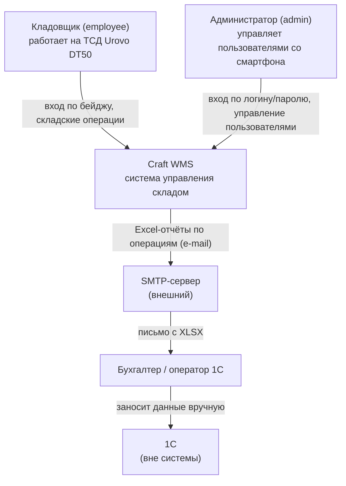
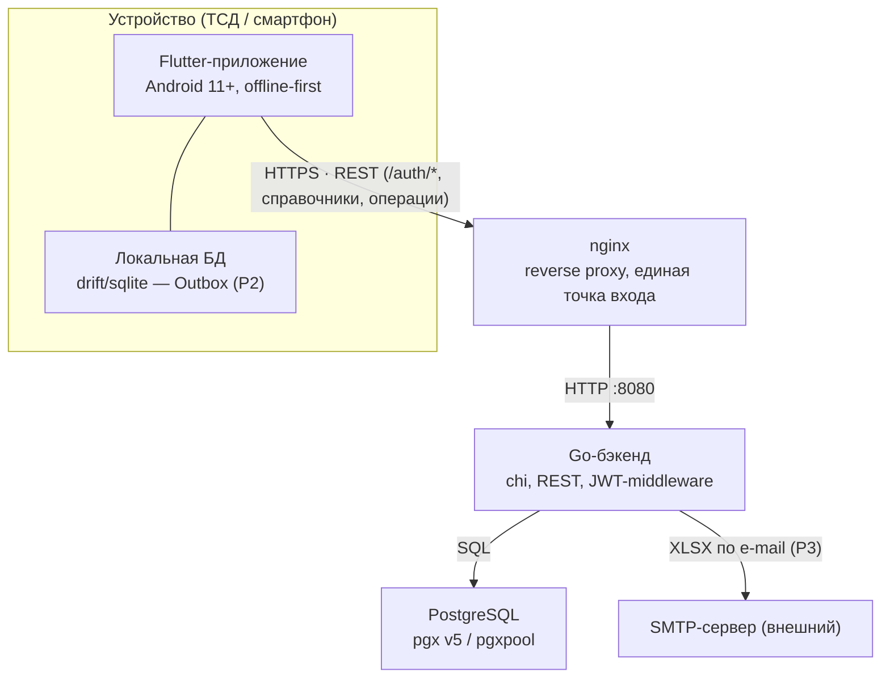
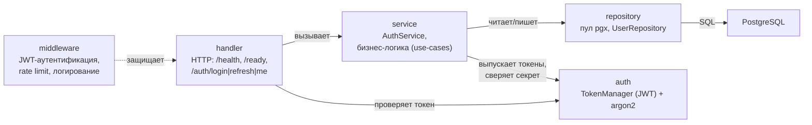
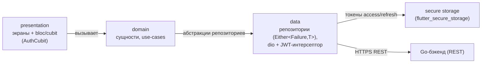

# Архитектура проекта Craft WMS

WMS для терминала сбора данных (ТСД). Пилот на одном складе.
План разработки — внутренний `docs/roadmap.md` (v3).

## Стек

| Слой                        | Технология                                                    |
|-----------------------------|---------------------------------------------------------------|
| Мобильное приложение (ТСД)  | Flutter, Android 11+ (Urovo DT50)                             |
| Бэкенд                      | Go (chi-роутер, slog-логгер), REST                            |
| БД                          | PostgreSQL (pgx v5 / pgxpool + golang-migrate)                |
| Инфраструктура              | Docker · docker-compose · nginx                               |
| Обмен с 1С                  | без прямой интеграции — Excel-отчёты (XLSX) на e-mail по SMTP |

Ключевые свойства: **offline-first** на устройстве, идемпотентность операций по `operation_id`,
авторизация по бейджу сотрудника, роли `employee` / `admin` (admin — управление пользователями).

Обоснования ключевых решений — в [ADR](adr/) (`docs/adr/`). Развёртывание — в [deploy.md](deploy.md).

## Архитектура по C4

Три уровня детализации: **Контекст → Контейнеры → Компоненты** (модель C4). Диаграммы — mermaid
(рендерятся на GitHub). Часть контейнеров/компонентов появляется по мере фаз (offline-стор — P2,
XLSX+SMTP — P3 и т.д.).

### Уровень 1 — Контекст (система и её окружение)

Кто пользуется системой и с какими внешними системами она связана.



Ключевое: **прямой интеграции с 1С нет** — обмен через Excel-файлы на e-mail, данные в 1С заносит
человек (см. [ADR-0004](adr/0004-obmen-1c-excel-email.md)).

### Уровень 2 — Контейнеры (крупные исполняемые части)



- **Наружу торчит только nginx**; бэкенд напрямую не публикуется.
- Пробы: `/health` (liveness), `/ready` (доступность БД).
- `BASE_URL` приложения задаётся при сборке (`--dart-define`), см. [deploy.md](deploy.md).

### Уровень 3 — Компоненты бэкенда (внутри контейнера Go)



Зависимости направлены внутрь: `handler → service → repository`; `auth` — пакет-лист без зависимостей
на другие слои (им пользуются и `service`, и `middleware`). Подробнее — раздел «Слои бэкенда» ниже.

### Уровень 3 — Компоненты клиента (внутри контейнера Flutter)



Навигация гейтится состоянием `AuthCubit` (единое место правды). Подробнее — раздел «Слои клиента» ниже.

## Монорепозиторий

```
craft_wms_app/
├── apps/
│   ├── craft_wms/              # Flutter-приложение для ТСД (Android 11+)
│   │   ├── lib/
│   │   │   ├── core/           # di (get_it/injectable), router (auto_route),
│   │   │   │                   #   network (dio + JWT-интерсептор), auth, error, theme, logging (talker)
│   │   │   ├── features/       # экраны по фичам (presentation/domain/data)
│   │   │   ├── app.dart        # MaterialApp.router + гейт навигации по auth-состоянию
│   │   │   └── main.dart       # bootstrap: DI → runApp
│   │   ├── android/            # minSdk 30, сборка APK
│   │   └── pubspec.yaml
│   │
│   └── backend/                # Go-сервис
│       ├── cmd/
│       │   ├── server/         # точка входа сервиса (main.go)
│       │   ├── migrate/        # раннер миграций (golang-migrate, встроенные .sql)
│       │   └── seed/           # сидер стартового админа
│       ├── internal/           # приватный код сервиса
│       │   ├── handler/        # HTTP-обработчики (транспортный слой): health, ready, auth
│       │   ├── service/        # бизнес-логика (домен, use-cases): AuthService
│       │   ├── repository/     # доступ к данным (пул pgx, UserRepository)
│       │   ├── model/          # сущности / DTO (User, роли)
│       │   ├── auth/           # JWT-токены + argon2 (примитивы аутентификации)
│       │   ├── config/         # чтение конфигурации из env
│       │   └── middleware/     # аутентификация (JWT), логирование, rate limiting
│       ├── migrations/         # SQL-миграции + embed.go (golang-migrate) — единый источник схемы БД
│       ├── Dockerfile          # (добавляется в P0-01)
│       ├── go.mod
│       └── go.sum
│
├── infra/                      # инфраструктура окружений
│   ├── docker-compose.yml      # dev-стек: postgres + backend + nginx (P0-01)
│   ├── docker-compose.prod.yml # прод-стек (P7)
│   └── nginx/                  # конфиг reverse proxy
│
├── docs/                       # документация (этот файл, api.md, deployment.md, ADR)
├── scripts/                    # dev-скрипты (setup, миграции, сиды)
├── .github/workflows/          # CI: lint + test + build (Go + Flutter)
├── Makefile                    # оркестрация задач (build/test/lint/migrate/up)
├── .env.example                # шаблон переменных окружения
└── README.md
```

### Принципы раскладки

- **Одно приложение — одна папка под `apps/`.** Flutter (`craft_wms`) и Go (`backend`) лежат
  симметрично; общей обёртки над несколькими сервисами нет — сервис один.
- **Миграции живут рядом с бэкендом** (`apps/backend/migrations`) и запускаются из Go-сервиса
  через golang-migrate. Это единственное место описания схемы БД — дублирующего каталога `db/` нет.
- **Dockerfile сервиса — рядом с сервисом** (`apps/backend/Dockerfile`).
  В `infra/` только оркестрация окружений (compose-файлы, nginx), без дублей Dockerfile.
- **Пустые «на вырост» каталоги не заводим** — создаём по факту надобности.

## Слои бэкенда

Классическая слоёная архитектура, зависимости направлены внутрь:

```
handler  →  service  →  repository  →  PostgreSQL
(HTTP)      (логика)     (данные)
```

- **handler** — разбор HTTP-запроса, валидация ввода, сериализация ответа. Без бизнес-правил.
- **service** — бизнес-логика: приёмка, размещение, перемещение, пополнение; атомарность остатков
  в транзакциях; формирование Excel-отчётов и постановка их в очередь на e-mail.
- **repository** — SQL-доступ к Postgres, изоляция БД от домена.
- **model** — сущности предметной области (товар, ячейка, партия, остаток, грузовая единица).
- **middleware** — auth по бейджу (JWT), логирование, rate limiting на `/auth/login`.

## Слои клиента (Flutter)

Чистая архитектура: **presentation → domain → data**, зависимости направлены внутрь.
Стек: **auto_route** (навигация), **flutter_bloc** + **freezed** (состояние), **get_it/injectable** (DI),
**dio** + JWT-интерсептор (сеть), **either_dart** + `Failure` (ошибки), **talker** (логирование),
**slang** (i18n — весь текст в `assets/i18n`).

- **presentation** — экраны и bloc/cubit; не знают про источники данных.
- **domain** — сущности и use-cases, независимы от Flutter и способа хранения.
- **data** — репозитории (`Either<Failure, T>`), сетевой клиент dio, локальный стор (offline — P2), кэш справочников.
- **JWT-интерсептор** — клиентская пара к middleware бэкенда: подставляет access-токен, на 401 молча
  обновляет его по refresh и повторяет запрос.
- **Токены — secure storage** (`flutter_secure_storage`, Android Keystore): пара access/refresh переживает
  перезапуск. При старте `AuthCubit.restore()` тихо восстанавливает сессию (`/auth/me` + авто-рефреш);
  refresh протух → хранилище чистится → экран входа. Без сети токены сохраняются («мягкий» офлайн-старт).

## Обмен и офлайн (кратко)

- **Устройство работает офлайн.** Операции пишутся в локальную очередь (Outbox, sqlite/drift)
  с `operation_id` и уходят на бэк при появлении сети (ретраи/backoff).
- **Бэк дедуплицирует** входящие батчи по `operation_id` — переотправка не двоит данные.
- **По завершении операции** бэк формирует XLSX («Поступление» / «Движение») и отправляет
  на e-mail из `.env` (SMTP). Прямой интеграции с 1С нет — файл в 1С заносит человек.

## Соответствие фазам плана

| Каталог / компонент                                 | Фаза                          |
|-----------------------------------------------------|-------------------------------|
| `infra/`, `Makefile`, CI, `apps/backend/cmd/server` | P0 — каркас и инфраструктура  |
| `migrations/`, `repository/`, импорт справочников   | P1 — справочники и остатки    |
| Flutter offline-стор, Outbox, движок синхронизации  | P2 — офлайн-ядро              |
| XLSX-генерация + SMTP в `service/`                  | P3 — экспорт в Excel и e-mail |
| приёмка, ГЕ, печать, генерация ШК                   | P4                            |
| размещение                                          | P5                            |
| перемещение и пополнение                            | P6                            |
| стабилизация, пилот, прод-развёртывание             | P7                            |

> Документ описывает целевую структуру. Часть каталогов и файлов (`Dockerfile`, `go.mod`,
> compose-файлы, `Makefile`) появляется по мере прохождения фаз P0–P1.
