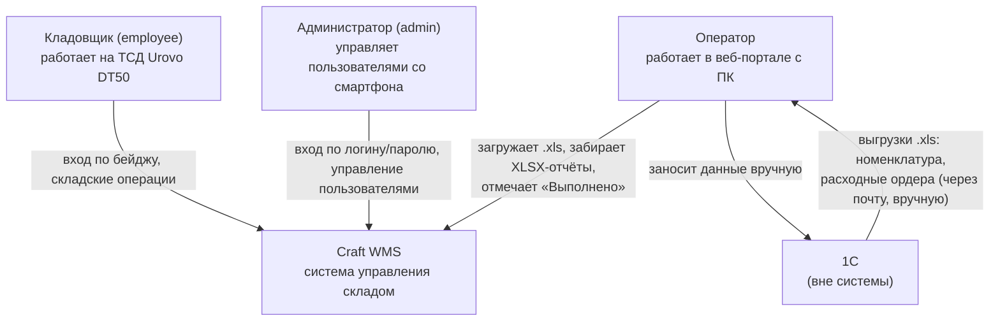
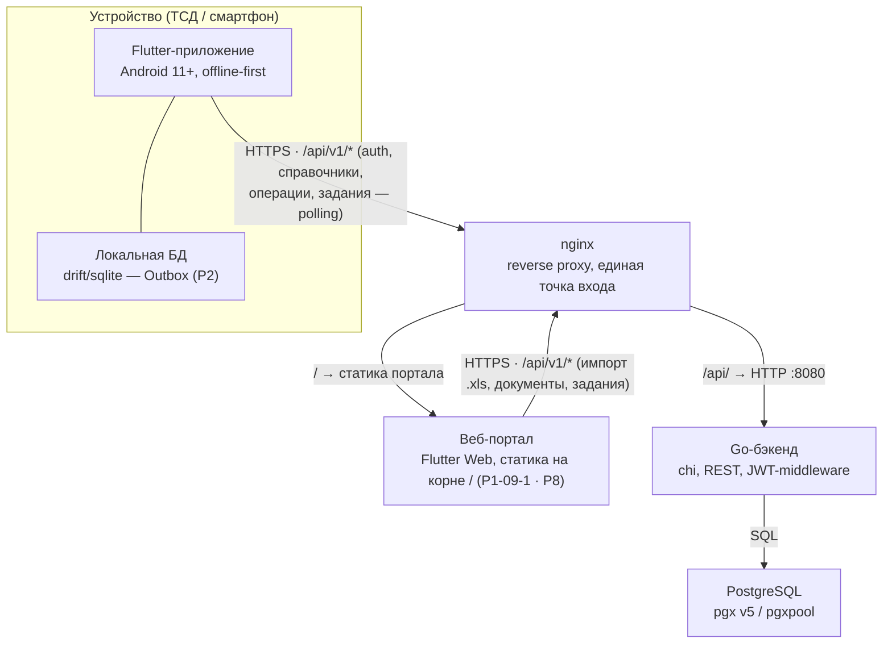
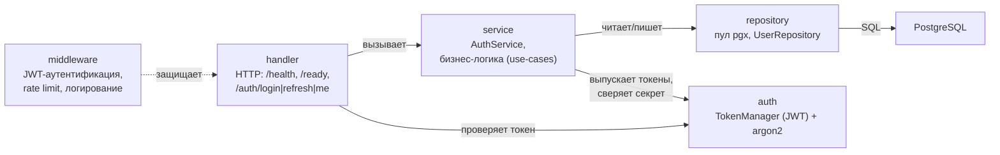
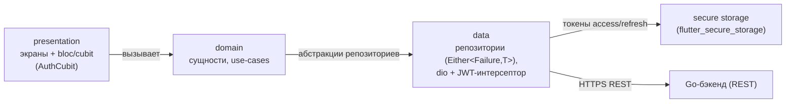

# Архитектура проекта Craft WMS

WMS для терминала сбора данных (ТСД). Пилот на одном складе.
План разработки — [`plan_v3.docx`](plan_v3.docx).

## Стек

| Слой                       | Технология                                                     |
|----------------------------|----------------------------------------------------------------|
| Мобильное приложение (ТСД) | Flutter, Android 11+ (Urovo DT50)                              |
| Веб-портал оператора       | Flutter Web (P1-09-1 · P8), статика за тем же nginx            |
| Бэкенд                     | Go (chi-роутер, slog-логгер), REST                             |
| БД                         | PostgreSQL (pgx v5 / pgxpool + golang-migrate)                 |
| Инфраструктура             | Docker · docker-compose · nginx                                |
| Обмен с 1С                 | без прямой интеграции — Excel-отчёты (XLSX) выдаются в портале |
| Транспорт                  | HTTP + Outbox + polling; без брокера и WebSocket               |

Ключевые свойства: **offline-first** на устройстве, идемпотентность операций по `operation_id`,
авторизация по бейджу сотрудника, роли `employee` / `admin` (admin — управление пользователями).

Обоснования ключевых решений — в [ADR](adr/) (`docs/adr/`). Развёртывание — в [deploy/](deploy/): [локально](deploy/dev-deploy.md) и [на сервере](deploy/prod-deploy.md).

## Архитектура по C4

Три уровня детализации: **Контекст → Контейнеры → Компоненты** (модель C4). Диаграммы — mermaid
(рендерятся на GitHub). Часть контейнеров/компонентов появляется по мере фаз (offline-стор — P2,
XLSX+SMTP — P3 и т.д.).

### Уровень 1 — Контекст (система и её окружение)

Кто пользуется системой и с какими внешними системами она связана.



Ключевое: **прямой интеграции с 1С нет** — обмен файловый, данные в 1С заносит человек
(см. [ADR-0004](adr/0004-obmen-1c-excel-email.md)). Файлы ходят **через веб-портал**, а не по
e-mail: оператор скачивает отчёт и отмечает его выполненным, поэтому необработанное остаётся
видимым (см. [ADR-0013](adr/0013-documents-via-portal-not-email.md)).

### Уровень 2 — Контейнеры (крупные исполняемые части)



- **Наружу торчит только nginx**; бэкенд напрямую не публикуется. Схема URL: **портал на корне
  `craft.skogi.ru/`, API под `/api/v1/`** — один origin, без CORS, один сертификат
  ([ADR-0015](adr/0015-url-scheme-api-v1-portal-root.md)). Портал — статика за тем же nginx/TLS,
  отдельного рантайма не требует ([ADR-0012](adr/0012-web-portal-flutter-web.md)).
- **Постоянного канала (WebSocket) и брокера сообщений нет**: обрывы связи закрывает Outbox
  на устройстве, актуальность — опрос ([ADR-0014](adr/0014-transport-http-outbox-polling.md)).
- Пробы: `/health` (liveness), `/ready` (доступность БД) — **на корне**, вне `/api/v1` (их дёргает
  docker-healthcheck напрямую к контейнеру).
- `BASE_URL` приложения задаётся при сборке (`--dart-define`; прод — `…/api/v1`), см. [deploy/dev-deploy.md](deploy/dev-deploy.md).

### Уровень 3 — Компоненты бэкенда (внутри контейнера Go)



Зависимости направлены внутрь: `handler → service → repository`; `auth` — пакет-лист без зависимостей
на другие слои (им пользуются и `service`, и `middleware`). Подробнее — раздел «Слои бэкенда» ниже.

### Уровень 3 — Компоненты клиента (внутри контейнера Flutter)



Навигация гейтится состоянием `AuthCubit` (единое место правды). Подробнее — раздел «Слои клиента» ниже.

## Монорепозиторий

```
craft_wms_app/
├── apps/
│   ├── craft_wms/              # Flutter-приложение для ТСД (Android 11+)
│   │   ├── lib/
│   │   │   ├── core/           # di (get_it/injectable), router (auto_route),
│   │   │   │                   #   network (dio + JWT-интерсептор), auth, error, theme, logging (talker)
│   │   │   ├── features/       # экраны по фичам (presentation/domain/data)
│   │   │   ├── app.dart        # MaterialApp.router + гейт навигации по auth-состоянию
│   │   │   └── main.dart       # bootstrap: DI → runApp
│   │   ├── android/            # minSdk 30, сборка APK
│   │   └── pubspec.yaml
│   │
│   └── backend/                # Go-сервис
│       ├── cmd/
│       │   ├── server/         # точка входа сервиса (main.go)
│       │   ├── migrate/        # раннер миграций (golang-migrate, встроенные .sql)
│       │   └── seed/           # сидер стартового админа
│       ├── internal/           # приватный код сервиса
│       │   ├── handler/        # HTTP-обработчики (транспортный слой): health, ready, auth
│       │   ├── service/        # бизнес-логика (домен, use-cases): AuthService
│       │   ├── repository/     # доступ к данным (пул pgx, UserRepository)
│       │   ├── model/          # сущности / DTO (User, роли)
│       │   ├── auth/           # JWT-токены + argon2 (примитивы аутентификации)
│       │   ├── config/         # чтение конфигурации из env
│       │   └── middleware/     # аутентификация (JWT), логирование, rate limiting
│       ├── migrations/         # SQL-миграции + embed.go (golang-migrate) — единый источник схемы БД
│       ├── Dockerfile          # (добавляется в P0-01)
│       ├── go.mod
│       └── go.sum
│
├── infra/                      # инфраструктура окружений
│   ├── docker-compose.yml      # dev-стек: postgres + backend + nginx (P0-01)
│   ├── docker-compose.prod.yml # прод-стек (P7)
│   └── nginx/                  # конфиг reverse proxy
│
├── docs/                       # документация (этот файл, api.md, deployment.md, ADR)
├── scripts/                    # dev-скрипты (setup, миграции, сиды)
├── .github/workflows/          # CI: lint + test + build (Go + Flutter)
├── Makefile                    # оркестрация задач (build/test/lint/migrate/up)
├── .env.example                # шаблон переменных окружения
└── README.md
```

### Принципы раскладки

- **Одно приложение — одна папка под `apps/`.** Flutter (`craft_wms`) и Go (`backend`) лежат
  симметрично; общей обёртки над несколькими сервисами нет — сервис один.
- **Миграции живут рядом с бэкендом** (`apps/backend/migrations`) и запускаются из Go-сервиса
  через golang-migrate. Это единственное место описания схемы БД — дублирующего каталога `db/` нет.
- **Dockerfile сервиса — рядом с сервисом** (`apps/backend/Dockerfile`).
  В `infra/` только оркестрация окружений (compose-файлы, nginx), без дублей Dockerfile.
- **Пустые «на вырост» каталоги не заводим** — создаём по факту надобности.

## Слои бэкенда

Классическая слоёная архитектура, зависимости направлены внутрь:

```
handler  →  service  →  repository  →  PostgreSQL
(HTTP)      (логика)     (данные)
```

- **handler** — разбор HTTP-запроса, валидация ввода, сериализация ответа. Без бизнес-правил.
- **service** — бизнес-логика: приёмка, размещение, перемещение, пополнение; атомарность остатков
  в транзакциях; формирование Excel-отчётов и постановка их в очередь на e-mail.
- **repository** — SQL-доступ к Postgres, изоляция БД от домена.
- **model** — сущности предметной области (товар, ячейка, партия, остаток, грузовая единица).
- **middleware** — auth по бейджу (JWT), логирование, rate limiting на `/auth/login`.

## Слои клиента (Flutter)

Чистая архитектура: **presentation → domain → data**, зависимости направлены внутрь.
Стек: **auto_route** (навигация), **flutter_bloc** + **freezed** (состояние), **get_it/injectable** (DI),
**dio** + JWT-интерсептор (сеть), **either_dart** + `Failure` (ошибки), **talker** (логирование),
**slang** (i18n — весь текст в `assets/i18n`).

- **presentation** — экраны и bloc/cubit; не знают про источники данных.
- **domain** — сущности и use-cases, независимы от Flutter и способа хранения.
- **data** — репозитории (`Either<Failure, T>`), сетевой клиент dio, локальный стор (offline — P2), кэш справочников.
- **JWT-интерсептор** — клиентская пара к middleware бэкенда: подставляет access-токен, на 401 молча
  обновляет его по refresh и повторяет запрос.
- **Токены — secure storage** (`flutter_secure_storage`, Android Keystore): пара access/refresh переживает
  перезапуск. При старте `AuthCubit.restore()` тихо восстанавливает сессию (`/auth/me` + авто-рефреш);
  refresh протух → хранилище чистится → экран входа. Без сети токены сохраняются («мягкий» офлайн-старт).

### Локальный стор устройства (P2-02)

Справочники живут в локальной базе на устройстве (drift/sqlite), и экраны читают их оттуда, а не
из API. `CatalogRepository` — фасад «сначала кэш»; сетевой источник вынесен в `CatalogApi`;
наполнением занимается `CatalogSyncService` (после входа и по кнопке «Обновить справочники»).

- **Кэшируются справочники:** товары, группы, поставщики, ячейки, привязки ШК — их меняет импорт
  из 1С и печать этикеток, то есть события редкие и внешние.
- **Остатки не кэшируются никогда.** Остаток меняется от каждой операции любого терминала, и
  устаревшее число хуже честного «нет связи»: по нему кладовщик примет решение.
- **Запись справочника — полная замена в транзакции.** Сервер отдаёт справочник целиком; при
  слиянии удалённые записи оставались бы в кэше навсегда.
- **Готовность — по каждому справочнику отдельно.** Один недоступный справочник не отключает
  офлайн для остальных.
- **Поиск товаров идёт по локальной базе** с той же семантикой, что на сервере: «все слова
  присутствуют, порядок не важен», нижний регистр, «ё» → «е». Расхождение правил означало бы
  разные списки в сети и без неё, поэтому совпадение закреплено тестами.
- **Вход без сети:** при сетевой ошибке сессия поднимается локально по сохранённому профилю,
  пока жив refresh-токен. Отказ сервера так не обходится — протухший refresh ведёт на экран входа.

### Платформенная интеграция: сканер ТСД

Аппаратный сканер — единственная платформенная зависимость клиента, и она изолирована в
`lib/core/scanner/` за интерфейсом `ScannerService`. Экраны не знают, откуда пришёл код.

- **Нативный мост** (`android/.../scanner/ScannerBridge.kt`) принимает broadcast-интенты декодера
  (`EventChannel`) и отвечает на опрос возможностей устройства (`MethodChannel`, метод `probe`).
  Приёмник живёт ровно на время подписки из Dart.
- **Два источника кода одновременно.** Режим вывода сканера — настройка устройства, приложение её
  не переключает: код принимается и из поля ввода (режим «клавиатуры», HID-эмуляция с суффиксом
  Enter), и из потока интентов. Повторная доставка одного кода в пределах короткого окна
  отсекается (`ScanDeduper`) — иначе устройство, настроенное отдавать код обоими способами,
  удвоило бы строку остатка.
- **Классификация скана** (`classifyScan`) даёт `ScanKind`: штрихкод товара, адрес ячейки,
  грузовая единица (QR) или «не распознан». На ней держится доменная развилка первого скана и
  защита от скана кода не того типа. Классификация применяется **после** неудачного резолва по
  справочнику: справочник — источник истины, форма кода — лишь догадка.
- **Тип устройства определяется по возможностям**, а не по списку моделей: системный сервис
  декодера и установленное штатное ПО сканера. От этого зависит форма экрана входа — скан бейджа
  на ТСД, логин и пароль на устройстве без сканера (выбор перекрывается вручную).
- **Подписка экрана на сканер** — миксин `HardwareScanListener` к состоянию экрана. Код доходит
  только до верхнего экрана стопки, поэтому фоновые экраны и экраны под открытым диалогом сканы
  не обрабатывают.

### Раскладка `presentation` внутри фичи

`lib/features/<фича>/presentation/` делится по назначению. Эталон — фича `stock`.

| Папка      | Что лежит                                                                    |
|------------|------------------------------------------------------------------------------|
| `pages/`   | экраны-точки маршрутов: файлы `*_page.dart`, классы `XxxPage` (`@RoutePage`) |
| `bloc/`    | управление состоянием (cubit/bloc)                                           |
| `widgets/` | вынесенные виджеты фичи                                                      |

- **`page`, а не `screen`** — общепроектное соглашение. auto_route срезает суффикс `Page`/`Screen`,
  поэтому имя маршрута `XxxRoute` при переименовании не меняется, но `build_runner` прогнать нужно.
- Папка состояния называется **`bloc` даже когда внутри Cubit** — соглашение экосистемы
  `flutter_bloc` (Cubit там частный случай Bloc).
- Виджеты, **общие для нескольких страниц фичи** → `widgets/common/`; **специфичные для страницы** →
  `widgets/<страница>/`. Когда страница у фичи одна — плоско в `widgets/`.
- **Кросс-фичевые виджеты** (нужны разным фичам, напр. `PageHeader`, `AppbarImage`,
  `GoodPickerSheet`) живут не в фиче, а в `lib/core/widgets/`. Эту границу держим: виджет,
  понадобившийся второй фиче, переезжает в `core/widgets`, а не импортируется из чужой фичи.
- `data/` фичи **не дробим** (модели и репозиторий вместе), пока реально не разрастётся.
- **Порог-запах размера файла — ~200–250 строк:** крупные виджеты выносим в `widgets/` (композиция
  вместо god-widget'ов). Ориентир, не догма; связный виджет чуть за порогом дробить искусственно
  не нужно. Сгенерированные файлы (`*.freezed.dart`, `*.g.dart`, `*.gr.dart`, `*.config.dart`) —
  вне счёта, они в `.gitignore` и создаются `dart run build_runner build`.
- **Импорты между `core` и `features` — относительные, к `lib/core`.** Из
  `lib/features/<фича>/presentation/` это `../../../core/...` (три уровня), из
  `.../presentation/pages|bloc|widgets/` — `../../../../core/...` (четыре).

### Визуальный стиль

Приложение оформлено в **неоморфном** стиле: фон `kNeumorphicBg`, вдавленные поля ввода и выпуклые
кнопки на токенах `kNeumorphic*`, шапки экранов с фон-картинкой и светлым `PageHeader`,
неоморф-плитки и карточки.

⚠ **Стиль ещё формируется и может меняться.** Поэтому перед вёрсткой нового экрана или элемента
нужно свериться с уже реализованными эталонными окнами («Остатки», «Ввод остатков») и повторять их
приёмы, а не изобретать свой вариант. Общие визуальные части выносятся в переиспользуемые виджеты.

Константы UI берутся только из `lib/core/constants/`: размеры — `AppSizes`, отступы — `AppInsets`,
`SizedBox`-разделители — `AppBoxes`. Магических чисел в виджетах нет; нужной константы нет —
добавляется в соответствующий файл, а не хардкодится на месте.

## Обмен и офлайн (кратко)

- **Устройство работает офлайн.** Операции пишутся в локальную очередь (Outbox, sqlite/drift)
  с `operation_id` и уходят на бэк при появлении сети (ретраи/backoff).
- **Бэк дедуплицирует** входящие батчи по `operation_id` — переотправка не двоит данные.
- **По завершении операции** бэк формирует XLSX («Поступление» / «Движение» / «Отгрузка») и
  публикует его в портал со статусом «новый». Оператор скачивает файл, заносит в 1С и отмечает
  **«Выполнено»** — необработанные документы остаются видимыми. Прямой интеграции с 1С нет.
- **Получатель документа — точка расширения:** e-mail при необходимости добавляется вторым
  каналом без переделки конвейера ([ADR-0013](adr/0013-documents-via-portal-not-email.md)).
- **Транспорт везде — обычный HTTP.** Устройство → сервер: Outbox с ретраями/backoff.
  Сервер → устройство (задания на сборку) и сервер → портал (статусы): опрос; для портала
  при необходимости SSE. Ни WebSocket, ни брокера ([ADR-0014](adr/0014-transport-http-outbox-polling.md)).
- ⚠ **Почта больше не служит внешним архивом отчётов** — БД WMS стала единственной копией,
  поэтому бэкап с проверенным восстановлением обязателен до пилота.

## Соответствие фазам плана

| Каталог / компонент                                 | Фаза                          |
|-----------------------------------------------------|-------------------------------|
| `infra/`, `Makefile`, CI, `apps/backend/cmd/server` | P0 — каркас и инфраструктура  |
| `migrations/`, `repository/`, импорт справочников   | P1 — справочники и остатки    |
| префикс `/api/v1` + переустановка ТСД               | P1-09-0 — переезд URL         |
| веб-портал (Flutter Web): вход + загрузка `.xls`    | P1-09-1 — портал MVP          |
| Flutter offline-стор, Outbox, движок синхронизации  | P2 — офлайн-ядро              |
| XLSX-генерация + публикация документов в `service/` | P3 — экспорт в Excel и выдача |
| приёмка, ГЕ, печать, генерация ШК                   | P4                            |
| размещение                                          | P5                            |
| перемещение и пополнение                            | P6                            |
| стабилизация, пилот, прод-развёртывание             | P7 — пилот первой волны       |
| портал: расходные документы, задания, выдача XLSX   | P8 — вторая волна             |
| сборка и отгрузка (задания на ТСД)                  | P9 — вторая волна             |
| инвентаризация (выборочная), стартовые остатки      | P10 — **до пилота P7**        |

> Документ описывает целевую структуру. Часть каталогов и файлов (`Dockerfile`, `go.mod`,
> compose-файлы, `Makefile`) появляется по мере прохождения фаз P0–P1.
