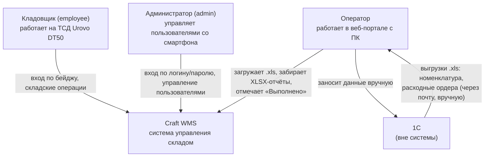
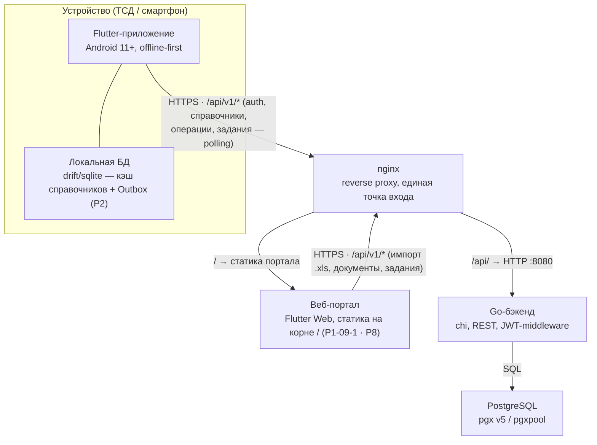
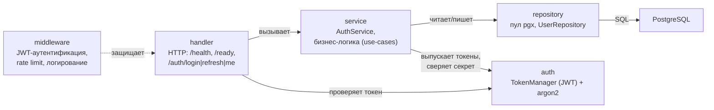
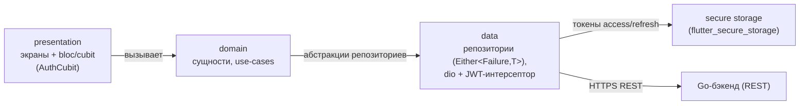

# Архитектура проекта Craft WMS

WMS для терминала сбора данных (ТСД). Пилот на одном складе.
План разработки — [`plan_v3.docx`](plan_v3.docx).

## Стек

| Слой                       | Технология                                                     |
|----------------------------|----------------------------------------------------------------|
| Мобильное приложение (ТСД) | Flutter, Android 11+ (Urovo DT50)                              |
| Веб-портал оператора       | Flutter Web (P1-09-1 · P8), статика за тем же nginx            |
| Бэкенд                     | Go (chi-роутер, slog-логгер), REST                             |
| БД                         | PostgreSQL (pgx v5 / pgxpool + golang-migrate)                 |
| Инфраструктура             | Docker · docker-compose · nginx                                |
| Обмен с 1С                 | без прямой интеграции — Excel-отчёты (XLSX) выдаются в портале |
| Транспорт                  | HTTP + Outbox + polling; без брокера и WebSocket               |

Ключевые свойства: **offline-first** на устройстве, идемпотентность операций по `operation_id`,
авторизация по бейджу сотрудника, роли `employee` / `admin` (admin — управление пользователями).

Обоснования ключевых решений — в [ADR](adr/) (`docs/adr/`). Развёртывание — в [deploy/](deploy/): [локально](deploy/dev-deploy.md) и [на сервере](deploy/prod-deploy.md).

## Архитектура по C4

Три уровня детализации: **Контекст → Контейнеры → Компоненты** (модель C4). Диаграммы — mermaid
(рендерятся на GitHub). Часть контейнеров/компонентов появляется по мере фаз (offline-стор — P2,
XLSX+SMTP — P3 и т.д.).

### Уровень 1 — Контекст (система и её окружение)

Кто пользуется системой и с какими внешними системами она связана.



Ключевое: **прямой интеграции с 1С нет** — обмен файловый, данные в 1С заносит человек
(см. [ADR-0004](adr/0004-obmen-1c-excel-email.md)). Файлы ходят **через веб-портал**, а не по
e-mail: оператор скачивает отчёт и отмечает его выполненным, поэтому необработанное остаётся
видимым (см. [ADR-0013](adr/0013-documents-via-portal-not-email.md)).

### Уровень 2 — Контейнеры (крупные исполняемые части)



- **Наружу торчит только nginx**; бэкенд напрямую не публикуется. Схема URL: **портал на корне
  `craft.skogi.ru/`, API под `/api/v1/`** — один origin, без CORS, один сертификат
  ([ADR-0015](adr/0015-url-scheme-api-v1-portal-root.md)). Портал — статика за тем же nginx/TLS,
  отдельного рантайма не требует ([ADR-0012](adr/0012-web-portal-flutter-web.md)).
- **Постоянного канала (WebSocket) и брокера сообщений нет**: обрывы связи закрывает Outbox
  на устройстве, актуальность — опрос ([ADR-0014](adr/0014-transport-http-outbox-polling.md)).
- Пробы: `/health` (liveness), `/ready` (доступность БД) — **на корне**, вне `/api/v1` (их дёргает
  docker-healthcheck напрямую к контейнеру).
- `BASE_URL` приложения задаётся при сборке (`--dart-define`; прод — `…/api/v1`), см. [deploy/dev-deploy.md](deploy/dev-deploy.md).

### Уровень 3 — Компоненты бэкенда (внутри контейнера Go)



Зависимости направлены внутрь: `handler → service → repository`; `auth` — пакет-лист без зависимостей
на другие слои (им пользуются и `service`, и `middleware`). Подробнее — раздел «Слои бэкенда» ниже.

### Уровень 3 — Компоненты клиента (внутри контейнера Flutter)



Навигация гейтится состоянием `AuthCubit` (единое место правды). Подробнее — раздел «Слои клиента» ниже.

## Монорепозиторий

```
craft_wms_app/
├── apps/
│   ├── craft_wms/              # Flutter-приложение для ТСД (Android 11+)
│   │   ├── lib/
│   │   │   ├── core/           # di (get_it/injectable), router (auto_route),
│   │   │   │                   #   network (dio + JWT-интерсептор), auth, error, theme, logging (talker)
│   │   │   ├── features/       # экраны по фичам (presentation/domain/data)
│   │   │   ├── app.dart        # MaterialApp.router + гейт навигации по auth-состоянию
│   │   │   └── main.dart       # bootstrap: DI → runApp
│   │   ├── android/            # minSdk 30, сборка APK
│   │   └── pubspec.yaml
│   │
│   └── backend/                # Go-сервис
│       ├── cmd/
│       │   ├── server/         # точка входа сервиса (main.go)
│       │   ├── migrate/        # раннер миграций (golang-migrate, встроенные .sql)
│       │   └── seed/           # сидер стартового админа
│       ├── internal/           # приватный код сервиса
│       │   ├── handler/        # HTTP-обработчики (транспортный слой): health, ready, auth
│       │   ├── service/        # бизнес-логика (домен, use-cases): AuthService
│       │   ├── repository/     # доступ к данным (пул pgx, UserRepository)
│       │   ├── model/          # сущности / DTO (User, роли)
│       │   ├── movement/       # разворот движений (ГЕ → товарные строки) для отчётов, P4-09-1
│       │   ├── auth/           # JWT-токены + argon2 (примитивы аутентификации)
│       │   ├── config/         # чтение конфигурации из env
│       │   └── middleware/     # аутентификация (JWT), логирование, rate limiting
│       ├── migrations/         # SQL-миграции + embed.go (golang-migrate) — единый источник схемы БД
│       ├── Dockerfile          # (добавляется в P0-01)
│       ├── go.mod
│       └── go.sum
│
├── infra/                      # инфраструктура окружений
│   ├── docker-compose.yml      # dev-стек: postgres + backend + nginx (P0-01)
│   ├── docker-compose.prod.yml # прод-стек (P7)
│   └── nginx/                  # конфиг reverse proxy
│
├── docs/                       # документация (этот файл, api.md, deployment.md, ADR)
├── scripts/                    # dev-скрипты (setup, миграции, сиды)
├── .github/workflows/          # CI: lint + test + build (Go + Flutter)
├── Makefile                    # оркестрация задач (build/test/lint/migrate/up)
├── .env.example                # шаблон переменных окружения
└── README.md
```

### Принципы раскладки

- **Одно приложение — одна папка под `apps/`.** Flutter (`craft_wms`) и Go (`backend`) лежат
  симметрично; общей обёртки над несколькими сервисами нет — сервис один.
- **Миграции живут рядом с бэкендом** (`apps/backend/migrations`) и запускаются из Go-сервиса
  через golang-migrate. Это единственное место описания схемы БД — дублирующего каталога `db/` нет.
- **Dockerfile сервиса — рядом с сервисом** (`apps/backend/Dockerfile`).
  В `infra/` только оркестрация окружений (compose-файлы, nginx), без дублей Dockerfile.
- **Пустые «на вырост» каталоги не заводим** — создаём по факту надобности.

## Слои бэкенда

Классическая слоёная архитектура, зависимости направлены внутрь:

```
handler  →  service  →  repository  →  PostgreSQL
(HTTP)      (логика)     (данные)
```

- **handler** — разбор HTTP-запроса, валидация ввода, сериализация ответа. Без бизнес-правил.
- **service** — бизнес-логика: приёмка, размещение, перемещение, пополнение; атомарность остатков
  в транзакциях; формирование Excel-отчётов и постановка их в очередь на e-mail.
- **repository** — SQL-доступ к Postgres, изоляция БД от домена.
- **model** — сущности предметной области (товар, ячейка, партия, остаток, грузовая единица).
- **middleware** — auth по бейджу (JWT), логирование, rate limiting на `/auth/login`.

## Слои клиента (Flutter)

Чистая архитектура: **presentation → domain → data**, зависимости направлены внутрь.
Стек: **auto_route** (навигация), **flutter_bloc** + **freezed** (состояние), **get_it/injectable** (DI),
**dio** + JWT-интерсептор (сеть), **either_dart** + `Failure` (ошибки), **talker** (логирование),
**slang** (i18n — весь текст в `assets/i18n`).

- **presentation** — экраны и bloc/cubit; не знают про источники данных.
- **domain** — сущности и use-cases, независимы от Flutter и способа хранения.
- **data** — репозитории (`Either<Failure, T>`), сетевой клиент dio, локальный стор (offline — P2), кэш справочников.
- **JWT-интерсептор** — клиентская пара к middleware бэкенда: подставляет access-токен, на 401 молча
  обновляет его по refresh и повторяет запрос.
- **Токены — secure storage** (`flutter_secure_storage`, Android Keystore): пара access/refresh переживает
  перезапуск. При старте `AuthCubit.restore()` тихо восстанавливает сессию (`/auth/me` + авто-рефреш);
  refresh протух → хранилище чистится → экран входа. Без сети токены сохраняются («мягкий» офлайн-старт).

### Локальный стор устройства (P2-02)

Справочники живут в локальной базе на устройстве (drift/sqlite), и экраны читают их оттуда, а не
из API. `CatalogRepository` — фасад «сначала кэш»; сетевой источник вынесен в `CatalogApi`;
наполнением занимается `CatalogSyncService` (после входа и по кнопке «Обновить справочники»).

- **Кэшируются справочники:** товары, группы, поставщики, ячейки, привязки ШК — их меняет импорт
  из 1С и печать этикеток, то есть события редкие и внешние.
- **Остатки по товару не кэшируются.** Остаток меняется от каждой операции любого терминала, и
  устаревшее число без подписи хуже честного «нет связи»: по нему кладовщик примет решение.
  Карточка товара в «Остатках» ходит только в сеть. С P5-05 в базе лежит **снимок содержимого
  склада** (короба и россыпь по ячейкам) — но всегда с подписью «данные на ЧЧ:ММ», см. ниже.
- **Запись справочника — полная замена в транзакции.** Сервер отдаёт справочник целиком; при
  слиянии удалённые записи оставались бы в кэше навсегда.
- **Готовность — по каждому справочнику отдельно.** Один недоступный справочник не отключает
  офлайн для остальных.
- **Поиск товаров идёт по локальной базе** с той же семантикой, что на сервере: «все слова
  присутствуют, порядок не важен», нижний регистр, «ё» → «е». Расхождение правил означало бы
  разные списки в сети и без неё, поэтому совпадение закреплено тестами.
- **Вход без сети:** при сетевой ошибке сессия поднимается локально по сохранённому профилю,
  пока жив refresh-токен. Отказ сервера так не обходится — протухший refresh ведёт на экран входа.

### Очередь исходящих операций и незавершённый проход (P2-03)

В той же локальной базе живут ещё две таблицы, и от кэша справочников они отличаются
принципиально: кэш одноразовый и всегда восстанавливается с сервера, а эти строки —
**единственная копия работы кладовщика**. Будущие миграции обязаны их переносить, а не
пересоздавать.

- **Очередь операций (`outbox_operations`, `lib/core/outbox/`).** Операция сперва пишется
  строкой с `operation_id` (UUID v4, ключ идемпотентности) и статусом, и только потом уходит
  в сеть. Порядок отправки — по отдельной колонке-счётчику, а не по метке времени: метки в
  пределах миллисекунды совпадают, а для пары «привязать ШК» / «отвязать ШК» порядок решает
  исход. Тип и статус хранятся строками — индексы enum поехали бы при вставке нового значения
  в середину списка. Подключены привязка и отвязка ШК, а с P4-09 — приёмка целиком
  (`receipt_submit`); отправка, ретраи и backoff — P2-04. С P5-02 сервер принимает и сеанс
  размещения целиком (`putaway_submit`), клиентская сторона — P5-03.
- **Незавершённый проход «Ввода остатков» (`entry_drafts`).** Проход копится в памяти и уходит
  на сервер одним махом на финале (вариант A), поэтому падение приложения теряло весь обход
  склада — при исправной сети. Слепок буфера пишется на каждое изменение и восстанавливается
  при открытии экрана. Undo-стек в слепок не входит: он служит текущему действию.
  С P4-09 в той же таблице лежит и незавершённая приёмка — строка на поток, ключ задаёт
  хранилище (`core/database/draft_slot.dart`).

### Приёмка на ТСД (P4-09)

Фича `features/receipt/`: поставщик → документ поставщика (номер или «б/н» и дата, обязателен,
ADHOC-23) → строки (в короб или штучно, в ячейку) → «Завершить приёмку». Документ, его короба и строки набираются на терминале и уходят на сервер **одной
операцией очереди** `receipt_submit`, которую сервер применяет одной транзакцией: открыть
документ, завести ГЕ, положить строки, оприходовать.

- **Одной операцией, а не цепочкой.** Очередь отклонённую операцию снимает и идёт дальше;
  отклонённая строка в цепочке дала бы оприходование документа без неё — остаток поднялся бы
  на неполный приход. Приёмка приходует целиком или не приходует вовсе.
- **Короб получает ячейку при создании** и больше её не меняет: противоречие «короб в двух
  ячейках» исключено на терминале конструкцией, а не отказом сервера после разгрузки.
- **Склад документа — от ячейки по умолчанию** (`cells.is_default`, отдаётся в `GET /cells`
  и лежит в кэше): приёмку начинают и без связи. Ячейку строки, если она не выбрана, подставляет
  сервер — умолчание живёт в одном месте.
- **Документы для 1С говорят товарами, а не коробами** — разворот движений в товарные строки
  вынесен в `internal/movement` (P4-09-1), см. ниже.
- **Внутренний ШК выдаётся только по сети** (`POST /goods/{id}/barcode`): код уникален во всей
  системе, а без заранее выданных терминалу диапазонов офлайн-выдача этого не обещает.


### Разворот движений в товарные строки (P4-09-1)

Склад двигает грузовые единицы («короб X из ячейки A в ячейку B»), а 1С о коробах не знает:
каждый документ для неё — товар · партия · откуда · куда · количество. Разворот общий для всех
отчётов с движением («Поступление», «Движение» размещения, перемещения и пополнения) и живёт
отдельным пакетом `internal/movement` без зависимостей от БД и HTTP.

- **ГЕ раскладывается по составу** вместе с вложенными ГЕ, россыпь проходит как есть.
- **Одинаковые товар, партия и ячейки складываются**; короб в документе не показывается —
  1С он не нужен. Строки с нулевым итогом отбрасываются; порядок — первого появления.
- **Состав подаёт интерфейс `ContentReader`.** Реализация в репозитории
  (`LoadUnitContents`) читает состав набора ГЕ одним рекурсивным запросом на переданном
  `Querier` — то есть внутри транзакции операции: документ должен показать то, что
  переехало, а не нынешнее содержимое короба.
- **«Нулевые» строки** (откуда = куда) — правило отчёта, а не разворота: отбрасываются
  в P6-07.

### Документ «Поступление» (P4-10)

Оприходование приёмки в той же транзакции сохраняет снимок документа формы `receipt`: шапка
(склад, поставщик, исполнитель, дата) и товарные строки через разворот. Путь проводки один для
прямой ручки и операции очереди, поэтому документ рождается в обоих случаях. Шаблон .xlsx —
`internal/report/receipt_xlsx.go`, дата по Москве фиксированным сдвигом. В портале у каждой
формы своя вкладка («Инвентаризация», «Приход», «Перемещение») поверх общей `DocumentsTab`;
список фильтруется на сервере параметром `GET /documents?kind=`.

### Документ «Движение» (P5-04)

Проведение сеанса размещения в той же транзакции сохраняет снимок формы `movement` с источником
`putaway`: шапка (операция, склад, задание и приёмка-основание с накладной поставщика,
исполнитель, дата) и строки «откуда · куда · товар по партиям» через разворот — короба
раскладываются по составу. Форма одна на размещение, перемещение и пополнение (P6): операция —
поле снимка, а не новый шаблон. Подстановка справочников в строки общая с «Поступлением»
(`movementSnapshotRows`). Шаблон — `internal/report/movement_xlsx.go`.
### Задания для склада (P5-02-1)

Задание — единица работы кладовщика на ТСД: раздел «ЗАДАНИЯ», подразделы «Текущие» и
«Завершённые». Первый вид — размещение; в P10 добавится пересчёт.

- **Задание рождается из приёмки** — в транзакции оприходования, из того, что легло в ячейку
  приёмки (`warehouse_tasks` + `putaway_task_items`). Размещения без задания нет: операция
  `putaway_submit` несёт `task_id` и не размещает ничего сверх позиций задания.
- **Остаток задания не хранится**, а считается по проведённым сеансам размещения этого
  задания — разойтись с реально перенесённым ему нечем.
- **Общий пул.** Статус хранится один (`new` → `in_progress` → `done`), а показывается
  относительно смотрящего: взятое видно только взявшему, зависшее (8 ч без отправок) — всем
  как «новое». Это решает запрос, а не фоновая задача: время само ничего в базе не меняет.
- **Взятие и отказ — только со связью** (`POST /tasks/{id}/take|release`): кто держит
  задание, знает сервер. Выполнение — операцией очереди и без связи; сеанс принимается, даже
  если задание успели перехватить, — это уже сделанная физическая работа.
- **Частичное «Завершить»** проводит размещённое и возвращает задание в пул «новым»; всё
  размещено — задание выполнено и уходит в ленту «Завершённые» (`GET /tasks/completed`,
  курсор по времени завершения, фильтры по периоду, исполнителю и виду).
- **Выполнение задания на размещение — фича `features/putaway/` (P5-03).** Порядок «товар →
  ячейка»; партия и количество россыпи — из задания. Сеанс копится черновиком на терминале и
  уходит одной операцией `putaway_submit`; без связи размещённое сразу отмечается в снимке
  текущих заданий, чтобы его не разместили второй раз.
- **На ТСД — фича `features/tasks/`.** «Текущие» хранятся снимком в локальной базе
  (`cached_tasks`, одна строка со списком и временем получения) и открываются без связи;
  «Завершённые» — только онлайн, лента по дням с подгрузкой.

### Движок синхронизации (P2-04)

Очередь разгребает `SyncEngine` (`lib/core/sync/`): проходит её строго FIFO и останавливается
на первой временной неудаче — «привязать ШК» и «отвязать ШК» дают разный итог в разной
последовательности, и перескочить через застрявшую операцию значит применить их задом наперёд.
Отказ по существу (4xx) выводит операцию из очереди и проходу не мешает.

- **Будят движок** вход в приложение, возврат на передний план, событие смены сети, кнопка
  «Обновить справочники» и таймер повтора.
- **Событие сети — подсказка, а не источник истины.** «Wi-Fi подключён» и «сервер отвечает»
  на складе расходятся регулярно, поэтому доступность проверяется самой попыткой отправки,
  а очередь уходит и без единого события сети — это гарантирует таймер.
- **Пауза повтора растёт** (5 с → 15 с → 45 с → 2 мин → 5 мин) и считается по счётчику попыток
  из строки очереди: перезапуск приложения не сбрасывает выдержку в ноль.
- **Правило «повторять или нет» — общее** (`core/outbox/outbox_retry.dart`) для движка и для
  репозитория, который отправляет операцию сразу при вызове. Разойдись они, одна и та же ошибка
  означала бы разное.

### Разбор несинхронизированного и локальный откат (P2-06)

Операция очереди меняет не только сервер, но и локальный кэш, и эти следствия описаны один раз
(`core/outbox/outbox_effects.dart`): что применить при постановке, что при подтверждении, что
при отказе. Отправка тоже одна — `SyncEngine.sendOne`, ею пользуется и проход по очереди, и
репозиторий, отправляющий операцию сразу. Пока путей было два, отложенная отправка не применяла
следствие: привязка уезжала на сервер, а в карточке товара штрихкод не появлялся.

- **Запись оптимистичная, но помеченная.** Привязка появляется в кэше при постановке в очередь
  с пометкой «ожидает»: кладовщик должен видеть результат сразу, иначе решит, что работа
  пропала. Пометка снимается при подтверждении и откатывается при отказе.
- **Отвязка симметрична:** запись убирается сразу, а `good_id` в теле операции нужен не серверу,
  а откату — им привязка возвращается на место.
- **Причина отказа хранится читаемой** — текст сервера дословно либо короткий маркер. Перевод
  ошибок dio в доменные общий для всех репозиториев (`core/error/dio_failure.dart`): своё
  правило в каждом уже разошлось однажды, и справочники теряли причину.
- **Экран «Несинхронизированное»** (меню в шапке) показывает отклонённые с причиной и
  ожидающие. У отклонённых две кнопки: повтор (сбрасывает выдержку — человек попросил явно) и
  отброс с подтверждением, потому что он необратим.

### Содержимое ячейки и короба по скану (P5-05)

Фича `features/contents/` — первая, разложенная по `dev.md §2` полностью: `domain` (сущности
и абстрактные `ContentsRepository`, `ContentsSnapshotSync`), `data` (сеть, кэш, наложение
очереди, реализации), `presentation` (экраны «Ячейка» и «Короб» зависят только от `domain`).
Скан этикетки ячейки или QR короба в «Остатках» открывает их содержимое.

- **Сервер → снимок → своя очередь поверх.** Карточка короба (`GET /load-units/{id}/card`) и
  ячейки (`GET /cells/{id}/contents`) сначала спрашивают сервер с коротким таймаутом; без
  связи читается снимок (`GET /contents/snapshot`, таблицы `cached_load_units`,
  `cached_load_unit_lines`, `cached_loose_stock`) с моментом, на который он согласован.
- **Снимок — один ответ в одной транзакции `REPEATABLE READ`**, без страниц: между страницами
  короб переезжал бы и попадал в снимок дважды или пропадал. Ответ сжимается (gzip).
  Грузится вместе со справочниками и после подтверждения своей приёмки или размещения.
- **Живой короб** — размещён и не пуст: явного статуса «выведен из обращения» у ГЕ нет.
  **Россыпь** — остаток ячейки минус содержимое её коробов, то же правило, что у размещения.
- **Свои неотправленные `receipt_submit` и `putaway_submit` накладываются при чтении**
  (`PendingOverlay`), а не пишутся в кэш: полная замена снимка их стёрла бы. Наложенное
  помечено «ожидает отправки». Короб, который уже знает сервер, приёмка повторно не наполняет —
  это операция «отправляется», ответ на которую не дошёл.
- **Вкладка «Короба» в «Остатках» (P5-05-1)** — список коробов из того же снимка (работает
  без связи), поиск по короткому коду с ярлыка: со связью `GET /load-units?code=…` по всем
  коробам, живым и нет, без связи — по снимку и своей очереди. Карточка короба печатает ярлык
  заново (через абстракцию `LoadUnitLabelPrinter`, без сети) и показывает историю —
  `GET /load-units/{id}/history`, только со связью: журнал размещений на терминал не тянется.

### Платформенная интеграция: принтер этикеток

Вторая платформенная зависимость клиента — Bluetooth-принтер — изолирована в `lib/core/printer/`
за интерфейсом `PrinterTransport`, нативная часть в `android/.../printer/PrinterBridge.kt`.

- **Транспорт и язык разделены.** `PrinterTransport` отвечает за доставку байтов, `LabelLanguage` —
  за то, что в этих байтах (TSPL основной, ZPL запасной). Меняются независимо: смешав их, пришлось
  бы переписывать печать при смене кабеля. USB и Wi-Fi — точки расширения за тем же интерфейсом.
- **Соединение держится открытым** между этикетками: установка RFCOMM-сокета занимает заметное
  время, и переподключение на каждую наклейку заставляло бы человека ждать у принтера.
- **Спаривание — явный шаг** (`createBond` с ожиданием исхода), а не побочный эффект подключения:
  неявное спаривание Android ведёт по упрощённому пути без запроса PIN, и принтер отвергает его
  отказом аутентификации. Проверено на живом XP-P323B.
- **Поиск отсекает BLE.** Принтер виден в эфире дважды — классическим устройством и BLE-объявлением,
  адреса отличаются одним символом, — а печать (SPP) живёт только на классическом.
- **Разрешения разведены по версиям Android:** до API 31 обнаружение требует геолокации, с 31 —
  собственных `BLUETOOTH_SCAN`/`BLUETOOTH_CONNECT`. Список спаренных устройств на Android 11
  не требует runtime-разрешений вовсе.
- **Выбранный принтер, язык и размер рулона помнит локальная база** (`device_settings`): принтер
  на складе один и меняется редко, выбирать его при каждой печати незачем. Размер рулона
  объявляется принтеру командой — он не знает, что в него заправлено, — и ошибка в нём даёт
  лишнюю пустую этикетку либо промотку всей ленты.
- **Кириллица печатается встроенными шрифтами** при `CODEPAGE 1251` (проверено на XP-P323B
  диагностической этикеткой по всем шрифтам сразу). Растр не нужен: команды весят сотни байт
  против ~18 КБ картинки и не зависят от шрифтов, загруженных в флеш принтера. Кодировка
  CP1251 своя (`core/printer/cp1251.dart`) — в `dart:convert` её нет. ⚠ Шрифт `5` печатает
  строчные заглавными, масштабируемого шрифта `0` в прошивке нет.
- **Любые данные из справочника проходят `sanitizeTsplText`** перед подстановкой в команду.
  Содержимое `TEXT` ограничено двойными кавычками, и кавычка в наименовании закрывает команду
  раньше времени: принтер печатает огрызок, не подав никакого признака. Экранирование `\"`
  прошивка XP-P323B игнорирует (проверено печатью), поэтому символ заменяется «ёлочкой».
- **Числа про геометрию принтера подтверждаются печатью, а не берутся из спецификации.**
  Шрифт «2» описан как 12×20 точек, реально символ занимает около 15 — строка уезжала за край
  и обрезалась молча. Тот же класс ошибки, что с числом модулей QR (ADHOC-17): спецификация,
  замер по фотографии и «так должно быть» одинаково недостаточны.
- **Ярлык ГЕ** (`core/printer/load_unit_label.dart`) — QR с полезной нагрузкой формата P4-04
  и короткий код (хвост идентификатора) для случая, когда QR затёрт. Короткий код — для глаз,
  а не идентификатор; поиск по нему обязан звать `normalizeShortCode`, потому что на ярлыке код
  разбит пробелом, и человек набирает его так, как видит.
- **Товарный ярлык** (`core/printer/good_label.dart`) — штрихкод и наименование. Тип штрихкода
  выводится из формы кода, а не из поля `symbology`: оно необязательно и заполняется людьми,
  а форма известна всегда. Печать и перепечать — одно действие: ярлык полностью определяется
  кодом и наименованием.

### Платформенная интеграция: сканер ТСД

Аппаратный сканер — единственная платформенная зависимость клиента, и она изолирована в
`lib/core/scanner/` за интерфейсом `ScannerService`. Экраны не знают, откуда пришёл код.

- **Нативный мост** (`android/.../scanner/ScannerBridge.kt`) принимает broadcast-интенты декодера
  (`EventChannel`) и отвечает на опрос возможностей устройства (`MethodChannel`, метод `probe`).
  Приёмник живёт ровно на время подписки из Dart.
- **Два источника кода одновременно.** Режим вывода сканера — настройка устройства, приложение её
  не переключает: код принимается и из поля ввода (режим «клавиатуры», HID-эмуляция с суффиксом
  Enter), и из потока интентов. Повторная доставка одного кода в пределах короткого окна
  отсекается (`ScanDeduper`) — иначе устройство, настроенное отдавать код обоими способами,
  удвоило бы строку остатка.
- **Классификация скана** (`classifyScan`) даёт `ScanKind`: штрихкод товара, адрес ячейки,
  грузовая единица или «не распознан». На ней держится доменная развилка первого скана и
  защита от скана кода не того типа. Классификация применяется **после** неудачного резолва по
  справочнику: справочник — источник истины, форма кода — лишь догадка.
- **Решает содержимое кода, а не символика** (P4-04). Три формы не пересекаются: у ярлыка ГЕ есть
  двоеточие, штрихкод — только цифры, адрес ячейки — сегменты через дефис. Раньше грузовой
  единицей считался любой QR, и на живой проверке ею оказалась ссылка на домофон: QR —
  универсальный носитель, и принадлежность кода обязана лежать в самих данных. Символика
  (`isQrSymbology`, `aimScheme`) осталась **объяснением для человека**, а не решением.
- **Формат ярлыка ГЕ** — `lib/core/load_unit/`: `CWLU<версия>:<uuid>` в одном месте и для печати,
  и для разбора, плюс генератор идентификатора (UUID на устройстве, работает без сети). На сервер
  уезжает чистый UUID — префикс живёт только на этикетке. Версия в префиксе даёт сменить схему,
  не обесценив уже наклеенные ярлыки: незнакомая версия читается как «ярлык новее, чем понимает
  приложение», а не как чужой код.
- **Тип устройства определяется по возможностям**, а не по списку моделей: системный сервис
  декодера и установленное штатное ПО сканера. От этого зависит форма экрана входа — скан бейджа
  на ТСД, логин и пароль на устройстве без сканера (выбор перекрывается вручную).
- **Раздача кодов — через `ScanRouter`, одна подписка на всё приложение.** Получатели
  подключаются миксином `HardwareScanListener` (к состоянию экрана, диалога или нижнего листа)
  и складываются в порядке монтирования, то есть в порядке стопки маршрутов. Код предлагается
  с конца стопки и уходит **первому**, кто его взял; получатель может отказаться, тогда код
  идёт дальше. Проверка «я верхний в стопке» сохранена — иначе экран под открытой поверх него
  карточкой остался бы получателем.
- **Подмешивать миксин нужно и в модальные слои.** Диалог или нижний лист, став верхним,
  забирает роль получателя у экрана под собой: без подписки код не получит никто. Так терялись
  сканы в диалоге привязки ШК.
- **Скан, который никто не взял, пишется в лог.** Это либо забытая подписка, либо осознанное
  «здесь сканы не нужны» (лист выбора товара). Раньше такой код исчезал бесследно, и упущение
  обнаруживалось только по жалобе с устройства.

### Раскладка `presentation` внутри фичи

`lib/features/<фича>/presentation/` делится по назначению. Эталон — фича `stock`.

| Папка      | Что лежит                                                                    |
|------------|------------------------------------------------------------------------------|
| `pages/`   | экраны-точки маршрутов: файлы `*_page.dart`, классы `XxxPage` (`@RoutePage`) |
| `bloc/`    | управление состоянием (cubit/bloc)                                           |
| `widgets/` | вынесенные виджеты фичи                                                      |

- **`page`, а не `screen`** — общепроектное соглашение. auto_route срезает суффикс `Page`/`Screen`,
  поэтому имя маршрута `XxxRoute` при переименовании не меняется, но `build_runner` прогнать нужно.
- Папка состояния называется **`bloc` даже когда внутри Cubit** — соглашение экосистемы
  `flutter_bloc` (Cubit там частный случай Bloc).
- Виджеты, **общие для нескольких страниц фичи** → `widgets/common/`; **специфичные для страницы** →
  `widgets/<страница>/`. Когда страница у фичи одна — плоско в `widgets/`.
- **Кросс-фичевые виджеты** (нужны разным фичам, напр. `PageHeader`, `AppbarImage`,
  `GoodPickerSheet`) живут не в фиче, а в `lib/core/widgets/`. Эту границу держим: виджет,
  понадобившийся второй фиче, переезжает в `core/widgets`, а не импортируется из чужой фичи.
- `data/` фичи **не дробим** (модели и репозиторий вместе), пока реально не разрастётся.
- **Порог-запах размера файла — ~200–250 строк:** крупные виджеты выносим в `widgets/` (композиция
  вместо god-widget'ов). Ориентир, не догма; связный виджет чуть за порогом дробить искусственно
  не нужно. Сгенерированные файлы (`*.freezed.dart`, `*.g.dart`, `*.gr.dart`, `*.config.dart`) —
  вне счёта, они в `.gitignore` и создаются `dart run build_runner build`.
- **Импорты между `core` и `features` — относительные, к `lib/core`.** Из
  `lib/features/<фича>/presentation/` это `../../../core/...` (три уровня), из
  `.../presentation/pages|bloc|widgets/` — `../../../../core/...` (четыре).

### Визуальный стиль

Приложение оформлено в **неоморфном** стиле: фон `kNeumorphicBg`, вдавленные поля ввода и выпуклые
кнопки на токенах `kNeumorphic*`, шапки экранов с фон-картинкой и светлым `PageHeader`,
неоморф-плитки и карточки.

⚠ **Стиль ещё формируется и может меняться.** Поэтому перед вёрсткой нового экрана или элемента
нужно свериться с уже реализованными эталонными окнами («Остатки», «Ввод остатков») и повторять их
приёмы, а не изобретать свой вариант. Общие визуальные части выносятся в переиспользуемые виджеты.

**Веб-портал (ADHOC-25)** — тот же неоморфизм, но светлый и акцентом: поверхность одного цвета
`kBg` (сайдбар, шапка, рабочая область, диалоги), неоморфны только кнопки (`NeumorphicIconButton`,
`NeumorphicTextButton`) и выбранный пункт меню (вдавленный, как поле поиска на ТСД); текст
и списки плоские. Оболочка — `pages/portal_shell.dart`, её части — `widgets/shell/`, общие
виджеты — `widgets/common/` (там же рамка диалога `PortalDialog`). Портал адаптивный: окно уже
`kPortalCompactWidth` — меню в выдвижной панели.

Вкладка документов (ADHOC-26) — закреплённая панель поиска и фильтров «Все / Ожидают 1С /
Проведено» (`DocToolbar`) и прокручиваемая под ней таблица (`DocTable`), уже 840 — карточки
(`DocCard`). Каркас общий для всех форм, колонки задаёт `DocForm`
(документ, контрагент или основание, время операции); поиск и фильтр — по загруженному
списку. Для оператора два состояния: «ожидает» (новый или скачанный) и «проведено».

Текст — только стилями `lib/core/theme/` (`RegularTextStyles`, `SemiboldTextStyles`,
`BoldTextStyles`) с `copyWith(color: …)`.

Константы UI берутся только из `lib/core/constants/`: размеры — `AppSizes`, отступы — `AppInsets`,
`SizedBox`-разделители — `AppBoxes`. Магических чисел в виджетах нет; нужной константы нет —
добавляется в соответствующий файл, а не хардкодится на месте.

## Обмен и офлайн (кратко)

> Подробно — [offline-sync.md](offline-sync.md): путь операции, статусы очереди, механика
> идемпотентности, инварианты и то, что системой **не** гарантируется.

- **Устройство работает офлайн.** Операции пишутся в локальную очередь (Outbox, sqlite/drift)
  с `operation_id` и уходят на бэк при появлении сети (ретраи/backoff).
- **Бэк дедуплицирует** входящие батчи по `operation_id` — переотправка не двоит данные.
- **По завершении операции** бэк публикует документ («Поступление» / «Движение» / «Отгрузка»)
  в портал со статусом «новый». Оператор скачивает XLSX, заносит в 1С и отмечает **«Выполнено»** —
  необработанные документы остаются видимыми. Прямой интеграции с 1С нет.
- **Содержимое документа замораживается снимком** в транзакции завершения операции (P3-01,
  таблица `report_documents`), а XLSX собирается из снимка на каждое скачивание. Иначе документ
  ехал бы за справочниками: отчёт строился запросом по `goods`/`cells`, а импорт номенклатуры —
  апсерт по «Код», поэтому переименование товара в 1С меняло уже выданный документ. Файлы на
  диске не хранятся — так документы попадают в обычный бэкап БД, которому иначе понадобился бы
  второй канал.
- **Статус документа** (P3-02) делает список рабочим, а не справочным: `новый` → `скачан` →
  `выполнен`. Выдача файла двигает статус только из «нового», поэтому открыть уже занесённый
  в 1С документ для сверки можно, не возвращая его в работу. Список отдаёт все формы отчёта
  сразу (`GET /documents`), необработанные сверху, — поэтому «Поступление» и «Движение» из
  P4-P6 появятся в портале без правок списка.
- **Получатель документа — точка расширения:** e-mail при необходимости добавляется вторым
  каналом без переделки конвейера ([ADR-0013](adr/0013-documents-via-portal-not-email.md)).
- **Транспорт везде — обычный HTTP.** Устройство → сервер: Outbox с ретраями/backoff.
  Сервер → устройство (задания на сборку) и сервер → портал (статусы): опрос; для портала
  при необходимости SSE. Ни WebSocket, ни брокера ([ADR-0014](adr/0014-transport-http-outbox-polling.md)).
- ⚠ **Почта больше не служит внешним архивом отчётов** — БД WMS стала единственной копией,
  поэтому бэкап с проверенным восстановлением обязателен до пилота.

## Соответствие фазам плана

| Каталог / компонент                                 | Фаза                          |
|-----------------------------------------------------|-------------------------------|
| `infra/`, `Makefile`, CI, `apps/backend/cmd/server` | P0 — каркас и инфраструктура  |
| `migrations/`, `repository/`, импорт справочников   | P1 — справочники и остатки    |
| префикс `/api/v1` + переустановка ТСД               | P1-09-0 — переезд URL         |
| веб-портал (Flutter Web): вход + загрузка `.xls`    | P1-09-1 — портал MVP          |
| Flutter offline-стор, Outbox, движок синхронизации  | P2 — офлайн-ядро              |
| XLSX-генерация + публикация документов в `service/` | P3 — экспорт в Excel и выдача |
| приёмка, ГЕ, печать, генерация ШК                   | P4                            |
| размещение, задания для склада                      | P5                            |
| перемещение и пополнение, «Проблемы склада»         | P6                            |
| Честный знак: чтение марок через True API           | CZ — после P6, CZ-07 после P9 |
| стабилизация, пилот, прод-развёртывание             | P7 — пилот первой волны       |
| портал: расходные документы, задания, выдача XLSX   | P8 — вторая волна             |
| сборка и отгрузка (задания на ТСД)                  | P9 — вторая волна             |
| инвентаризация (выборочная), стартовые остатки      | P10 — **до пилота P7**        |

> Документ описывает целевую структуру. Часть каталогов и файлов (`Dockerfile`, `go.mod`,
> compose-файлы, `Makefile`) появляется по мере прохождения фаз P0–P1.
