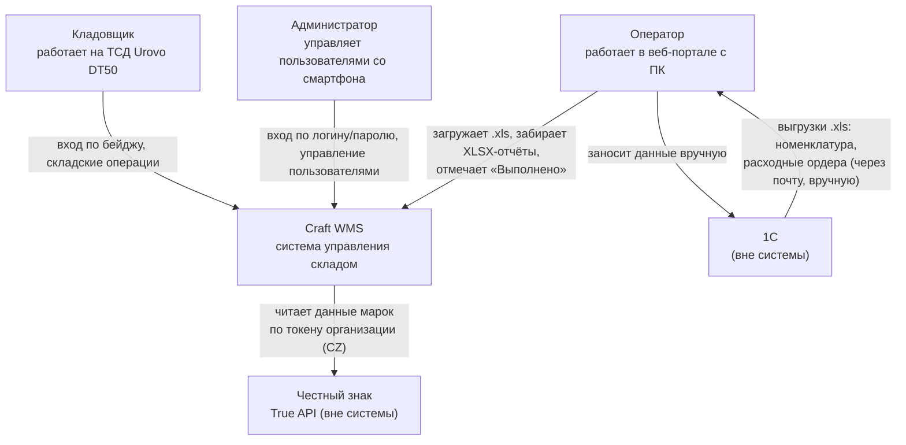
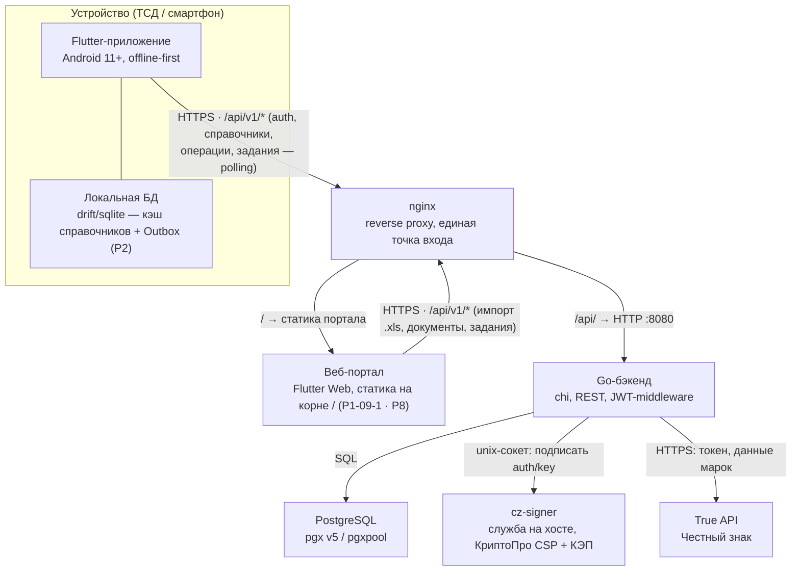
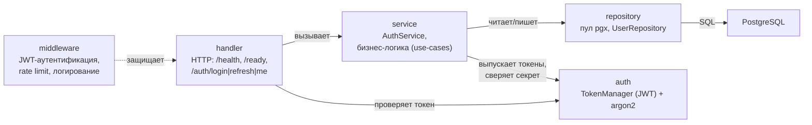
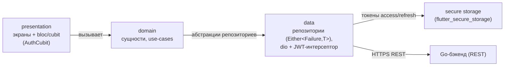

# Архитектура проекта Craft WMS

WMS для терминала сбора данных (ТСД). Пилот на одном складе.
План разработки — [`plan_v3.docx`](plan_v3.docx).

## Стек

| Слой                       | Технология                                                     |
|----------------------------|----------------------------------------------------------------|
| Мобильное приложение (ТСД) | Flutter, Android 11+ (Urovo DT50)                              |
| Веб-портал оператора       | Flutter Web (P1-09-1 · P8), статика за тем же nginx            |
| Бэкенд                     | Go (chi-роутер, slog-логгер), REST                             |
| БД                         | PostgreSQL (pgx v5 / pgxpool + golang-migrate)                 |
| Инфраструктура             | Docker · docker-compose · nginx                                |
| Обмен с 1С                 | без прямой интеграции — Excel-отчёты (XLSX) выдаются в портале |
| Транспорт                  | HTTP + Outbox + polling; без брокера и WebSocket               |

Ключевые свойства: **offline-first** на устройстве, идемпотентность операций по `operation_id`,
авторизация по бейджу сотрудника, доступ — по правам должности (ADHOC-49; до неё — роли
`employee` / `admin`).

Обоснования ключевых решений — в [ADR](adr/) (`docs/adr/`). Развёртывание — в [deploy/](deploy/): [локально](deploy/dev-deploy.md) и [на сервере](deploy/prod-deploy.md).

## Архитектура по C4

Три уровня детализации: **Контекст → Контейнеры → Компоненты** (модель C4). Диаграммы — mermaid
(рендерятся на GitHub). Часть контейнеров/компонентов появляется по мере фаз (offline-стор — P2,
XLSX+SMTP — P3 и т.д.).

### Уровень 1 — Контекст (система и её окружение)

Кто пользуется системой и с какими внешними системами она связана.



Ключевое: **прямой интеграции с 1С нет** — обмен файловый, данные в 1С заносит человек
(см. [ADR-0004](adr/0004-obmen-1c-excel-email.md)). Файлы ходят **через веб-портал**, а не по
e-mail: оператор скачивает отчёт и отмечает его выполненным, поэтому необработанное остаётся
видимым (см. [ADR-0013](adr/0013-documents-via-portal-not-email.md)).

Честный знак WMS только читает: товар, даты и состав упаковки по марке. Документы в ЧЗ
подписывает СБИС, WMS туда ничего не пишет (см. [ADR-0017](adr/0017-chestny-znak-true-api-read.md)).

### Уровень 2 — Контейнеры (крупные исполняемые части)



- **Наружу торчит только nginx**; бэкенд напрямую не публикуется. Схема URL: **портал на корне
  `craft.skogi.ru/`, API под `/api/v1/`** — один origin, без CORS, один сертификат
  ([ADR-0015](adr/0015-url-scheme-api-v1-portal-root.md)). Портал — статика за тем же nginx/TLS,
  отдельного рантайма не требует ([ADR-0012](adr/0012-web-portal-flutter-web.md)).
- **Постоянного канала (WebSocket) и брокера сообщений нет**: обрывы связи закрывает Outbox
  на устройстве, актуальность — версии областей данных в заголовке каждого ответа API, без
  фонового опроса ([ADR-0014](adr/0014-transport-http-outbox-polling.md),
  [ADR-0018](adr/0018-data-versions-in-every-response.md)).
- Пробы: `/health` (liveness), `/ready` (доступность БД) — **на корне**, вне `/api/v1` (их дёргает
  docker-healthcheck напрямую к контейнеру).
- **Подписант Честного знака — не контейнер, а служба systemd на хосте** (CZ-02): КриптоПро
  CSP, ключ и лицензия стоят на сервере. Бэкенд достаёт до неё только через unix-сокет в
  смонтированном каталоге `/run/cz-signer`; в сеть подписант не выходит. Подробнее — раздел
  «Честный знак: подписант и клиент True API».
- `BASE_URL` приложения задаётся при сборке (`--dart-define`; прод — `…/api/v1`), см. [deploy/dev-deploy.md](deploy/dev-deploy.md).

### Уровень 3 — Компоненты бэкенда (внутри контейнера Go)



Зависимости направлены внутрь: `handler → service → repository`; `auth` — пакет-лист без зависимостей
на другие слои (им пользуются и `service`, и `middleware`). Подробнее — раздел «Слои бэкенда» ниже.

### Уровень 3 — Компоненты клиента (внутри контейнера Flutter)



Навигация гейтится состоянием `AuthCubit` (единое место правды). Подробнее — раздел «Слои клиента» ниже.

## Монорепозиторий

```
craft_wms_app/
├── apps/
│   ├── craft_wms/              # Flutter-приложение для ТСД (Android 11+)
│   │   ├── lib/
│   │   │   ├── core/           # di (get_it/injectable), router (auto_route),
│   │   │   │                   #   network (dio + JWT-интерсептор), auth, error, theme, logging (talker)
│   │   │   ├── features/       # экраны по фичам (presentation/domain/data)
│   │   │   ├── app.dart        # MaterialApp.router + гейт навигации по auth-состоянию
│   │   │   └── main.dart       # bootstrap: DI → runApp
│   │   ├── android/            # minSdk 30, сборка APK
│   │   └── pubspec.yaml
│   │
│   └── backend/                # Go-сервис
│       ├── cmd/
│       │   ├── server/         # точка входа сервиса (main.go)
│       │   ├── migrate/        # раннер миграций (golang-migrate, встроенные .sql)
│       │   ├── seed/           # сидер стартового админа
│       │   └── cz-signer/      # подписант ЧЗ: служба на хосте, едет в образе бэкенда (CZ-02)
│       ├── internal/           # приватный код сервиса
│       │   ├── handler/        # HTTP-обработчики (транспортный слой): health, ready, auth
│       │   ├── service/        # бизнес-логика (домен, use-cases): AuthService
│       │   ├── repository/     # доступ к данным (пул pgx, UserRepository)
│       │   ├── model/          # сущности / DTO (User, роли)
│       │   ├── movement/       # разворот движений (ГЕ → товарные строки) для отчётов, P4-09-1
│       │   ├── picking/        # подбор источников заказа сборки: партия, ячейка, FEFO (P9-03)
│       │   ├── trueapi/        # клиент True API: токен, кэш, чтение марок (CZ-02)
│       │   ├── czsigner/       # подпись КЭП через cryptcp на unix-сокете (CZ-02)
│       │   ├── auth/           # JWT-токены + argon2 (примитивы аутентификации)
│       │   ├── config/         # чтение конфигурации из env
│       │   └── middleware/     # аутентификация (JWT), логирование, rate limiting
│       ├── migrations/         # SQL-миграции + embed.go (golang-migrate) — единый источник схемы БД
│       ├── Dockerfile          # (добавляется в P0-01)
│       ├── go.mod
│       └── go.sum
│
├── infra/                      # инфраструктура окружений
│   ├── docker-compose.yml      # dev-стек: postgres + backend + nginx (P0-01)
│   ├── docker-compose.prod.yml # прод-стек (P7)
│   └── nginx/                  # конфиг reverse proxy
│
├── docs/                       # документация (этот файл, api.md, deployment.md, ADR)
├── scripts/                    # dev-скрипты (setup, миграции, сиды)
├── .github/workflows/          # CI: lint + test + build (Go + Flutter)
├── Makefile                    # оркестрация задач (build/test/lint/migrate/up)
├── .env.example                # шаблон переменных окружения
└── README.md
```

### Принципы раскладки

- **Одно приложение — одна папка под `apps/`.** Flutter (`craft_wms`) и Go (`backend`) лежат
  симметрично; общей обёртки над несколькими сервисами нет — сервис один.
- **Миграции живут рядом с бэкендом** (`apps/backend/migrations`) и запускаются из Go-сервиса
  через golang-migrate. Это единственное место описания схемы БД — дублирующего каталога `db/` нет.
- **Dockerfile сервиса — рядом с сервисом** (`apps/backend/Dockerfile`).
  В `infra/` только оркестрация окружений (compose-файлы, nginx), без дублей Dockerfile.
- **Пустые «на вырост» каталоги не заводим** — создаём по факту надобности.

## Слои бэкенда

Классическая слоёная архитектура, зависимости направлены внутрь:

```
handler  →  service  →  repository  →  PostgreSQL
(HTTP)      (логика)     (данные)
```

- **handler** — разбор HTTP-запроса, валидация ввода, сериализация ответа. Без бизнес-правил.
- **service** — бизнес-логика: приёмка, размещение, перемещение, пополнение; атомарность остатков
  в транзакциях; формирование Excel-отчётов и постановка их в очередь на e-mail.
- **repository** — SQL-доступ к Postgres, изоляция БД от домена.
- **model** — сущности предметной области (товар, ячейка, партия, остаток, грузовая единица).
- **middleware** — auth по бейджу (JWT), логирование, rate limiting на `/auth/login`.
  Доступ — `RequireAccess(правило)` (ADHOC-49/50): доступ должности читается из базы на каждый
  запрос и кладётся в контекст, поэтому смена должности и блокировка действуют сразу, без
  нового токена. Роль в токене осталась меткой для старых клиентов и Bugsink.
- **observability** — ошибки журнала (slog, уровень error) и паники запросов уходят в Bugsink
  (совместим с Sentry, клиент `sentry-go`); без `SENTRY_DSN` выключено (ADHOC-42).
- **trueapi** — клиент внешнего API Честного знака, на месте repository для сервиса `CZService`:
  сервис зависит от узкого интерфейса, ошибки-сигналы ЧЗ лежат в `model` (CZ-02).

### Честный знак: подписант и клиент True API (CZ-02)

True API пускает по токену организации, а токен выдаётся в обмен на строку `auth/key`,
подписанную КЭП сотрудника с МЧД ([ADR-0017](adr/0017-chestny-znak-true-api-read.md)).

```
хост: craft-wms-cz-signer.service (User = владелец ключа, Group = cz-signer)
  ├─ cryptcp → файловая копия ключа, сертификат в uMy
  └─ /run/cz-signer/sign.sock (660)
            │  каталог смонтирован в контейнер, группа — через group_add
backend: trueapi.Client → https://markirovka.crpt.ru/api/v3/true-api
```

- **Подписант** (`cmd/cz-signer`, `internal/czsigner`) умеет одно: `POST /sign` — подпись
  CAdES-BES присланных байтов, `GET /health` — пробная подпись. Про True API не знает.
  Пароль копии ключа живёт в отдельном `cz-signer.env` (root, `600`) и бэкенду не виден.
- **Клиент** (`internal/trueapi`) получает токен (`auth/key` → подпись → `simpleSignIn`),
  держит его в памяти и обновляет фоном за час до истечения. Параллельные запросы ждут одно
  обновление. Если обновить не вышло, а старый токен ещё годен, работает на старом. Сбой входа
  пишется в журнал ошибкой и уходит в Bugsink.
- **Ошибки** различаются по месту ремонта: не настроено, подписант недоступен, ЧЗ отказал во
  входе, True API недоступен, нет договора по товарной группе (`403`), код не найден (`404`).
- **Без `CZ_SIGNER_SOCKET`** клиента нет, ручки ЧЗ отвечают «не настроено»: локальный стек и
  тестовый стенд работают без КриптоПро.
- Администратор проверяет ЧЗ ручками `GET /api/v1/admin/cz/status` и
  `POST /api/v1/admin/cz/info`.
- **Скан марки или короба на ТСД** (CZ-04) — `POST /api/v1/cz/scan {code}`, любому
  сотруднику, только онлайн. `CZService.Scan` приводит код к ключу ЧЗ (префикс AIM,
  криптохвост), читает ЧЗ, находит товар по GTIN и место марки в WMS. Упаковку раскрывает до
  единиц: вложенные КИ дочитываются пачками до 100 и сводятся по товару и партии (дате
  производства единицы). Формат ответа закреплён эталонами `testdata/cz_scan_*.json`.
- **На ТСД** (фича `cz`): скан марки в «Остатках» и «Номенклатуре» открывает карточку товара с
  блоком марки, незнакомый GTIN — привязку ШК поиском (как у незнакомого ШК), принятый короб —
  карточку ГЕ, прочую упаковку — экран состава. Куда вести, решает `czScanTarget`.
- **Марки на складе** (CZ-03) — таблицы `cz_marks` и `cz_aggregates`, репозиторий
  `CZMarkRepository`. Транспортный короб ЧЗ — это ГЕ: находится по SSCC, движется как любая ГЕ.
  Марка лежит в ГЕ или россыпью в ячейке; место короба марка не дублирует. Запись есть и
  функциями на `Querier`, чтобы приёмка писала марки в одной транзакции со своим документом.
  Схема — `docs/data-model.md`, §3.33–3.34.
- **Приёмка марок** (CZ-05). Скан на ТСД читает ЧЗ онлайн; ответ `cz/scan` несёт и
  расхождение (`discrepancy`: владелец по `CZ_OWNER_INN`, статус в обороте), и упаковку каждой
  единицы (`groups`, `parents`). Тело `receipt_submit` расширено необязательными полями
  (`cz_code` у ГЕ, `cz_groups`, `marks` у строки); сервис проверяет их форму до базы, а
  `repository/receipt_cz.go` после `postReceipt`, в той же транзакции, пишет агрегаты, марки
  с местом, признак `goods.cz_marked` и проблемы с расхождением в «Изолятор» (через
  `problemSubmit`, минуя только запрет ячейки приёмки). Ошибки ЧЗ проводки — отказ операции,
  а не повтор. Признак «маркируемый» правит admin: `PATCH /api/v1/goods/{id}/cz-marked`
  (`CZService`). На ТСД: `cz_marked` в кэше товаров (база ТСД 10), миксин приёмки
  `ReceiptCzScanActions`, чистые правила марок — `receipt/presentation/bloc/receipt_cz.dart`.
- **Марки в движении** (CZ-06). Место марки меняет одна функция `moveMarks`
  (`repository/cz_movement.go`) — её зовут перемещение, размещение россыпи и пометка
  проблемы, приёмка заводит свои проблемы тем же путём. Строка товара маркируемого товара
  несёт `marks`; без них — отказ строки. Вскрытие упаковки (`openTouchedAggregates`) — по
  факту: марка ушла из своего короба ЧЗ или разошлась с остальными марками групповой
  упаковки. Перенос короба целиком марок не трогает — их место и есть короб. Решение офиса и
  отгрузка возврата берут товар проблемы по её маркам (`repository/cz_problem.go`);
  `return_submit` с марками проверяет, что названы все марки позиции. ГЕ короба ЧЗ — по
  `GET /api/v1/load-units/cz/{code}`, а снимок содержимого несёт коды коробов ЧЗ и марки:
  ТСД находит и то и другое без связи (база ТСД 12, `ContentsRepository.marksByCode` со своей
  очередью поверх).

## Слои клиента (Flutter)

Чистая архитектура: **presentation → domain → data**, зависимости направлены внутрь.
Стек: **auto_route** (навигация), **flutter_bloc** + **freezed** (состояние), **get_it/injectable** (DI),
**dio** + JWT-интерсептор (сеть), **either_dart** + `Failure` (ошибки), **talker** (логирование),
**slang** (i18n — весь текст в `assets/i18n`).

- **presentation** — экраны и bloc/cubit; не знают про источники данных.
- **domain** — сущности и use-cases, независимы от Flutter и способа хранения.
- **data** — репозитории (`Either<Failure, T>`), сетевой клиент dio, локальный стор (offline — P2), кэш справочников.
- **JWT-интерсептор** — клиентская пара к middleware бэкенда: подставляет access-токен, на 401 молча
  обновляет его по refresh и повторяет запрос.
- **Токены — secure storage** (`flutter_secure_storage`, Android Keystore): пара access/refresh переживает
  перезапуск. При старте `AuthCubit.restore()` тихо восстанавливает сессию (`/auth/me` + авто-рефреш);
  refresh протух → хранилище чистится → экран входа. Без сети токены сохраняются («мягкий» офлайн-старт).

### Локальный стор устройства (P2-02)

Справочники живут в локальной базе на устройстве (drift/sqlite), и экраны читают их оттуда, а не
из API. `CatalogRepository` — фасад «сначала кэш»; сетевой источник вынесен в `CatalogApi`;
наполнением занимается `CatalogSyncService` (после входа и по кнопке «Обновить справочники»).

- **Кэшируются справочники:** товары, группы, поставщики, ячейки, привязки ШК — их меняет импорт
  из 1С и печать этикеток, то есть события редкие и внешние.
- **Остатки по товару отдельно не кэшируются.** Остаток меняется от каждой операции любого
  терминала, и устаревшее число без подписи хуже честного «нет связи»: по нему кладовщик примет
  решение. С P5-05 в базе лежит **снимок содержимого склада** (короба и россыпь по ячейкам),
  с ADHOC-33 остатки по товарам и карточка товара считаются из него — всегда с подписью «данные
  на ЧЧ:ММ», если снимок обновить не удалось, см. ниже.
- **Запись справочника — полная замена в транзакции.** Сервер отдаёт справочник целиком; при
  слиянии удалённые записи оставались бы в кэше навсегда.
- **Готовность — по каждому справочнику отдельно.** Один недоступный справочник не отключает
  офлайн для остальных.
- **Поиск товаров идёт по локальной базе** с той же семантикой, что на сервере: «все слова
  присутствуют, порядок не важен», нижний регистр, «ё» → «е». Расхождение правил означало бы
  разные списки в сети и без неё, поэтому совпадение закреплено тестами.
- **Вход без сети:** при сетевой ошибке сессия поднимается локально по сохранённому профилю,
  пока жив refresh-токен. Отказ сервера так не обходится — протухший refresh ведёт на экран входа.

### Очередь исходящих операций и незавершённый проход (P2-03)

В той же локальной базе живут ещё две таблицы, и от кэша справочников они отличаются
принципиально: кэш одноразовый и всегда восстанавливается с сервера, а эти строки —
**единственная копия работы кладовщика**. Будущие миграции обязаны их переносить, а не
пересоздавать.

- **Очередь операций (`outbox_operations`, `lib/core/outbox/`).** Операция сперва пишется
  строкой с `operation_id` (UUID v4, ключ идемпотентности) и статусом, и только потом уходит
  в сеть. Порядок отправки — по отдельной колонке-счётчику, а не по метке времени: метки в
  пределах миллисекунды совпадают, а для пары «привязать ШК» / «отвязать ШК» порядок решает
  исход. Тип и статус хранятся строками — индексы enum поехали бы при вставке нового значения
  в середину списка. Подключены привязка и отвязка ШК, а с P4-09 — приёмка целиком
  (`receipt_submit`); отправка, ретраи и backoff — P2-04. С P5-02 сервер принимает и сеанс
  размещения целиком (`putaway_submit`), клиентская сторона — P5-03. С P6-03 — документ движения
  (`movement_submit`: перемещение и пополнение одной операцией), клиентская сторона — P6-04.
- **Незавершённый проход «Ввода остатков» (`entry_drafts`).** Проход копится в памяти и уходит
  на сервер одним махом на финале (вариант A), поэтому падение приложения теряло весь обход
  склада — при исправной сети. Слепок буфера пишется на каждое изменение и восстанавливается
  при открытии экрана. Undo-стек в слепок не входит: он служит текущему действию.
  С P4-09 в той же таблице лежит и незавершённая приёмка — строка на поток, ключ задаёт
  хранилище (`core/database/draft_slot.dart`).

### Приёмка на ТСД (P4-09)

Фича `features/receipt/`: поставщик → документ поставщика (номер или «б/н» и дата, обязателен,
ADHOC-23) → строки (в короб или штучно, в ячейку) → «Завершить приёмку». Документ, его короба и строки набираются на терминале и уходят на сервер **одной
операцией очереди** `receipt_submit`, которую сервер применяет одной транзакцией: открыть
документ, завести ГЕ, положить строки, оприходовать.

- **Одной операцией, а не цепочкой.** Очередь отклонённую операцию снимает и идёт дальше;
  отклонённая строка в цепочке дала бы оприходование документа без неё — остаток поднялся бы
  на неполный приход. Приёмка приходует целиком или не приходует вовсе.
- **Короб получает ячейку при создании** и больше её не меняет: противоречие «короб в двух
  ячейках» исключено на терминале конструкцией, а не отказом сервера после разгрузки.
- **Склад документа — от ячейки по умолчанию** (`cells.is_default`, отдаётся в `GET /cells`
  и лежит в кэше): приёмку начинают и без связи. Ячейку строки, если она не выбрана, подставляет
  сервер — умолчание живёт в одном месте.
- **Документы для 1С говорят товарами, а не коробами** — разворот движений в товарные строки
  вынесен в `internal/movement` (P4-09-1), см. ниже.
- **Внутренний ШК выдаётся только по сети** (`POST /goods/{id}/barcode`): код уникален во всей
  системе, а без заранее выданных терминалу диапазонов офлайн-выдача этого не обещает.


### Подбор источников сборки (P9-03)

Откуда брать товар заказа сборки — чистое правило над остатком, отдельный пакет
`internal/picking` без БД и HTTP (`SuggestOrder`); источники с доступным остатком ему подаёт
`PickingRepository.Sources`, заказ и проверку «можно ли собирать» — `PickingTaskService.Task`.

- **Партия и ячейка реестра — основа:** сначала партия реестра, недостающее — другими партиями
  по FEFO; внутри партии — ячейка реестра, затем россыпь раньше короба и больший остаток раньше.
- **Доступное = остаток минус «в сборке»** (открытые пики); россыпь — остаток склада в ячейке
  минус короба того же склада. Источник — только ячейки хранения (не `ПРИЁМКА`, не `ОТГРУЗКА`,
  напольное хранение входит) на внутренних складах с галочкой «разрешить сборку».
- **Резерва нет:** две строки одного заказа делят доступное, два заказа — нет; кто первым
  пикнул, тот и взял, остаток проверяет пик (P9-05).
- **Сборка на ТСД — онлайн** (P9-04, право `tsd.picking`): `GET /picking/orders` (все
  несобранные заказы любой даты; чужой в работе — занят, зависший 8 ч — свободен),
  `GET /picking/orders/{id}` (заказ с подбором и коробами), `POST …/take|release`,
  `POST …/boxes` (короб отгрузки с UUID ярлыка от ТСД, номер «N» выдаёт сервер, повтор
  идемпотентен), `POST …/lines/{lineId}/shortage` (отметка «не хватает» и пересчёт позиции в
  одной транзакции). Заказ закрепляется за кладовщиком блокировкой строки заказа.
- **Пик — операция очереди** (`picking_pick`, `picking_unpick`, P9-05): не меняет остаток, а
  ставит товар «в сборку». «В сборке» вычитается в общих точках доступного — `looseQty`,
  `takeFromLoadUnit`, снимок пересчёта, `moveMarks`, — а не в каждой операции; `ОТГРУЗКА` в
  движении запрещена, как и `ПРИЁМКА`.

### Разворот движений в товарные строки (P4-09-1)

Склад двигает грузовые единицы («короб X из ячейки A в ячейку B»), а 1С о коробах не знает:
каждый документ для неё — товар · партия · откуда · куда · количество. Разворот общий для всех
отчётов с движением («Поступление», «Движение» размещения, перемещения и пополнения) и живёт
отдельным пакетом `internal/movement` без зависимостей от БД и HTTP.

- **ГЕ раскладывается по составу** вместе с вложенными ГЕ, россыпь проходит как есть.
- **Одинаковые товар, партия и ячейки складываются**; короб в документе не показывается —
  1С он не нужен. Строки с нулевым итогом отбрасываются; порядок — первого появления.
- **Состав подаёт интерфейс `ContentReader`.** Реализация в репозитории
  (`LoadUnitContents`) читает состав набора ГЕ одним рекурсивным запросом на переданном
  `Querier` — то есть внутри транзакции операции: документ должен показать то, что
  переехало, а не нынешнее содержимое короба.
- **«Нулевые» строки** (откуда = куда) — правило отчёта, а не разворота: отбрасываются
  в P6-07.

### Документ «Поступление» (P4-10)

Оприходование приёмки в той же транзакции сохраняет снимок документа формы `receipt`: шапка
(склад, поставщик, исполнитель, дата) и товарные строки через разворот. Путь проводки один для
прямой ручки и операции очереди, поэтому документ рождается в обоих случаях. Шаблон .xlsx —
`internal/report/receipt_xlsx.go`, дата по Москве фиксированным сдвигом. В портале у каждой
формы своя вкладка («Инвентаризация», «Приход», «Перемещение») поверх общей `DocumentsTab`;
список фильтруется на сервере параметром `GET /documents?kind=`.

### Документ «Движение» (P5-04)

Проведение сеанса размещения в той же транзакции сохраняет снимок формы `movement` с источником
`putaway`: шапка (операция, склад, задание и приёмка-основание с накладной поставщика,
исполнитель, дата) и строки «откуда · куда · товар по партиям» через разворот — короба
раскладываются по составу. Форма одна на размещение, перемещение и пополнение (P6): операция —
поле снимка, а не новый шаблон. Подстановка справочников в строки общая с «Поступлением»
(`movementSnapshotRows`). Шаблон — `internal/report/movement_xlsx.go`.

Перемещение (P6-07) публикует ту же форму с источником `movement` в транзакции
`movement_submit`. Короб раскладывается по составу на момент своего переноса — его отдаёт
`transferLoadUnit`, — а не по составу на конец документа: в один документ можно перенести
короб и затем доложить в него или взять из него. «Нулевые» строки (откуда = куда) отбрасываются,
документ из одних таких строк не публикуется.

### Проблемы склада (P6-07-1)

Брак — метка внутреннего склада (ADR-0016), а не перенос: товар остаётся в той же ячейке
и перемещается со своей меткой. Метка есть у строки остатка и у короба целиком
(`load_units.internal_warehouse_id`). Пометка — операция очереди `problem_submit`: короб целиком,
россыпь или часть короба (вынимается в россыпь склада назначения) переводится на другой
внутренний склад в той же ячейке, в одной транзакции с записью `warehouse_problems` (причина
из фиксированного списка, комментарий, марка ЧЗ). Документа для 1С нет. Россыпь по складу
считается одинаково везде (`looseQty`, снимок ТСД): остаток склада минус короба этого склада;
перенос короба двигает остаток строкой его склада; товар кладётся в короб только того же
склада. Справочник складов — `GET /internal-warehouses` (все, и скрытые, с признаками
`is_active` и `in_use`); ведёт его admin из портала, «Настройки» → «Внутренние склады»
(ADHOC-29): `POST`, `PATCH` (имя, скрыть/вернуть), `DELETE` — только склад без остатка
и истории; склад по умолчанию не скрывается и не удаляется. Скрытым складом на ТСД не
помечают, но его остаток подписывается.

### Решение офиса по проблеме (P6-07-3)

Портал, вкладка «Проблемы склада» (раздел «Склад»): `GET /problems` (открытые сверху; у каждой —
товар, допустимые решения и подсказка поставщика) и `POST /problems/{id}/resolve` («Провести»),
оба только admin. Решение — целиком на проблему и только из допустимых при причине (таблица —
`model.ProblemDecisionsFor`, портал своей копии не держит): «списать» — номер и дата документа
списания 1С, остаток склада-метки уменьшается при проведении; «разместить» — товар возвращается
в «Основной» в той же ячейке; «возврат поставщику» — товар переходит на системный склад
«Возврат поставщику» (`internal_warehouses.system_role`) и проблема ложится в открытое задание
возврата поставщика (одно на поставщика). Своего Excel WMS не формирует. Товар проблемы решение
берёт там, где он лежит сейчас, и пишет откуда (`warehouse_problem_lines`), — одной транзакцией
с решением, через примитивы остатка. На системный склад кладовщик не помечает и с него не
перепомечает.

Проблемы видит и склад: `GET /problems/current` — открытые проблемы всего склада для ТСД
(ADHOC-35, без подгрузки), `GET /problems/resolved` — лента решённых (ADHOC-34); обе открыты
сотруднику, только чтение — решение остаётся офису. Окно по
времени решения и курсор (`before_resolved_at` + `before_id`) — тот же приём, что у ленты
«Завершённые» заданий; ответ — та же форма проблемы, что в портале (эталон
`testdata/problems_resolved.json`), плюс исполнение возврата — кто и когда отгрузил
(`shipped_by`, `shipped_at` из сеанса отгрузки).

### Фото к проблеме склада (ADHOC-45)

Снимки хранятся в базе (`problem_photos`, `bytea`): проблем единицы в день, снимок, сжатый на ТСД
до ~1600 px JPEG, — 200–400 КБ, и так фото сами попадают в зашифрованный бэкап, проверку
восстановления и обнуление базы перед пилотом. До трёх на проблему, добавлять — пока она открыта.
`PUT /problems/{id}/photos/{photoId}` (тело — сам снимок, тип узнаётся по содержимому, до 1 МБ;
id выдаёт ТСД, повтор не задваивает) и `GET` того же пути (снимок с долгим `private`-кэшем) —
любому сотруднику. Списки проблем (`/problems`, `/problems/current`, `/problems/resolved`) несут
`photos` — идентификаторы в порядке съёмки. Слои — свои: `ProblemPhotoHandler` с узким интерфейсом
сервиса, `ProblemPhotoService`, `ProblemPhotoRepository`, ошибки в `model`.

### Отгрузка возврата поставщику на ТСД (ADHOC-31)

Задание `supplier_return` приходит на ТСД в «ЗАДАНИЯ» вместе с размещением (`GET /tasks`):
поставщик и позиции — короб с составом или товар с партией и количеством, у каждой проблема-
основание (`problem_id`) и ячейка, где позиция лежит сейчас. Экран отгрузки (фича
`features/supplier_return/`, со слоем `domain`): позиции отмечаются сканом короба, ячейки
и товара или касанием; «Отгружено» — только когда отмечено всё, задание отгружается целиком.
Сеанс — одна операция очереди `return_submit` (`shipment_id`, `task_id`, `warehouse_id`,
`problem_ids`), без количества и ячеек: позиция целиком, а место сервер находит сам — короб
в его ячейке, россыпь склада возврата сначала там, куда её положило решение, дальше по адресам.
Сервер снимает позиции с остатка теми же примитивами, что списание по решению, пишет
`supplier_return_shipment_lines` (что и откуда ушло), помечает проблемы отгруженными
(`shipment_id`) и выполняет задание. Без связи снимок заданий отмечает отгруженное сразу
(`TasksCache.applyReturn`). Своего Excel нет — возврат оформляется в 1С по факту.

### История перемещений на ТСД (ADHOC-28)

Вкладка «Завершённые» в разделе «Перемещение» — перемещения всего склада, только онлайн:
`GET /movements` (лента, свежие сверху; фильтр `from`/`to` по дням склада и `executor`, курсор
`before_posted_at` + `before_id`), `GET /movements/executors`, `GET /movements/{id}` (строки
по порядку проведения). Источник — журнал P6-01 (`movements`, `movement_lines`), без снимка:
это рабочий инструмент склада, а не документ для 1С, поэтому короба и перекладывание внутри
ячейки здесь видны. Строка отдаётся в виде строки сеанса перемещения (`from`/`to` — ячейка
и короб), и ТСД показывает историю теми же словами, что свой сеанс. Разбор периода и курсора
общий с лентой «Завершённые» заданий (`service.parseFeedWindow`).
### Задания для склада (P5-02-1)

Задание — единица работы кладовщика на ТСД: раздел «ЗАДАНИЯ», подразделы «Текущие» и
«Завершённые». Первый вид — размещение; в P10 добавится пересчёт.

- **Задание рождается из приёмки** — в транзакции оприходования, из того, что легло в ячейку
  приёмки (`warehouse_tasks` + `putaway_task_items`). Размещения без задания нет: операция
  `putaway_submit` несёт `task_id` и не размещает ничего сверх позиций задания.
- **Остаток задания не хранится**, а считается по проведённым сеансам размещения этого
  задания — разойтись с реально перенесённым ему нечем.
- **Общий пул.** Статус хранится один (`new` → `in_progress` → `done`), а показывается
  относительно смотрящего: взятое видно только взявшему, зависшее (8 ч без отправок) — всем
  как «новое». Это решает запрос, а не фоновая задача: время само ничего в базе не меняет.
- **Взятие и отказ — только со связью** (`POST /tasks/{id}/take|release`): кто держит
  задание, знает сервер. Выполнение — операцией очереди и без связи; сеанс принимается, даже
  если задание успели перехватить, — это уже сделанная физическая работа.
- **Частичное «Завершить»** проводит размещённое и возвращает задание в пул «новым»; всё
  размещено — задание выполнено и уходит в ленту «Завершённые» (`GET /tasks/completed`,
  курсор по времени завершения, фильтры по периоду, исполнителю и виду).
- **Выполнение задания на размещение — фича `features/putaway/` (P5-03).** Порядок «товар →
  ячейка»; партия и количество россыпи — из задания. Сеанс копится черновиком на терминале и
  уходит одной операцией `putaway_submit`; без связи размещённое сразу отмечается в снимке
  текущих заданий, чтобы его не разместили второй раз.
- **Перемещение — фича `features/movement/` (P6-04), со слоем `domain`.** Сеанс «взял →
  положил»: источник — ячейка или QR короба, приёмник — ячейка или короб; в руках короб —
  следующий скан решает, целиком он едет или из него берут товар. Доступное в источнике —
  снимок содержимого со своей очередью плюс строки самого сеанса. Сеанс — черновиком, на
  «Завершить» одной операцией `movement_submit`; своё неотправленное движение накладывается на
  содержимое склада при чтении (`PendingOverlay`). Ячейку приёмки терминал не трогает.
  Товар едет своим внутренним складом (P6-07-2): брак и основной одной партии — разные позиции,
  в короб — только товар его склада, у россыпи не «Основного» склада склад уходит в строке.
- **Фото проблем (ADHOC-45)** — своя очередь загрузки, отдельно от очереди операций: снимок
  весит сотни килобайт и в теле операции задерживал бы всё за ним. Снимки лежат в локальной
  базе (`ProblemPhotoUploads`, база ТСД **11**) и грузятся после каждого прохода очереди
  операций — проблема к ним уже на сервере; 404 «проблемы ещё нет» — ждать, отказ по существу —
  снимок убрать и записать в журнал. Камера — `image_picker` (штатная камера, сжатие на
  терминале). Форма проблемы снимает до трёх фото; карточка проблемы показывает фото с сервера и
  свои неотправленные, у открытой — «Сфотографировать»; «Несинхронизированное» — сколько ждёт.
- **Проблемы склада — фича `features/problems/` (P6-07-2), со слоем `domain`.** Одна проблема —
  одна операция `problem_submit`, без черновика: скан короба или ячейки (в ячейке — её короба
  на выбор, если ярлык не читается) → короб целиком или товар с количеством → склад
  назначения, причина, комментарий, марка ЧЗ → «Зафиксировать». Неотправленная пометка
  накладывается на содержимое (`PendingOverlay`): короб уже «Брак» и без связи.
  Вкладки «Текущие» (ADHOC-35) — открытые проблемы склада и свои неотправленные из очереди
  (без связи — только свои), внизу «Добавить» — фиксация во весь экран; «Завершённые»
  (ADHOC-34) — решённые офисом проблемы всего склада лентой по дням,
  только онлайн, фильтр по периоду (общий лист фильтра с заданиями и перемещениями);
  карточка — проблема, решение офиса и исполнение (кто разместил, отгрузил или по какому
  документу списано), без отдельного запроса.
- **Внутренние склады на ТСД — `core/warehouse/InternalWarehouses` (P6-07-2).** Справочник
  `GET /internal-warehouses` в таблице `cached_internal_warehouses`, грузится со справочниками,
  но не останавливает синхронизацию (сервер без ручки — 404 — не сбой). Соглашение терминала:
  склад по умолчанию в сущностях — `null`; id сервера и очереди приводятся к нему один раз,
  в репозитории содержимого, до наложения очереди. Снимок несёт склад короба
  (`cached_load_units.internal_warehouse_id`, локальная база версии 8).
- **На ТСД — фича `features/tasks/`.** «Текущие» хранятся снимком в локальной базе
  (`cached_tasks`, одна строка со списком и временем получения) и открываются без связи;
  «Завершённые» — только онлайн, лента по дням с подгрузкой.

### Должности и права (ADHOC-49, ADHOC-50)

- **Права — действия по разделам**, код «приложение.раздел.действие» (`portal.receipt.post`,
  `tsd.tasks.putaway`) — 31 действие, список в `model.Rights` и в ограничении базы. Группы
  дерева (приложение, раздел) не хранятся: дерево с подписями — `core/auth/rights.dart`, общее
  у портала и ТСД. Системная должность «Администратор» — все действия, в том числе будущие; её
  не изменить и не удалить.
- **Разметка ручек:** каждая — своим действием; документы — по виду документа и действию
  (обработчик уточняет по `model.DocumentRight`), очередь ТСД — по виду операции
  (`model.OperationRights`, операция без права отклоняется, батч идёт дальше). Чтение
  справочников и ход пересчёта — любому вошедшему. Служебные проверки ЧЗ и мониторинга —
  только «Администратор».
- **Портал** пускает по любому действию портала; меню, виды вкладок и кнопки — по действиям
  (`Profile.can`). **ТСД** (ADHOC-51) — плитки, виды заданий и действия внутри разделов по
  правам вошедшего (`sessionCan`), без единого права ТСД — «Нет доступа к ТСД». Сервер без
  должностей — по прежней роли.
- **Пользователи и должности** — `GET /rights`, `/positions` (CRUD), `/users` (список, завести,
  править), действие «Настройки: должности и пользователи». Вход — ровно один: бейдж или логин
  с паролем. Правки — в транзакции под рекомендательной блокировкой; после каждой проверяется,
  что остался активный пользователь с этим действием, иначе откат. Журнал — `audit_log`, без
  секретов.

### Пересчёт (P10)

Пересчёт выборочный: область — ячейки, группы номенклатуры (матрица — тоже группа, с
поддеревом), поставщики, товары, внутренние склады или весь склад. Код — `StocktakeService` и
`StocktakeRepository` (P10-02).

- **Заведение разворачивает область в ячейки** одной транзакцией: шапка `stocktakes`, объекты
  `stocktake_scope`, ячейки `stocktake_cells` (`pending`) и одно общее задание `stocktake` в
  пуле. Ячейки и «весь склад» (с пустыми ячейками) — как заданы; внутренний склад, группа,
  поставщик, товар — ячейки, где сейчас есть их остаток. Ячейка приёмки в пересчёт не входит.
- **Снимок «ожидалось» — в начале подсчёта ячейки** (скан на месте), а не при заведении:
  между ними могут пройти часы. Строки — россыпь по товару, партии и внутреннему складу, живые
  короба целиком, марки ЧЗ россыпью; расчёт россыпи и коробов тот же, что у «Остатков».
  Область по группе, поставщику, товару снимает только свой товар и короба с ним.
- **Мягкая блокировка — триггерами в базе** (миграция 31): любое изменение содержимого ячейки
  на подсчёте (`stock`, `lu_content`, место и склад короба, место марки) переводит её в
  `disrupted`, и ячейку считают заново. Правило в базе, а не в коде операций: пишут в эти
  таблицы больше десятка мест. Гонку снимка с движением закрывает рекомендательная блокировка
  ячейки: начало подсчёта — исключительная, движение — разделяемая.
- **Предупреждение на ТСД до движения (ADHOC-48):** перемещение, размещение, пометка проблемы и
  возврат поставщику при скане ячейки спрашивают `GET /cells/{id}/stocktake-count` (ожидание 3 с)
  и на ячейке под подсчётом показывают «кто считает, какой пересчёт» с выбором «Отмена» /
  «Всё равно». Это предупреждение, а не запрет; без связи его нет — блокировку держат триггеры.
- **Работа на ТСД (P10-03)** — ручки `/stocktakes/{id}/cells`, `/stocktake-cells/{id}/take|release|start`
  только со связью: кто держит ячейку и что в ней ожидалось, знает сервер. Скан ячейки отдаёт
  позиции без количеств — слепой счёт. Взятая и не начатая ячейка через 8 ч снова видна всем.
  Задание `stocktake` в `GET /tasks` несёт `stocktake_id`.
- **Факт ячейки — операция очереди `stocktake_cell_submit`**, работает без связи. Остаток
  приводится к факту сразу по ячейке, правка — в `audit_log`. Не найденные короб и марки уходят
  на системный склад «Не найдено» проблемой с причиной «не найдено» (решения офиса: списать или
  «нашлось»); учётный короб или марка из другого места переносятся туда, где их нашли.
  Неизвестный WMS короб или марка — отказ. Товар системных складов пересчёт не считает.
- **Заводит и закрывает пересчёт** старший смены — пока admin (`POST /stocktakes`,
  `/stocktakes/{id}/close`); закрыть досрочно — с `force`, неподсчитанные ячейки остаток не
  трогают.
- **На ТСД — фича `features/stocktake/` (P10-04)** со слоем `domain`. Задание `stocktake` в
  «Текущих» открывает экран ячеек; скан ячейки на месте берёт и начинает её. Подсчёт — слепой,
  насчитанное — в черновике ячейки (`entry_drafts`, строка `stocktake:<id>`), поэтому после
  скана работает без связи; факт — операцией очереди. Короба и марки терминал узнаёт по своему
  снимку склада. Старший смены заводит пересчёт с ТСД по простой области (ячейки сканом,
  внутренний склад, весь склад) и закрывает его.
- **В портале — вкладка «Инвентаризация» (P10-05):** пересчёты (заведение по любой из шести
  областей, ход, закрытие; `GET /stocktakes`), документы «Инвентаризация» и «Ввод остатков».
- **Документ «Инвентаризация»** (`report_documents.kind = stocktake`) — один на пересчёт, в
  транзакции закрытия: все подсчитанные позиции по ячейке, товару, партии и складу WMS с
  ожидалось/факт/расхождением, короба развёрнуты в состав (строки «товар в коробе» пишет подсчёт
  ячейки), «не найдено» и «не считалась» — пометками. Excel — два листа: всё и расхождения.

### Движок синхронизации (P2-04)

Очередь разгребает `SyncEngine` (`lib/core/sync/`): проходит её строго FIFO и останавливается
на первой временной неудаче — «привязать ШК» и «отвязать ШК» дают разный итог в разной
последовательности, и перескочить через застрявшую операцию значит применить их задом наперёд.
Отказ по существу (4xx) выводит операцию из очереди и проходу не мешает.

- **Будят движок** вход в приложение, возврат на передний план, событие смены сети, кнопка
  «Обновить справочники» и таймер повтора.
- **Событие сети — подсказка, а не источник истины.** «Wi-Fi подключён» и «сервер отвечает»
  на складе расходятся регулярно, поэтому доступность проверяется самой попыткой отправки,
  а очередь уходит и без единого события сети — это гарантирует таймер.
- **Пауза повтора растёт** (5 с → 15 с → 45 с → 2 мин → 5 мин) и считается по счётчику попыток
  из строки очереди: перезапуск приложения не сбрасывает выдержку в ноль.
- **Правило «повторять или нет» — общее** (`core/outbox/outbox_retry.dart`) для движка и для
  репозитория, который отправляет операцию сразу при вызове. Разойдись они, одна и та же ошибка
  означала бы разное.

### Разбор несинхронизированного и локальный откат (P2-06)

Операция очереди меняет не только сервер, но и локальный кэш, и эти следствия описаны один раз
(`core/outbox/outbox_effects.dart`): что применить при постановке, что при подтверждении, что
при отказе. Отправка тоже одна — `SyncEngine.sendOne`, ею пользуется и проход по очереди, и
репозиторий, отправляющий операцию сразу. Пока путей было два, отложенная отправка не применяла
следствие: привязка уезжала на сервер, а в карточке товара штрихкод не появлялся.

- **Запись оптимистичная, но помеченная.** Привязка появляется в кэше при постановке в очередь
  с пометкой «ожидает»: кладовщик должен видеть результат сразу, иначе решит, что работа
  пропала. Пометка снимается при подтверждении и откатывается при отказе.
- **Отвязка симметрична:** запись убирается сразу, а `good_id` в теле операции нужен не серверу,
  а откату — им привязка возвращается на место.
- **Причина отказа хранится читаемой** — текст сервера дословно либо короткий маркер. Перевод
  ошибок dio в доменные общий для всех репозиториев (`core/error/dio_failure.dart`): своё
  правило в каждом уже разошлось однажды, и справочники теряли причину.
- **Экран «Несинхронизированное»** (меню в шапке) показывает отклонённые с причиной и
  ожидающие. У отклонённых две кнопки: повтор (сбрасывает выдержку — человек попросил явно) и
  отброс с подтверждением, потому что он необратим.

### Содержимое ячейки и короба по скану (P5-05)

Фича `features/contents/` — первая, разложенная по `dev.md §2` полностью: `domain` (сущности
и абстрактные `ContentsRepository`, `ContentsSnapshotSync`), `data` (сеть, кэш, наложение
очереди, реализации), `presentation` (экраны «Ячейка» и «Короб» зависят только от `domain`).
Скан этикетки ячейки или QR короба в «Остатках» открывает их содержимое.

- **Сервер → снимок → своя очередь поверх.** Карточка короба (`GET /load-units/{id}/card`) и
  ячейки (`GET /cells/{id}/contents`) сначала спрашивают сервер с коротким таймаутом; без
  связи читается снимок (`GET /contents/snapshot`, таблицы `cached_load_units`,
  `cached_load_unit_lines`, `cached_loose_stock`) с моментом, на который он согласован.
- **Снимок — один ответ в одной транзакции `REPEATABLE READ`**, без страниц: между страницами
  короб переезжал бы и попадал в снимок дважды или пропадал. Ответ сжимается (gzip).
  Грузится вместе со справочниками и после подтверждения своей приёмки или размещения.
- **Живой короб** — размещён и не пуст: явного статуса «выведен из обращения» у ГЕ нет.
  **Россыпь** — остаток ячейки минус содержимое её коробов, то же правило, что у размещения.
- **Свои неотправленные `receipt_submit` и `putaway_submit` накладываются при чтении**
  (`PendingOverlay`), а не пишутся в кэш: полная замена снимка их стёрла бы. Наложенное
  помечено «ожидает отправки». Короб, который уже знает сервер, приёмка повторно не наполняет —
  это операция «отправляется», ответ на которую не дошёл.
- **Вкладка «Короба» в «Остатках» (P5-05-1)** — список коробов из того же снимка (работает
  без связи), поиск по короткому коду с ярлыка: со связью `GET /load-units?code=…` по всем
  коробам, живым и нет, без связи — по снимку и своей очереди. Карточка короба печатает ярлык
  заново (через абстракцию `LoadUnitLabelPrinter`, без сети) и показывает историю —
  `GET /load-units/{id}/history`, только со связью: журнал размещений на терминал не тянется.
  История — физические события одной лентой по времени (ADHOC-32): приёмка, переносы короба
  (`placements`) и изменения состава — доложили и вынули (`movement_lines`), вынули в россыпь
  при пометке части короба (`warehouse_problems`), списали по решению (`warehouse_problem_lines`),
  отгрузили поставщику (`supplier_return_shipment_lines`). Пометки и решения сами по себе в неё
  не идут — только то, что они сделали с товаром.
- **Вкладка «Товары» в «Остатках» и карточка товара (ADHOC-33)** — из того же снимка со своей
  очередью поверх, без связи тоже. Остаток товара — сумма россыпи всех ячеек и содержимого
  живых коробов по внутренним складам (`ContentsRepository.goodsStock`); в списке только
  товары с остатком больше нуля, склады — фильтром с множественным выбором (по умолчанию все).
  Карточка — места товара: ячейка, короб, партия, склад (`goodPlaces`). Открытие вкладки
  и карточки сначала обновляет снимок; `GET /stock` терминал больше не вызывает (остался
  порталу). Очередь накладывается на весь склад сразу (`PendingOverlay.applyToWarehouse`).
  Весь справочник товаров с поиском, ШК и привязкой — «Номенклатура» в меню главного экрана.

### Платформенная интеграция: принтер этикеток

Вторая платформенная зависимость клиента — Bluetooth-принтер — изолирована в `lib/core/printer/`
за интерфейсом `PrinterTransport`, нативная часть в `android/.../printer/PrinterBridge.kt`.

- **Транспорт и язык разделены.** `PrinterTransport` отвечает за доставку байтов, `LabelLanguage` —
  за то, что в этих байтах (TSPL основной, ZPL запасной). Меняются независимо: смешав их, пришлось
  бы переписывать печать при смене кабеля. USB и Wi-Fi — точки расширения за тем же интерфейсом.
- **Соединение держится открытым** между этикетками: установка RFCOMM-сокета занимает заметное
  время, и переподключение на каждую наклейку заставляло бы человека ждать у принтера.
- **Спаривание — явный шаг** (`createBond` с ожиданием исхода), а не побочный эффект подключения:
  неявное спаривание Android ведёт по упрощённому пути без запроса PIN, и принтер отвергает его
  отказом аутентификации. Проверено на живом XP-P323B.
- **Поиск отсекает BLE.** Принтер виден в эфире дважды — классическим устройством и BLE-объявлением,
  адреса отличаются одним символом, — а печать (SPP) живёт только на классическом.
- **Разрешения разведены по версиям Android:** до API 31 обнаружение требует геолокации, с 31 —
  собственных `BLUETOOTH_SCAN`/`BLUETOOTH_CONNECT`. Список спаренных устройств на Android 11
  не требует runtime-разрешений вовсе.
- **Выбранный принтер, язык и размер рулона помнит локальная база** (`device_settings`): принтер
  на складе один и меняется редко, выбирать его при каждой печати незачем. Размер рулона
  объявляется принтеру командой — он не знает, что в него заправлено, — и ошибка в нём даёт
  лишнюю пустую этикетку либо промотку всей ленты.
- **Кириллица печатается встроенными шрифтами** при `CODEPAGE 1251` (проверено на XP-P323B
  диагностической этикеткой по всем шрифтам сразу). Растр не нужен: команды весят сотни байт
  против ~18 КБ картинки и не зависят от шрифтов, загруженных в флеш принтера. Кодировка
  CP1251 своя (`core/printer/cp1251.dart`) — в `dart:convert` её нет. ⚠ Шрифт `5` печатает
  строчные заглавными, масштабируемого шрифта `0` в прошивке нет.
- **Любые данные из справочника проходят `sanitizeTsplText`** перед подстановкой в команду.
  Содержимое `TEXT` ограничено двойными кавычками, и кавычка в наименовании закрывает команду
  раньше времени: принтер печатает огрызок, не подав никакого признака. Экранирование `\"`
  прошивка XP-P323B игнорирует (проверено печатью), поэтому символ заменяется «ёлочкой».
- **Числа про геометрию принтера подтверждаются печатью, а не берутся из спецификации.**
  Шрифт «2» описан как 12×20 точек, реально символ занимает около 15 — строка уезжала за край
  и обрезалась молча. Тот же класс ошибки, что с числом модулей QR (ADHOC-17): спецификация,
  замер по фотографии и «так должно быть» одинаково недостаточны.
- **Ярлык ГЕ** (`core/printer/load_unit_label.dart`) — QR с полезной нагрузкой формата P4-04
  и короткий код (хвост идентификатора) для случая, когда QR затёрт. Короткий код — для глаз,
  а не идентификатор; поиск по нему обязан звать `normalizeShortCode`, потому что на ярлыке код
  разбит пробелом, и человек набирает его так, как видит.
- **Товарный ярлык** (`core/printer/good_label.dart`) — штрихкод и наименование. Тип штрихкода
  выводится из формы кода, а не из поля `symbology`: оно необязательно и заполняется людьми,
  а форма известна всегда. Печать и перепечать — одно действие: ярлык полностью определяется
  кодом и наименованием.

### Платформенная интеграция: сканер ТСД

Аппаратный сканер — единственная платформенная зависимость клиента, и она изолирована в
`lib/core/scanner/` за интерфейсом `ScannerService`. Экраны не знают, откуда пришёл код.

- **Нативный мост** (`android/.../scanner/ScannerBridge.kt`) принимает broadcast-интенты декодера
  (`EventChannel`) и отвечает на опрос возможностей устройства (`MethodChannel`, метод `probe`).
  Приёмник живёт ровно на время подписки из Dart.
- **Два источника кода одновременно.** Режим вывода сканера — настройка устройства, приложение её
  не переключает: код принимается и из поля ввода (режим «клавиатуры», HID-эмуляция с суффиксом
  Enter), и из потока интентов. Повторная доставка одного кода в пределах короткого окна
  отсекается (`ScanDeduper`) — иначе устройство, настроенное отдавать код обоими способами,
  удвоило бы строку остатка.
- **Классификация скана** (`classifyScan`) даёт `ScanKind`: штрихкод товара, адрес ячейки,
  грузовая единица, марка «Честного знака», код короба ЧЗ или «не распознан». На ней держится доменная развилка первого скана и
  защита от скана кода не того типа. Классификация применяется **после** неудачного резолва по
  справочнику: справочник — источник истины, форма кода — лишь догадка.
- **Решает содержимое кода, а не символика** (P4-04). Три формы не пересекаются: у ярлыка ГЕ есть
  двоеточие, штрихкод — только цифры, адрес ячейки — сегменты через дефис. Раньше грузовой
  единицей считался любой QR, и на живой проверке ею оказалась ссылка на домофон: QR —
  универсальный носитель, и принадлежность кода обязана лежать в самих данных. Символика
  (`isQrSymbology`, `aimScheme`) осталась **объяснением для человека**, а не решением.
- **Коды «Честного знака»** (CZ-04, `lib/core/scanner/cz_code.dart`) проверяются раньше
  штрихкода: код короба `00`+SSCC — тоже 20 сплошных цифр и иначе ушёл бы в «товар». Марка —
  `01`+GTIN+`21`+серийный; префикс AIM и GS по краям срезаются (`trim()` в Dart GS не трогает),
  криптохвост после GS на вид не влияет. На сервер уходит скан как есть — к ключу ЧЗ его
  приводит сервер. Экраны, где марок ещё не ждут, ведут их веткой незнакомого кода.
- **Формат ярлыка ГЕ** — `lib/core/load_unit/`: `CWLU<версия>:<uuid>` в одном месте и для печати,
  и для разбора, плюс генератор идентификатора (UUID на устройстве, работает без сети). На сервер
  уезжает чистый UUID — префикс живёт только на этикетке. Версия в префиксе даёт сменить схему,
  не обесценив уже наклеенные ярлыки: незнакомая версия читается как «ярлык новее, чем понимает
  приложение», а не как чужой код.
- **Тип устройства определяется по возможностям**, а не по списку моделей: системный сервис
  декодера и установленное штатное ПО сканера. От этого зависит форма экрана входа — скан бейджа
  на ТСД, логин и пароль на устройстве без сканера (выбор перекрывается вручную).
- **Раздача кодов — через `ScanRouter`, одна подписка на всё приложение.** Получатели
  подключаются миксином `HardwareScanListener` (к состоянию экрана, диалога или нижнего листа)
  и складываются в порядке монтирования, то есть в порядке стопки маршрутов. Код предлагается
  с конца стопки и уходит **первому**, кто его взял; получатель может отказаться, тогда код
  идёт дальше. Проверка «я верхний в стопке» сохранена — иначе экран под открытой поверх него
  карточкой остался бы получателем.
- **Подмешивать миксин нужно и в модальные слои.** Диалог или нижний лист, став верхним,
  забирает роль получателя у экрана под собой: без подписки код не получит никто. Так терялись
  сканы в диалоге привязки ШК.
- **Скан, который никто не взял, пишется в лог.** Это либо забытая подписка, либо осознанное
  «здесь сканы не нужны» (лист выбора товара). Раньше такой код исчезал бесследно, и упущение
  обнаруживалось только по жалобе с устройства.

### Раскладка `presentation` внутри фичи

`lib/features/<фича>/presentation/` делится по назначению. Эталон — фича `stock`.

| Папка      | Что лежит                                                                    |
|------------|------------------------------------------------------------------------------|
| `pages/`   | экраны-точки маршрутов: файлы `*_page.dart`, классы `XxxPage` (`@RoutePage`) |
| `bloc/`    | управление состоянием (cubit/bloc)                                           |
| `widgets/` | вынесенные виджеты фичи                                                      |

- **`page`, а не `screen`** — общепроектное соглашение. auto_route срезает суффикс `Page`/`Screen`,
  поэтому имя маршрута `XxxRoute` при переименовании не меняется, но `build_runner` прогнать нужно.
- Папка состояния называется **`bloc` даже когда внутри Cubit** — соглашение экосистемы
  `flutter_bloc` (Cubit там частный случай Bloc).
- Виджеты, **общие для нескольких страниц фичи** → `widgets/common/`; **специфичные для страницы** →
  `widgets/<страница>/`. Когда страница у фичи одна — плоско в `widgets/`.
- **Кросс-фичевые виджеты** (нужны разным фичам, напр. `PageHeader`, `AppbarImage`,
  `GoodPickerSheet`) живут не в фиче, а в `lib/core/widgets/`. Эту границу держим: виджет,
  понадобившийся второй фиче, переезжает в `core/widgets`, а не импортируется из чужой фичи.
- `data/` фичи **не дробим** (модели и репозиторий вместе), пока реально не разрастётся.
- **Порог-запах размера файла — ~200–250 строк:** крупные виджеты выносим в `widgets/` (композиция
  вместо god-widget'ов). Ориентир, не догма; связный виджет чуть за порогом дробить искусственно
  не нужно. Сгенерированные файлы (`*.freezed.dart`, `*.g.dart`, `*.gr.dart`, `*.config.dart`) —
  вне счёта, они в `.gitignore` и создаются `dart run build_runner build`.
- **Импорты между `core` и `features` — относительные, к `lib/core`.** Из
  `lib/features/<фича>/presentation/` это `../../../core/...` (три уровня), из
  `.../presentation/pages|bloc|widgets/` — `../../../../core/...` (четыре).

### Визуальный стиль

Приложение оформлено в **неоморфном** стиле: фон `kNeumorphicBg`, вдавленные поля ввода и выпуклые
кнопки на токенах `kNeumorphic*`, шапки экранов с фон-картинкой и светлым `PageHeader`,
неоморф-плитки и карточки.

⚠ **Стиль ещё формируется и может меняться.** Поэтому перед вёрсткой нового экрана или элемента
нужно свериться с уже реализованными эталонными окнами («Остатки», «Ввод остатков») и повторять их
приёмы, а не изобретать свой вариант. Общие визуальные части выносятся в переиспользуемые виджеты.

**Веб-портал (ADHOC-25)** — тот же неоморфизм, но светлый и акцентом: поверхность одного цвета
`kBg` (сайдбар, шапка, рабочая область, диалоги), неоморфны только кнопки (`NeumorphicIconButton`,
`NeumorphicTextButton`) и выбранный пункт меню (вдавленный, как поле поиска на ТСД); текст
и списки плоские. Оболочка — `pages/portal_shell.dart`, её части — `widgets/shell/`, общие
виджеты — `widgets/common/` (там же рамка диалога `PortalDialog`). Портал адаптивный: окно уже
`kPortalCompactWidth` — меню в выдвижной панели.

Вкладка документов (ADHOC-26) — закреплённая панель поиска и фильтров «Все / Ожидают 1С /
Проведено» (`DocToolbar`) и прокручиваемая под ней таблица (`DocTable`), уже 840 — карточки
(`DocCard`). Каркас общий для всех форм, колонки задаёт `DocForm`
(документ, контрагент или основание, время операции); поиск и фильтр — по загруженному
списку. Для оператора два состояния: «ожидает» (новый или скачанный) и «проведено».

Страница «Ячейки» (ADHOC-57) — весь склад одним списком (`GET /cells/setup`), справа карточка
ячейки с галочками этикетки на балку и карточки стеллажа, уже 960 — карточка окном. Состояние
страницы — `CellsController` (`ChangeNotifier`): его слушают и страница, и окно карточки.
Расчёты без вёрстки — слой `lib/portal/domain/`: порядок наклейки, фильтры и сводные галочки
(`cells/cells_view.dart`), образец этикетки (`labels/beam_label.dart`, `labels/code128.dart`).
Геометрия, метрики Helvetica-Bold и Code128 набора B там те же, что у PDF бэкенда
(`internal/labels`), и меняются вместе с ним; тест сверяет числа с Go.

Текст — только стилями `lib/core/theme/` (`RegularTextStyles`, `SemiboldTextStyles`,
`BoldTextStyles`) с `copyWith(color: …)`.

Константы UI берутся только из `lib/core/constants/`: размеры — `AppSizes`, отступы — `AppInsets`,
`SizedBox`-разделители — `AppBoxes`. Магических чисел в виджетах нет; нужной константы нет —
добавляется в соответствующий файл, а не хардкодится на месте.

## Обмен и офлайн (кратко)

> Подробно — [offline-sync.md](offline-sync.md): путь операции, статусы очереди, механика
> идемпотентности, инварианты и то, что системой **не** гарантируется.

- **Устройство работает офлайн.** Операции пишутся в локальную очередь (Outbox, sqlite/drift)
  с `operation_id` и уходят на бэк при появлении сети (ретраи/backoff).
- **Бэк дедуплицирует** входящие батчи по `operation_id` — переотправка не двоит данные.
- **По завершении операции** бэк публикует документ («Поступление» / «Движение» / «Отгрузка»)
  в портал со статусом «новый». Оператор скачивает XLSX, заносит в 1С и отмечает **«Выполнено»** —
  необработанные документы остаются видимыми. Прямой интеграции с 1С нет.
- **Содержимое документа замораживается снимком** в транзакции завершения операции (P3-01,
  таблица `report_documents`), а XLSX собирается из снимка на каждое скачивание. Иначе документ
  ехал бы за справочниками: отчёт строился запросом по `goods`/`cells`, а импорт номенклатуры —
  апсерт по «Код», поэтому переименование товара в 1С меняло уже выданный документ. Файлы на
  диске не хранятся — так документы попадают в обычный бэкап БД, которому иначе понадобился бы
  второй канал.
- **Статус документа** (P3-02) делает список рабочим, а не справочным: `новый` → `скачан` →
  `выполнен`. Выдача файла двигает статус только из «нового», поэтому открыть уже занесённый
  в 1С документ для сверки можно, не возвращая его в работу. Список отдаёт все формы отчёта
  сразу (`GET /documents`), необработанные сверху, — поэтому «Поступление» и «Движение» из
  P4-P6 появятся в портале без правок списка.
- **Получатель документа — точка расширения:** e-mail при необходимости добавляется вторым
  каналом без переделки конвейера ([ADR-0013](adr/0013-documents-via-portal-not-email.md)).
- **Транспорт везде — обычный HTTP.** Устройство → сервер: Outbox с ретраями/backoff.
  Сервер → устройство и портал: каждый ответ `/api/v1` несёт заголовок `X-Data-Versions`
  (версии областей `goods`, `cells`, `settings`, `contents`, `tasks`, `problems`, `stocktakes`,
  `documents`), клиент в фоне перечитывает только выросшие области. Таймеров опроса нет —
  батарея ТСД. Ни WebSocket, ни брокера ([ADR-0014](adr/0014-transport-http-outbox-polling.md),
  [ADR-0018](adr/0018-data-versions-in-every-response.md)).
- ⚠ **Почта больше не служит внешним архивом отчётов** — БД WMS стала единственной копией,
  поэтому бэкап с проверенным восстановлением обязателен до пилота.

## Соответствие фазам плана

| Каталог / компонент                                 | Фаза                          |
|-----------------------------------------------------|-------------------------------|
| `infra/`, `Makefile`, CI, `apps/backend/cmd/server` | P0 — каркас и инфраструктура  |
| `migrations/`, `repository/`, импорт справочников   | P1 — справочники и остатки    |
| префикс `/api/v1` + переустановка ТСД               | P1-09-0 — переезд URL         |
| веб-портал (Flutter Web): вход + загрузка `.xls`    | P1-09-1 — портал MVP          |
| Flutter offline-стор, Outbox, движок синхронизации  | P2 — офлайн-ядро              |
| XLSX-генерация + публикация документов в `service/` | P3 — экспорт в Excel и выдача |
| приёмка, ГЕ, печать, генерация ШК                   | P4                            |
| размещение, задания для склада                      | P5                            |
| перемещение и пополнение, «Проблемы склада»         | P6                            |
| Честный знак: чтение марок через True API           | CZ — после P6, CZ-07 после P9 |
| стабилизация, пилот, прод-развёртывание             | P7 — пилот первой волны       |
| портал: расходные документы, задания, выдача XLSX   | P8 — вторая волна             |
| сборка и отгрузка (задания на ТСД)                  | P9 — вторая волна             |
| инвентаризация (выборочная), стартовые остатки      | P10 — **до пилота P7**        |

> Документ описывает целевую структуру. Часть каталогов и файлов (`Dockerfile`, `go.mod`,
> compose-файлы, `Makefile`) появляется по мере прохождения фаз P0–P1.
