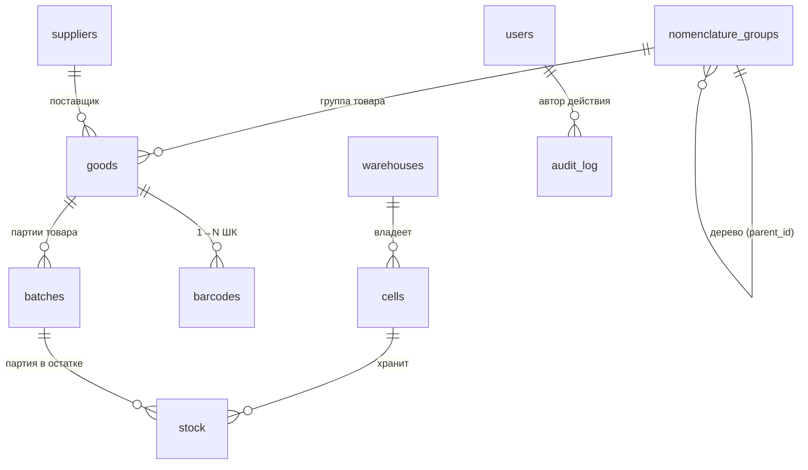

# P1-10D · Модель данных и форматы файлов импорта

**Статус:** актуально на миграции `000001`–`000008` (конец P1 + P-FastStart + P2-05).
**Задача:** свести в один документ схему БД (таблицы, ключи, связи, инварианты) и ожидаемые
форматы файлов импорта номенклатуры и ячеек — чтобы понимать модель без чтения миграций.
**Критерий:** есть `docs/data-model.md`, описывающий таблицы и форматы импорта.

> Источник истины по схеме — миграции `apps/backend/migrations/*.up.sql`. Этот документ
> производный: при изменении схемы обновлять его вместе с миграцией. Доменные обоснования — в
> ADR (`docs/adr/`) и задачных `docs/p1-0X.md`.

---

## 1. Обзор

Учёт строится вокруг **остатка** (`stock`) в разрезе **ячейка × товар × партия → количество**.
Всё остальное — справочники вокруг этой грани.

Группировка таблиц:

| Область          | Таблицы                                                 | Миграция           |
|------------------|---------------------------------------------------------|--------------------|
| Учётки и аудит   | `users`, `audit_log`                                    | `000001`, `000002` |
| Склад и ячейки   | `warehouses`, `cells`                                   | `000003`, `000006` |
| Номенклатура     | `goods`, `barcodes`, `nomenclature_groups`, `suppliers` | `000003`, `000005` |
| Партии и остатки | `batches`, `stock`                                      | `000004`           |

---

## 2. Общие соглашения

- **Первичный ключ** — суррогатный `uuid` (`DEFAULT gen_random_uuid()`), кроме `audit_log`
  (быстрый `bigint IDENTITY` для append-only журнала).
- **Время** — `timestamptz`, колонки `created_at`/`updated_at` с `DEFAULT now()`.
- **`updated_at`** обновляется **триггером БД** `set_updated_at()` (объявлен в `000001`,
  переиспользуется всеми таблицами) — не полагаемся на приложение.
- **«Удаление» — мягкое:** флаг `is_active boolean NOT NULL DEFAULT true`; блокировка/архивация =
  `is_active = false`, физически строки не удаляем (кроме каскада ШК, см. `barcodes`).
- **Кол-во — `numeric`, не float:** точные дроби для весового товара (`uom = 'кг'`).
- **Бизнес-ключи из 1С** (`code`, `external_id`) отделены от внутреннего `id` — обмен идёт через
  Excel, а не REST, поэтому 1С-идентификаторы не гарантированы (см. §5).

---

## 3. Таблицы

### 3.1 `users` — учётные записи (миграции `000001`, `000002`)

Две ветки входа: **работник по бейджу** (16 цифр → `login` = первые 8) и **admin/менеджер по
username + паролю** (вход со смартфона/портала). Ровно одно из `(login, username)` задано.

| Колонка                   | Тип           | Ограничения / смысл                                                                        |
|---------------------------|---------------|--------------------------------------------------------------------------------------------|
| `id`                      | `uuid`        | PK                                                                                         |
| `login`                   | `varchar(8)`  | `UNIQUE`, `CHECK (login ~ '^[0-9]{8}$')`; nullable — первые 8 цифр бейджа, у admin его нет |
| `username`                | `text`        | `UNIQUE`, `CHECK length 3–64`; nullable (у работника — NULL)                               |
| `password_hash`           | `text`        | argon2 в PHC-формате (соль/параметры внутри)                                               |
| `full_name`               | `text`        | ФИО → «исполнитель» в отчётах                                                              |
| `role`                    | `text`        | `CHECK IN ('employee','admin')`, дефолт `employee`                                         |
| `is_active`               | `boolean`     | активность/блокировка                                                                      |
| `created_at`/`updated_at` | `timestamptz` | триггер `updated_at`                                                                       |

Инвариант: `CHECK ((login IS NOT NULL) <> (username IS NOT NULL))` — XOR бейдж/username.
Обоснование ролей и argon2 — ADR-0005; выбор пути входа по устройству — ADR-0010.

### 3.2 `audit_log` — журнал действий (миграция `000001`)

Append-only «кто / что / когда»; по нему разбирают спорные движения товара.

| Колонка       | Тип               | Смысл                                                         |
|---------------|-------------------|---------------------------------------------------------------|
| `id`          | `bigint IDENTITY` | PK, порядковый                                                |
| `user_id`     | `uuid`            | FK → `users(id)`; NULL для системных/неавторизованных событий |
| `action`      | `text`            | `'auth.login'`, `'stock.move'`, …                             |
| `entity_type` | `text`            | `'user'`, `'stock'`, …                                        |
| `entity_id`   | `text`            | id объекта (uuid/int/qr как текст)                            |
| `details`     | `jsonb`           | произвольный контекст (было/стало, кол-во, ячейка, партия)    |
| `created_at`  | `timestamptz`     | —                                                             |

Индексы: `(user_id)`, `(created_at)`, `(entity_type, entity_id)`.

### 3.3 `warehouses` — физические склады (миграция `000003`)

Физический (внешний) склад. На пилоте один — «Шабулина» (`code = 'SHB'`). Справочник заведён сразу,
т.к. от него идёт адресация ячеек.

| Колонка     | Тип       | Смысл                                                    |
|-------------|-----------|----------------------------------------------------------|
| `id`        | `uuid`    | PK                                                       |
| `code`      | `text`    | `UNIQUE` — короткий код (`'SHB'`), для адресации/отчётов |
| `name`      | `text`    | человекочитаемое название («Шабулина»)                   |
| `is_active` | `boolean` | —                                                        |

> ⚠ «Внутренний склад» (основной/брак/…) — это **НЕ** `warehouses`, а измерение остатка (см. §6, ADR-0016).

### 3.4 `cells` — ячейки хранения (миграции `000003`, `000006`)

Физические ячейки одного склада. **Зон нет** — ячейка ссылается на склад напрямую.

| Колонка        | Тип       | Ограничения / смысл                                                          |
|----------------|-----------|------------------------------------------------------------------------------|
| `id`           | `uuid`    | PK                                                                           |
| `warehouse_id` | `uuid`    | FK → `warehouses(id)`; склад-владелец                                        |
| `address`      | `text`    | адрес ячейки (латиница, напр. `M1-1-2-1`); уникален внутри склада            |
| `type`         | `text`    | дефолт `'storage'`, **без CHECK** «на вырост» (storage/receiving/shipping/…) |
| `is_floor`     | `boolean` | напольная ячейка (нижний ярус); из колонки `floor` файла импорта             |
| `is_active`    | `boolean` | —                                                                            |

Ключ: `UNIQUE (warehouse_id, address)`. Индекс `(warehouse_id)` — «все ячейки склада».

### 3.5 `nomenclature_groups` — группы номенклатуры (миграция `000005`)

Дерево произвольной глубины (самоссылка `parent_id`). Заполняется импортом номенклатуры.

| Колонка     | Тип    | Смысл                                         |
|-------------|--------|-----------------------------------------------|
| `id`        | `uuid` | PK                                            |
| `code`      | `text` | `UNIQUE` — «Код» группы из 1С (ключ дедупа)   |
| `name`      | `text` | —                                             |
| `parent_id` | `uuid` | FK → `nomenclature_groups(id)`; NULL = корень |

Индекс `(parent_id)`. Фильтр товаров по группе идёт **по поддереву** (рекурсивный CTE, P1-06/P1-07).

### 3.6 `suppliers` — поставщики (миграция `000005`)

| Колонка | Тип    | Смысл                                            |
|---------|--------|--------------------------------------------------|
| `id`    | `uuid` | PK                                               |
| `name`  | `text` | `UNIQUE` — в выгрузке 1С строкой, дедуп по имени |

### 3.7 `goods` — номенклатура (миграции `000003`, `000005`)

Ключ товара — **внутренний суррогатный `id`**; `code`/`external_id` — бизнес-ключи из 1С.

| Колонка       | Тип       | Ограничения / смысл                                                           |
|---------------|-----------|-------------------------------------------------------------------------------|
| `id`          | `uuid`    | PK; на него ссылаются `barcodes`/`batches`/`stock`                            |
| `external_id` | `uuid`    | GUID номенклатуры 1С; partial-unique `WHERE external_id IS NOT NULL`          |
| `code`        | `text`    | `UNIQUE` (`goods_code_key`) — «Код» из 1С, **ключ апсерта** импорта; nullable |
| `name`        | `text`    | наименование (на экран/в отчёты)                                              |
| `full_name`   | `text`    | «Полное наименование»                                                         |
| `uom`         | `text`    | единица измерения строкой (`'шт'`, `'кг'`)                                    |
| `group_id`    | `uuid`    | FK → `nomenclature_groups(id)`; самая глубокая группа пути                    |
| `supplier_id` | `uuid`    | FK → `suppliers(id)`                                                          |
| `is_active`   | `boolean` | —                                                                             |

Индексы: `goods_external_id_key` (partial-unique), `goods_group_id_idx`, `goods_supplier_id_idx`.
`code` в `000003` заводился обычным индексом, в `000005` повышен до `UNIQUE` — под `ON CONFLICT (code)`.

### 3.8 `barcodes` — штрихкоды (миграция `000003`)

Один товар → 1..N ШК; ШК глобально уникален (первый скан однозначно ведёт к товару).

| Колонка     | Тип    | Смысл                                                                |
|-------------|--------|----------------------------------------------------------------------|
| `id`        | `uuid` | PK                                                                   |
| `good_id`   | `uuid` | FK → `goods(id)` `ON DELETE CASCADE` (ШК удаляются вместе с товаром) |
| `barcode`   | `text` | `UNIQUE` — сам ШК (EAN-13/Code128)                                   |
| `symbology` | `text` | `'ean13'`/`'code128'`; NULL, если неизвестна                         |

Индекс `(good_id)` — «все ШК товара».

### 3.9 `batches` — партии (миграция `000004`)

Партия = **товар + дата выпуска** (крипто-маркировки нет, партия простая).

| Колонка           | Тип    | Смысл                                   |
|-------------------|--------|-----------------------------------------|
| `id`              | `uuid` | PK                                      |
| `good_id`         | `uuid` | FK → `goods(id)`                        |
| `production_date` | `date` | `NOT NULL` — дата выпуска = суть партии |

Ключи: `UNIQUE (good_id, production_date)` (одна партия товара на дату) и `UNIQUE (id, good_id)`
(цель составного FK из `stock`, см. §5).

### 3.10 `stock` — остатки (миграция `000004`)

Ядро учёта. Грань — **(ячейка, товар, партия) → количество**.

| Колонка    | Тип             | Ограничения / смысл                                                        |
|------------|-----------------|----------------------------------------------------------------------------|
| `id`       | `uuid`          | PK                                                                         |
| `cell_id`  | `uuid`          | FK → `cells(id)`; ячейка хранения                                          |
| `good_id`  | `uuid`          | товар (**денормализован** ради запроса «где товар X» без join к `batches`) |
| `batch_id` | `uuid`          | партия                                                                     |
| `qty`      | `numeric(20,3)` | `CHECK (qty >= 0)`; дробное для `uom='кг'`                                 |

Ключ грани: `UNIQUE (cell_id, good_id, batch_id)` (ведущий `cell_id` → «что лежит в ячейке»).
Составной FK `(batch_id, good_id) → batches(id, good_id)` гарантирует, что партия существует
**и** её товар совпадает с денормализованным `stock.good_id`. Отдельный FK `good_id → goods` не
нужен — валидность транзитивна через `batches.good_id`. Индексы `(good_id)`, `(batch_id)`.

### 3.11 `stock_entry_sessions` — документ ввода остатков (миграция `000007`)

Шапка одного прохода склада с ТСД. Строки копятся на устройстве, на checkpoint'е ячейки уходят
в сессию, а в `stock` переносятся только на финале.

| Колонка        | Тип           | Ограничения / смысл                              |
|----------------|---------------|--------------------------------------------------|
| `id`           | `uuid`        | PK. Может прийти **с устройства** — см. ниже     |
| `warehouse_id` | `uuid`        | FK → `warehouses(id)`; склад, по которому проход |
| `created_by`   | `uuid`        | FK → `users(id)`; кто вводил                     |
| `status`       | `text`        | `CHECK IN ('draft','closed')`; дефолт `draft`    |
| `closed_at`    | `timestamptz` | момент финала; `NULL`, пока `draft`              |

Идентификатор сессии **генерирует устройство** (UUID v4) и присылает в теле старта: checkpoint и
финал адресуются по нему, а без сети серверный идентификатор взять неоткуда. Создание
идемпотентно (`ON CONFLICT (id) DO NOTHING`) — старт едет из очереди и повторяется. Пустой
идентификатор в запросе означает «сервер, выдай сам»: так ходят сборки до P2-05.

### 3.12 `stock_entry_lines` — строки документа ввода (миграция `000007`)

Сырой ввод сессии до финала. Грань — **(сессия, ячейка, товар, дата выпуска) → количество**.

| Колонка           | Тип             | Ограничения / смысл                            |
|-------------------|-----------------|------------------------------------------------|
| `session_id`      | `uuid`          | FK → `stock_entry_sessions(id)` `ON DELETE CASCADE` |
| `cell_id`         | `uuid`          | FK → `cells(id)`                               |
| `good_id`         | `uuid`          | FK → `goods(id)`                               |
| `production_date` | `date`          | партия; обязательна                            |
| `qty`             | `numeric(20,3)` | `CHECK (qty >= 0)`; итог по строке             |

`UNIQUE (session_id, cell_id, good_id, production_date)`: повторный checkpoint той же грани
**перезаписывает** количество (SET, не приращение). Отсюда же следует, что повтор checkpoint'а
безвреден сам по себе — дедуп по `operation_id` нужен не ради него (§3.13).

### 3.13 `processed_operations` — журнал применённых операций (миграция `000008`)

Ключ идемпотентности офлайн-очереди устройства.

| Колонка        | Тип           | Ограничения / смысл                                  |
|----------------|---------------|------------------------------------------------------|
| `operation_id` | `uuid`        | PK; сгенерирован на устройстве до сетевого вызова    |
| `kind`         | `text`        | тип операции                                         |
| `result`       | `jsonb`       | ответ, отданный в первый раз; дефолт `{}`            |
| `created_at`   | `timestamptz` | индекс — разбор за период и будущая чистка по возрасту |

Отметка ставится **в той же транзакции**, что и эффект операции: порознь появляется момент,
в котором применено одно без другого. Повтор получает сохранённый `result`, а не выполняет
эффект заново. Отклонённая по существу операция отметки не оставляет — откат транзакции
снимает её вместе с эффектом, и повтор после ручного разбора выполнится по-настоящему.

Журнал нужен там, где эффект не идемпотентен сам по себе: финал сессии (повтор без журнала
вернул бы 409 «уже закрыта», то есть успешную работу — отказом) и будущие приёмка/перемещение
с семантикой приращения. Привязка ШК (§3.8) и строка сессии (§3.12) повтор переживают и без него.

### 3.14 `report_documents` — документы отчётов (миграция `000009`)

Неизменяемое содержимое документа, снятое в момент завершения операции.

| Колонка       | Тип           | Ограничения / смысл                                       |
|---------------|---------------|-----------------------------------------------------------|
| `id`          | `uuid`        | PK, `gen_random_uuid()`                                    |
| `kind`        | `text`        | форма отчёта: какой шаблон применять                       |
| `source_type` | `text`        | вид операции-источника                                     |
| `source_id`   | `uuid`        | сама операция; `UNIQUE (source_type, source_id)`           |
| `snapshot`    | `jsonb`       | содержимое документа: шапка + строки                       |
| `created_at`  | `timestamptz` | индекс `(kind, created_at DESC)` — список в портале        |

Отчёт собирался запросом по живым справочникам, а импорт номенклатуры — апсерт по «Код».
Значит переименование товара в 1С меняло уже выданный документ, а вместе с ним и порядок строк
(сортировка шла по имени товара): оператор заносит файл в 1С, через неделю скачивает тот же
документ для сверки и видит другое. Снимок это прекращает — после завершения операции документ
от справочников не зависит.

Пишется **в той же транзакции**, что и закрытие операции: закрытая сессия без документа
невозможна, как и документ по незакрытой. Повтор (в том числе финал из очереди устройства)
сохраняет ПЕРВЫЙ снимок — `ON CONFLICT DO NOTHING`, иначе документ переписался бы содержимым,
собранным позже по изменившимся справочникам.

Файл `.xlsx` на диске не хранится: он собирается из снимка на каждое скачивание. Так документы
попадают в обычный бэкап БД (`pg_dump`), которому иначе понадобился бы второй канал для файлов,
а правка шаблона задним числом применяется ко всем документам, не трогая их данные.

`kind` и `source_type` — разные поля, хотя у единственной сегодня формы совпадают: связь не
один-к-одному, «Движение» рождается размещением, перемещением и пополнением (P5–P6).

---

---

## 4. Инварианты и целостность

- **Неотрицательный остаток:** `CHECK (qty >= 0)` — backstop к атомарным операциям (P1-03).
- **Согласованность денормализации:** составной FK на `stock` не даёт `good_id` разойтись с партией.
- **Атомарность движения остатка** обеспечивается на уровне SQL (upsert-приход /
  `UPDATE … WHERE qty >= $` расход / transfer в транзакции), **без `FOR UPDATE`**; нулевые остатки
  не удаляются. `qty` на границе SQL передаётся строкой (`$::numeric` / `qty::text`) — детали P1-03.
- **Идемпотентность импорта** — по бизнес-ключам (`goods.code`, `nomenclature_groups.code`,
  `suppliers.name`, `cells (warehouse_id, address)`): повторная загрузка того же файла не плодит
  дубли, а обновляет (см. §7).

---

## 5. Ключевые доменные решения (почему так)

- **Ключ товара — суррогатный `id`, а не 1С-GUID.** Обмен с 1С через Excel, GUID в выгрузке не
  гарантирован. `external_id`/`code` — бизнес-ключи для сверки/идемпотентности. Ключ апсерта
  импорта — `code` («Код» из 1С), т.к. GUID в реальных файлах отсутствует (P1-01, P1-04).
- **Партия = дата выпуска.** Крипто-маркировки («Честный знак») в пилоте нет, партия простая (P1-02).
- **`good_id` денормализован в `stock`** ради главного учётного запроса «где и сколько товара X»
  без join к `batches`; целостность держит составной FK (P1-02).
- **Зон нет** — `warehouses → cells` напрямую (упрощение под один склад пилота).
- **Внутренний склад — измерение остатка, а не ячейки** — см. §6 и ADR-0016.

---

## 6. Планируемое изменение схемы (ADR-0016, ещё не в БД)

«Внутренний склад» (основной/брак/… — учётные категории, произвольное число) — это **измерение
остатка**, а не свойство ячейки: одна физическая ячейка `M1-1-2-1` одновременно держит товар
«основного» и «брака». Поэтому запланировано (P1-06 / приёмка P4, пока БД почти пуста — миграция
дешёвая):

- новая таблица-справочник `internal_warehouses` (не enum — число произвольно);
- колонка `stock.internal_warehouse_id` (FK);
- **расширение грани остатка:** `UNIQUE (cell_id, good_id, batch_id)` →
  `UNIQUE (cell_id, good_id, batch_id, internal_warehouse_id)`;
- учёт нового измерения в атомарных операциях P1-03.

⚠ Отложено осознанно — не забыть при первой операции, поднимающей остаток (приёмка P4).

---

## 7. Форматы файлов импорта

Оба импорта — `multipart/form-data` (поле `file`), **admin-only**, под `/api/v1`. Проблемные строки
не валят импорт: они попадают в `skipped` отчёта с номером строки (1-based, как в Excel) и причиной.

### 7.1 Номенклатура — `.xls` (выгрузка 1С)

- **Эндпоинт:** `POST /api/v1/import/goods`.
- **Формат:** старый бинарный `.xls` (BIFF). Парсер — `github.com/extrame/xls` (кириллица UTF-16
  читается). Реализация — `internal/importer/goods.go`.
- **Первый лист**, строка 0 — заголовок; колонки маппятся **по имени** (устойчиво к порядку и лишним
  колонкам). Нормализация имени: нижний регистр, обрезка пробелов.

| Колонка (заголовок)   | Обяз. | Назначение                                                                   |
|-----------------------|-------|------------------------------------------------------------------------------|
| `Код`                 | да    | «Код» из 1С — **ключ апсерта** (`goods.code`) для товара / `code` для группы |
| `Наименование`        | да    | `goods.name` / имя группы                                                    |
| `Полное наименование` | —     | `goods.full_name`; **признак товара vs группы** (см. ниже)                   |
| `Ед.`                 | —     | `goods.uom`                                                                  |
| `Поставщик`           | —     | строкой → дедуп в `suppliers.name`                                           |

- **Строка-раздел (группа) vs строка-товар:** если «Полное наименование» **пусто** — это группа
  (заполнены только Код+Наименование); если заполнено — это товар.
- **Иерархия групп — линейная, одна ветка на файл:** каждая строка-раздел углубляет текущий путь;
  товар цепляется к самой глубокой группе пути (→ `goods.group_id`). Путь групп апсертится по `code`.
- **⚠ Хак `demangleCode`:** `extrame/xls` иногда принимает числовой «Код» с пользовательским
  числовым форматом за дату и печатает RFC3339 (напр. код `12246` → `1933-07-11T00:00:00Z`). Парсер
  ловит ровно этот формат и восстанавливает исходное число (Excel-serial от эпохи 1899-12-30), чтобы
  ключ апсерта совпадал с реальным кодом 1С. Обычные коды не трогаются.
- **Отчёт** (`ImportReport`): `goods_created`, `goods_updated`, `skipped[]`.

### 7.2 Ячейки — `.xlsx`

- **Эндпоинт:** `POST /api/v1/import/cells`. Параметры склада — **не в файле**, а в запросе
  (дефолт: имя «Шабулина», код `SHB`).
- **Формат:** современный `.xlsx` (OOXML). Парсер — `github.com/xuri/excelize/v2` (иной формат, чем
  `.xls` номенклатуры). Реализация — `internal/importer/cells.go`.
- **Первый лист**, строка 0 — заголовок; колонки по имени.

| Колонка (заголовок) | Обяз. | Назначение                                                                        |
|---------------------|-------|-----------------------------------------------------------------------------------|
| `cell`              | да    | адрес ячейки (латиница, напр. `M1-1-2-1`) → `cells.address` (часть ключа апсерта) |
| `floor`             | да    | признак напольной ячейки → `cells.is_floor`                                       |

- **Разбор `floor`:** `true`/`1`/`да` → `true`; пусто/`false`/`0`/`нет` → `false`; иное значение →
  строка уходит в `skipped` (не считается тихо `false`). Строка без адреса → `skipped`.
- **Апсерт по `(warehouse_id, address)`** — склад + все ячейки в одной транзакции. Повторный импорт
  идемпотентен.
- **Отчёт** (`CellsImportReport`): `warehouse` (код), `cells_created`, `cells_updated`, `skipped[]`.

> Реальные образцы, на которых разобраны форматы: номенклатура — `testdata/nomenclature_sample.xls`
> (`internal/importer`); ячейки — файл 125 ячеек (25 напольных). Детали разбора — `p1/p1-04.md`,
> `p1/p1-05.md`.

---

## 8. Границы документа

- Описывает схему на миграции `000001`–`000008`. Будущие таблицы (внутренние склады §6, документы
  приёмки/сборки/инвентаризации P4/P9/P10) появятся своими миграциями и дополнят этот файл.
- Не дублирует SQL — только модель и инварианты; точные DDL — в миграциях.
- Форматы файлов зафиксированы по реальным выгрузкам заказчика; при появлении новых форматов
  (напр. расходный ордер P9, открытый вопрос №8) — отдельные разделы.
