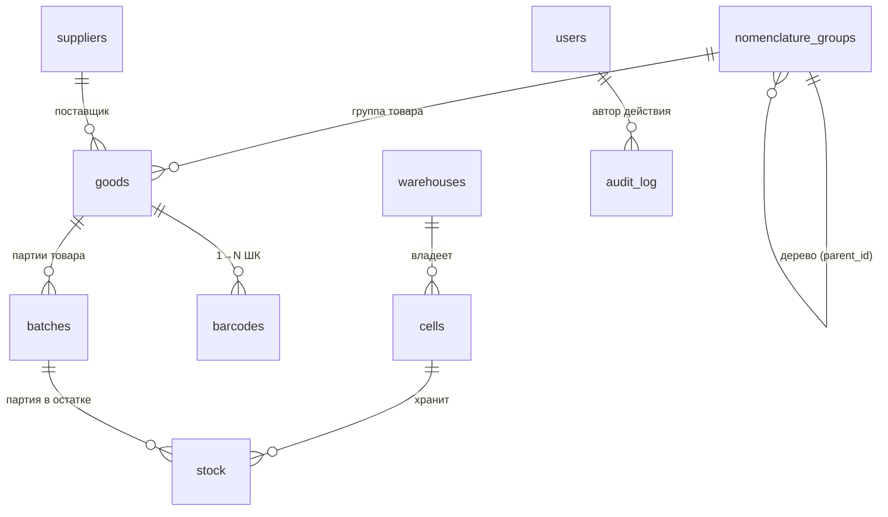

# P1-10D · Модель данных и форматы файлов импорта

**Статус:** актуально на миграции `000001`–`000022` (P1 · P-FastStart · P2 · P3 · P4 · P5 · P6-01).
**Задача:** свести в один документ схему БД (таблицы, ключи, связи, инварианты) и ожидаемые
форматы файлов импорта номенклатуры и ячеек — чтобы понимать модель без чтения миграций.
**Критерий:** есть `docs/data-model.md`, описывающий таблицы и форматы импорта.

> Источник истины по схеме — миграции `apps/backend/migrations/*.up.sql`. Этот документ
> производный: при изменении схемы обновлять его вместе с миграцией. Доменные обоснования — в
> ADR (`docs/adr/`) и задачных `docs/p1-0X.md`.

---

## 1. Обзор

Учёт строится вокруг **остатка** (`stock`) в разрезе **ячейка × товар × партия → количество**.
Всё остальное — справочники вокруг этой грани.

Группировка таблиц:

| Область          | Таблицы                                                 | Миграция           |
|------------------|---------------------------------------------------------|--------------------|
| Учётки и аудит   | `users`, `audit_log`                                    | `000001`, `000002` |
| Склад и ячейки   | `warehouses`, `cells`                                   | `000003`, `000006`, `000015` |
| Номенклатура     | `goods`, `barcodes`, `nomenclature_groups`, `suppliers` | `000003`, `000005`, `000016` |
| Партии и остатки | `batches`, `stock`                                      | `000004`           |

---

## 2. Общие соглашения

- **Первичный ключ** — суррогатный `uuid` (`DEFAULT gen_random_uuid()`), кроме `audit_log`
  (быстрый `bigint IDENTITY` для append-only журнала).
- **Время** — `timestamptz`, колонки `created_at`/`updated_at` с `DEFAULT now()`.
- **`updated_at`** обновляется **триггером БД** `set_updated_at()` (объявлен в `000001`,
  переиспользуется всеми таблицами) — не полагаемся на приложение.
- **«Удаление» — мягкое:** флаг `is_active boolean NOT NULL DEFAULT true`; блокировка/архивация =
  `is_active = false`, физически строки не удаляем (кроме каскада ШК, см. `barcodes`).
- **Кол-во — `numeric`, не float:** точные дроби для весового товара (`uom = 'кг'`).
- **Бизнес-ключи из 1С** (`code`, `external_id`) отделены от внутреннего `id` — обмен идёт через
  Excel, а не REST, поэтому 1С-идентификаторы не гарантированы (см. §5).

---

## 3. Таблицы

### 3.1 `users` — учётные записи (миграции `000001`, `000002`)

Две ветки входа: **работник по бейджу** (16 цифр → `login` = первые 8) и **admin/менеджер по
username + паролю** (вход со смартфона/портала). Ровно одно из `(login, username)` задано.

| Колонка                   | Тип           | Ограничения / смысл                                                                        |
|---------------------------|---------------|--------------------------------------------------------------------------------------------|
| `id`                      | `uuid`        | PK                                                                                         |
| `login`                   | `varchar(8)`  | `UNIQUE`, `CHECK (login ~ '^[0-9]{8}$')`; nullable — первые 8 цифр бейджа, у admin его нет |
| `username`                | `text`        | `UNIQUE`, `CHECK length 3–64`; nullable (у работника — NULL)                               |
| `password_hash`           | `text`        | argon2 в PHC-формате (соль/параметры внутри)                                               |
| `full_name`               | `text`        | ФИО → «исполнитель» в отчётах                                                              |
| `role`                    | `text`        | `CHECK IN ('employee','admin')`, дефолт `employee`                                         |
| `is_active`               | `boolean`     | активность/блокировка                                                                      |
| `created_at`/`updated_at` | `timestamptz` | триггер `updated_at`                                                                       |

Инвариант: `CHECK ((login IS NOT NULL) <> (username IS NOT NULL))` — XOR бейдж/username.
Обоснование ролей и argon2 — ADR-0005; выбор пути входа по устройству — ADR-0010.

### 3.2 `audit_log` — журнал действий (миграция `000001`)

Append-only «кто / что / когда»; по нему разбирают спорные движения товара.

| Колонка       | Тип               | Смысл                                                         |
|---------------|-------------------|---------------------------------------------------------------|
| `id`          | `bigint IDENTITY` | PK, порядковый                                                |
| `user_id`     | `uuid`            | FK → `users(id)`; NULL для системных/неавторизованных событий |
| `action`      | `text`            | `'auth.login'`, `'stock.move'`, …                             |
| `entity_type` | `text`            | `'user'`, `'stock'`, …                                        |
| `entity_id`   | `text`            | id объекта (uuid/int/qr как текст)                            |
| `details`     | `jsonb`           | произвольный контекст (было/стало, кол-во, ячейка, партия)    |
| `created_at`  | `timestamptz`     | —                                                             |

Индексы: `(user_id)`, `(created_at)`, `(entity_type, entity_id)`.

### 3.3 `warehouses` — физические склады (миграция `000003`)

Физический (внешний) склад. На пилоте один — «Шабулина» (`code = 'SHB'`). Справочник заведён сразу,
т.к. от него идёт адресация ячеек.

| Колонка     | Тип       | Смысл                                                    |
|-------------|-----------|----------------------------------------------------------|
| `id`        | `uuid`    | PK                                                       |
| `code`      | `text`    | `UNIQUE` — короткий код (`'SHB'`), для адресации/отчётов |
| `name`      | `text`    | человекочитаемое название («Шабулина»)                   |
| `is_active` | `boolean` | —                                                        |

> ⚠ «Внутренний склад» (основной/брак/…) — это **НЕ** `warehouses`, а измерение остатка (см. §6, ADR-0016).

### 3.4 `cells` — ячейки хранения (миграции `000003`, `000006`, `000015`)

Физические ячейки одного склада. **Зон нет** — ячейка ссылается на склад напрямую.

| Колонка        | Тип       | Ограничения / смысл                                                          |
|----------------|-----------|------------------------------------------------------------------------------|
| `id`           | `uuid`    | PK                                                                           |
| `warehouse_id` | `uuid`    | FK → `warehouses(id)`; склад-владелец                                        |
| `address`      | `text`    | адрес ячейки (латиница, напр. `M1-1-2-1`); уникален внутри склада            |
| `type`         | `text`    | дефолт `'storage'`, **без CHECK** «на вырост» (storage/receiving/shipping/…) |
| `is_floor`     | `boolean` | напольная ячейка (нижний ярус); из колонки `floor` файла импорта             |
| `is_default`   | `boolean` | ячейка приёмки по умолчанию (`С-Н-П`); одна на склад                         |
| `is_active`    | `boolean` | —                                                                            |

Ключи: `UNIQUE (warehouse_id, address)`; частичный `UNIQUE (warehouse_id) WHERE is_default` —
ровно одна дефолтная ячейка на склад средствами БД, а не дисциплиной кода. Индекс
`(warehouse_id)` — «все ячейки склада».

**`С-Н-П` — имя ячейки, а не шаблон «стеллаж-секция-полка».** Код находит её по флагу
`is_default`, а не по строке адреса: переименование не должно ломать приёмку (тот же приём, что
у `internal_warehouses.is_default`). Ячейку заводит тот, кто заводит склад, — сидер при
развёртывании и импорт ячеек, — потому что склад без неё означал бы, что приёмка на нём
невозможна. ШК у неё нет, из печати этикеток она исключается.

### 3.5 `nomenclature_groups` — группы номенклатуры (миграция `000005`)

Дерево произвольной глубины (самоссылка `parent_id`). Заполняется импортом номенклатуры.

| Колонка     | Тип    | Смысл                                         |
|-------------|--------|-----------------------------------------------|
| `id`        | `uuid` | PK                                            |
| `code`      | `text` | `UNIQUE` — «Код» группы из 1С (ключ дедупа)   |
| `name`      | `text` | —                                             |
| `parent_id` | `uuid` | FK → `nomenclature_groups(id)`; NULL = корень |

Индекс `(parent_id)`. Фильтр товаров по группе идёт **по поддереву** (рекурсивный CTE, P1-06/P1-07).

### 3.6 `suppliers` — поставщики (миграция `000005`)

| Колонка | Тип    | Смысл                                            |
|---------|--------|--------------------------------------------------|
| `id`    | `uuid` | PK                                               |
| `name`  | `text` | `UNIQUE` — в выгрузке 1С строкой, дедуп по имени |

### 3.7 `goods` — номенклатура (миграции `000003`, `000005`)

Ключ товара — **внутренний суррогатный `id`**; `code`/`external_id` — бизнес-ключи из 1С.

| Колонка       | Тип       | Ограничения / смысл                                                           |
|---------------|-----------|-------------------------------------------------------------------------------|
| `id`          | `uuid`    | PK; на него ссылаются `barcodes`/`batches`/`stock`                            |
| `external_id` | `uuid`    | GUID номенклатуры 1С; partial-unique `WHERE external_id IS NOT NULL`          |
| `code`        | `text`    | `UNIQUE` (`goods_code_key`) — «Код» из 1С, **ключ апсерта** импорта; nullable |
| `name`        | `text`    | наименование (на экран/в отчёты)                                              |
| `full_name`   | `text`    | «Полное наименование»                                                         |
| `uom`         | `text`    | единица измерения строкой (`'шт'`, `'кг'`)                                    |
| `group_id`    | `uuid`    | FK → `nomenclature_groups(id)`; самая глубокая группа пути                    |
| `supplier_id` | `uuid`    | FK → `suppliers(id)`                                                          |
| `is_active`   | `boolean` | —                                                                             |

Индексы: `goods_external_id_key` (partial-unique), `goods_group_id_idx`, `goods_supplier_id_idx`.
`code` в `000003` заводился обычным индексом, в `000005` повышен до `UNIQUE` — под `ON CONFLICT (code)`.

### 3.8 `barcodes` — штрихкоды (миграции `000003`, `000016`)

Один товар → 1..N ШК; ШК глобально уникален (первый скан однозначно ведёт к товару).

| Колонка       | Тип       | Смысл                                                                |
|---------------|-----------|----------------------------------------------------------------------|
| `id`          | `uuid`    | PK                                                                   |
| `good_id`     | `uuid`    | FK → `goods(id)` `ON DELETE CASCADE` (ШК удаляются вместе с товаром) |
| `barcode`     | `text`    | `UNIQUE` — сам ШК (EAN-13/Code128)                                   |
| `symbology`   | `text`    | `'ean13'`/`'code128'`; NULL, если неизвестна                         |
| `is_internal` | `boolean` | ШК выдан нами (внутренний EAN-13 с префиксом 20–29), а не из выгрузки |

Индексы: `(good_id)` — «все ШК товара»; частичный `(good_id) WHERE is_internal` — «какой
внутренний ШК у этого товара», запрос перед каждой выдачей.

**Принадлежность хранится флагом, а не разбирается из префикса.** Диапазон 20–29 зарезервирован
GS1 под внутреннее использование, но выгрузка 1С может принести внутренний код прежней системы
с тем же префиксом — разбор строки выдал бы его за наш. Тот же приём, что у `cells.is_default`.

**Последовательность `internal_barcode_serial`** (миграция `000016`) выдаёт серийные номера
внутренних ШК: десять цифр — всё, что остаётся в EAN-13 после двузначного префикса и контрольной
цифры. Выбор `max()+1` при одновременных выдачах дал бы один номер дважды; дыры в нумерации
допустимы — номер не документ.

### 3.9 `batches` — партии (миграция `000004`)

Партия = **товар + дата выпуска** (крипто-маркировки нет, партия простая).

| Колонка           | Тип    | Смысл                                   |
|-------------------|--------|-----------------------------------------|
| `id`              | `uuid` | PK                                      |
| `good_id`         | `uuid` | FK → `goods(id)`                        |
| `production_date` | `date` | `NOT NULL` — дата выпуска = суть партии |

Ключи: `UNIQUE (good_id, production_date)` (одна партия товара на дату) и `UNIQUE (id, good_id)`
(цель составного FK из `stock`, см. §5).

### 3.10 `stock` — остатки (миграция `000004`)

Ядро учёта. Грань — **(ячейка, товар, партия) → количество**.

| Колонка    | Тип             | Ограничения / смысл                                                        |
|------------|-----------------|----------------------------------------------------------------------------|
| `id`       | `uuid`          | PK                                                                         |
| `cell_id`  | `uuid`          | FK → `cells(id)`; ячейка хранения                                          |
| `good_id`  | `uuid`          | товар (**денормализован** ради запроса «где товар X» без join к `batches`) |
| `batch_id` | `uuid`          | партия                                                                     |
| `qty`      | `numeric(20,3)` | `CHECK (qty >= 0)`; дробное для `uom='кг'`                                 |

Ключ грани: `UNIQUE (cell_id, good_id, batch_id)` (ведущий `cell_id` → «что лежит в ячейке»).
Составной FK `(batch_id, good_id) → batches(id, good_id)` гарантирует, что партия существует
**и** её товар совпадает с денормализованным `stock.good_id`. Отдельный FK `good_id → goods` не
нужен — валидность транзитивна через `batches.good_id`. Индексы `(good_id)`, `(batch_id)`.

### 3.11 `stock_entry_sessions` — документ ввода остатков (миграция `000007`)

Шапка одного прохода склада с ТСД. Строки копятся на устройстве, на checkpoint'е ячейки уходят
в сессию, а в `stock` переносятся только на финале.

| Колонка        | Тип           | Ограничения / смысл                              |
|----------------|---------------|--------------------------------------------------|
| `id`           | `uuid`        | PK. Может прийти **с устройства** — см. ниже     |
| `warehouse_id` | `uuid`        | FK → `warehouses(id)`; склад, по которому проход |
| `created_by`   | `uuid`        | FK → `users(id)`; кто вводил                     |
| `status`       | `text`        | `CHECK IN ('draft','closed')`; дефолт `draft`    |
| `closed_at`    | `timestamptz` | момент финала; `NULL`, пока `draft`              |

Идентификатор сессии **генерирует устройство** (UUID v4) и присылает в теле старта: checkpoint и
финал адресуются по нему, а без сети серверный идентификатор взять неоткуда. Создание
идемпотентно (`ON CONFLICT (id) DO NOTHING`) — старт едет из очереди и повторяется. Пустой
идентификатор в запросе означает «сервер, выдай сам»: так ходят сборки до P2-05.

### 3.12 `stock_entry_lines` — строки документа ввода (миграция `000007`)

Сырой ввод сессии до финала. Грань — **(сессия, ячейка, товар, дата выпуска) → количество**.

| Колонка           | Тип             | Ограничения / смысл                            |
|-------------------|-----------------|------------------------------------------------|
| `session_id`      | `uuid`          | FK → `stock_entry_sessions(id)` `ON DELETE CASCADE` |
| `cell_id`         | `uuid`          | FK → `cells(id)`                               |
| `good_id`         | `uuid`          | FK → `goods(id)`                               |
| `production_date` | `date`          | партия; обязательна                            |
| `qty`             | `numeric(20,3)` | `CHECK (qty >= 0)`; итог по строке             |

`UNIQUE (session_id, cell_id, good_id, production_date)`: повторный checkpoint той же грани
**перезаписывает** количество (SET, не приращение). Отсюда же следует, что повтор checkpoint'а
безвреден сам по себе — дедуп по `operation_id` нужен не ради него (§3.13).

### 3.13 `processed_operations` — журнал применённых операций (миграция `000008`)

Ключ идемпотентности офлайн-очереди устройства.

| Колонка        | Тип           | Ограничения / смысл                                  |
|----------------|---------------|------------------------------------------------------|
| `operation_id` | `uuid`        | PK; сгенерирован на устройстве до сетевого вызова    |
| `kind`         | `text`        | тип операции                                         |
| `result`       | `jsonb`       | ответ, отданный в первый раз; дефолт `{}`            |
| `created_at`   | `timestamptz` | индекс — разбор за период и будущая чистка по возрасту |

Отметка ставится **в той же транзакции**, что и эффект операции: порознь появляется момент,
в котором применено одно без другого. Повтор получает сохранённый `result`, а не выполняет
эффект заново. Отклонённая по существу операция отметки не оставляет — откат транзакции
снимает её вместе с эффектом, и повтор после ручного разбора выполнится по-настоящему.

Журнал нужен там, где эффект не идемпотентен сам по себе: финал сессии (повтор без журнала
вернул бы 409 «уже закрыта», то есть успешную работу — отказом) и будущие приёмка/перемещение
с семантикой приращения. Привязка ШК (§3.8) и строка сессии (§3.12) повтор переживают и без него.

### 3.14 `report_documents` — документы отчётов (миграция `000009`)

Неизменяемое содержимое документа, снятое в момент завершения операции.

| Колонка       | Тип           | Ограничения / смысл                                       |
|---------------|---------------|-----------------------------------------------------------|
| `id`          | `uuid`        | PK, `gen_random_uuid()`                                    |
| `kind`        | `text`        | форма отчёта: какой шаблон применять                       |
| `source_type` | `text`        | вид операции-источника                                     |
| `source_id`   | `uuid`        | сама операция; `UNIQUE (source_type, source_id)`           |
| `snapshot`    | `jsonb`       | содержимое документа: шапка + строки                       |
| `created_at`  | `timestamptz` | индекс `(kind, created_at DESC)` — список в портале        |
| `status`      | `text`        | `new` → `downloaded` → `done`; CHECK; индекс `(status, created_at DESC)` |
| `downloaded_at` | `timestamptz` | момент ПЕРВОГО скачивания; повтор его не двигает          |
| `done_at`     | `timestamptz` | отметка «занесено в 1С»                                    |

Отчёт собирался запросом по живым справочникам, а импорт номенклатуры — апсерт по «Код».
Значит переименование товара в 1С меняло уже выданный документ, а вместе с ним и порядок строк
(сортировка шла по имени товара): оператор заносит файл в 1С, через неделю скачивает тот же
документ для сверки и видит другое. Снимок это прекращает — после завершения операции документ
от справочников не зависит.

Пишется **в той же транзакции**, что и закрытие операции: закрытая сессия без документа
невозможна, как и документ по незакрытой. Повтор (в том числе финал из очереди устройства)
сохраняет ПЕРВЫЙ снимок — `ON CONFLICT DO NOTHING`, иначе документ переписался бы содержимым,
собранным позже по изменившимся справочникам.

Файл `.xlsx` на диске не хранится: он собирается из снимка на каждое скачивание. Так документы
попадают в обычный бэкап БД (`pg_dump`), которому иначе понадобился бы второй канал для файлов,
а правка шаблона задним числом применяется ко всем документам, не трогая их данные.

`kind` и `source_type` — разные поля: связь не один-к-одному, «Движение» рождается
размещением, перемещением и пополнением (P5–P6).

**Формы сегодня:**

| `kind`        | `source_type`         | Источник                                  |
|---------------|-----------------------|-------------------------------------------|
| `stock_entry` | `stock_entry_session` | закрытие сессии ввода остатков             |
| `receipt`     | `receipt`             | оприходование приёмки (P4-10)              |
| `movement`    | `putaway`             | проведение сеанса размещения (P5-04)       |
| `movement`    | `movement`            | проведение документа движения (P6-07)      |

**Снимок** — JSON с явными тегами: `warehouse_code`, `warehouse_name`, `created_at`, `rows[]`
(`cell_address`, `good_code`, `good_name`, `production_date`, `qty` — текстом, чтобы не терять
знаки decimal). У «Поступления» в шапке ещё `supplier` (пусто — без поставщика) и `executor`
(ФИО того, кто принимал); у ввода остатков этих полей нет, и `omitempty` оставляет прежние
снимки такими, какими они сохранены. Строки «Поступления» — товарные: короба развёрнуты
и сложены по товару, партии и ячейке (P4-09-1), короб в документе не показывается.
У «Поступления» в шапке также накладная поставщика `doc_number`, `doc_date` (ADHOC-23).

«Движение» (P5-04): в шапке `operation` (`putaway` — размещение, `move` — перемещение,
`replenish` — пополнение, P6-07), `task_number` (задание-основание, только у размещения),
`executor`, а `supplier`, `doc_number`, `doc_date` описывают приёмку-основание размещения.
У перемещения основания нет; строки внутри одной ячейки (из короба в россыпь и обратно)
в документ не попадают, а документ из одних таких строк не публикуется. В строке ещё `from_cell_address` — ячейка-отправитель; `cell_address` —
адресат. Строки развёрнуты из коробов и сложены по товару, партии и паре ячеек.

**Статусы (миграция `000010`).** Документ живёт как рабочая задача оператора: опубликован →
скачан → занесён в 1С. Выдача файла двигает статус только из `new`, а повторное скачивание уже
выполненного документа его не откатывает — оператор мог открыть файл для сверки. Отметить
выполненным можно и минуя скачивание: данные могли попасть в 1С другим путём.

---

### 3.15 `report_document_events` — журнал документа (миграция `000011`)

История документа: только дописывается, строки не меняются.

| Колонка       | Тип           | Ограничения / смысл                                            |
|---------------|---------------|-----------------------------------------------------------------|
| `id`          | `bigint`      | PK, `GENERATED ALWAYS AS IDENTITY` — журнал только растёт        |
| `document_id` | `uuid`        | FK → `report_documents(id)` `ON DELETE CASCADE`; индекс с `created_at` |
| `event`       | `text`        | `created` · `downloaded` · `done` · `generation_failed`; CHECK   |
| `user_id`     | `uuid`        | FK → `users(id)`; NULL — событие системное или автор не сохранён |
| `details`     | `jsonb`       | контекст: причина ошибки сборки                                  |
| `created_at`  | `timestamptz` | когда                                                            |

Статус (§3.14) отвечает «в каком состоянии документ сейчас», журнал — «что с ним было». Колонки
состояния хранят последнее значение, а расхождение с 1С разбирают по истории: скачивание пишется
на **каждый** раз, тогда как статус двигается только из `new`.

Событие `created` пишется в той же транзакции, что и сам документ, — документ без истории
невозможен. Автор — тот, кто вёл операцию-источник: у документа нет собственного создателя.

ФИО в журнал не копируется, а подтягивается по ссылке: копия означала бы, что переименование
сотрудника рождает в истории двух разных людей.

---

### 3.16 `load_units` — грузовые единицы (миграция `000012`)

Короб или паллета, собранная на приёмке: физическая упаковка, которую двигают целиком. ГЕ
добровольна — товар принимают и россыпью.

| Колонка      | Тип           | Ограничения / смысл                                          |
|--------------|---------------|---------------------------------------------------------------|
| `id`         | `uuid`        | PK, **выдаёт устройство** (UUID v4) — он же кодируется в QR ярлыка |
| `kind`       | `text`        | `box` / `pallet`; CHECK                                       |
| `parent_id`  | `uuid`        | self-FK `ON DELETE SET NULL`, вложенность; CHECK `<> id`      |
| `cell_id`    | `uuid`        | FK → `cells(id)`; текущее место; NULL — ещё не размещена      |
| `status`     | `text`        | `open` → `closed` → `placed`; CHECK                           |
| `internal_warehouse_id` | `uuid` | FK → `internal_warehouses(id)`, NOT NULL; склад короба целиком (`000023`) |
| `created_at` / `updated_at` | `timestamptz` | триггер `set_updated_at`                       |

Отдельной колонки `qr_id` нет намеренно: она хранила бы значение `id` вторым экземпляром, а два
источника истины расходятся. Тот же приём, что у сессии ввода остатков, где `id` тоже приходит
с ТСД.

`ON DELETE SET NULL` у `parent_id`, а не `CASCADE`: удаление паллеты не уносит вложенные короба —
физически они на месте.

Индексы: `(cell_id)` и `(parent_id)` — частичные, только для непустых значений; `(status)` —
рабочий список неразмещённых.

`internal_warehouse_id` (миграция `000023`, P6-07-1) — внутренний склад короба **целиком**:
весь состав лежит в остатке ячейки строкой этого склада. По умолчанию — функция
`default_internal_warehouse()` (склад с `is_default`), поэтому короб рождается «Основным» без
правок мест, где короба заводятся. Меняет склад короба только пометка проблемы склада (§3.29).

`cell_id` — **единственное хранилище текущего места** ГЕ; история переносов — журнал
`placements` (§3.21). Меняется `cell_id` только общей функцией размещения, которая в той же
транзакции пишет строку журнала.

### 3.17 `lu_content` — состав грузовой единицы (миграция `000012`)

| Колонка        | Тип             | Ограничения / смысл                                        |
|----------------|-----------------|-------------------------------------------------------------|
| `id`           | `uuid`          | PK                                                          |
| `load_unit_id` | `uuid`          | FK → `load_units(id)` `ON DELETE CASCADE`                   |
| `good_id`      | `uuid`          | денормализован; см. составной FK                            |
| `batch_id`     | `uuid`          | партия                                                      |
| `qty`          | `numeric(20,3)` | CHECK `>= 0`; дробное для `uom='кг'`                        |

Грань — `UNIQUE (load_unit_id, good_id, batch_id)`, та же, что у остатка: повторное вложение того
же товара той же партии увеличивает количество, а не плодит строки. Составной FK
`(batch_id, good_id) → batches(id, good_id)` страхует от рассинхронизации денормализованного
`good_id` (приём из `stock`).

Состав **не заменяет остаток**: `stock` отвечает «сколько товара в ячейке», `lu_content` — «что
внутри этого короба». Внутреннего склада (ADR-0016) у позиции состава нет: склад у короба один на
весь состав (`load_units.internal_warehouse_id`). Поэтому **россыпь** ячейки по складу = остаток
склада минус состав коробов **этого же склада** (P6-07-1).

---

### 3.18 `internal_warehouses` — внутренние склады (миграция `000013`, ADR-0016)

Учётные категории остатка: «Основной», «Брак» и сколько угодно ещё. Наложены на те же физические
ячейки — одна ячейка одновременно держит остатки разных внутренних складов.

| Колонка      | Тип           | Ограничения / смысл                                       |
|--------------|---------------|------------------------------------------------------------|
| `id`         | `uuid`        | PK                                                         |
| `code`       | `text`        | UNIQUE; короткий код для отчётов и импорта                 |
| `name`       | `text`        | как показывается человеку                                  |
| `is_default` | `boolean`     | куда приходовать, если склад не выбран; **ровно один**     |
| `is_active`  | `boolean`     | скрыт из выбора; остатки на нём сохраняются                |

Справочник, а не enum: число складов произвольно и пополняется из интерфейса. Стартовый состав
(`MAIN` «Основной» по умолчанию, `DEFECT` «Брак») заводится миграцией — без склада по умолчанию
приходовать некуда. `ISOLATOR` «Изолятор» (не наша марка ЧЗ и т. п.) заводит миграция `000023`.

«Ровно один по умолчанию» обеспечивает частичный уникальный индекс `((true)) WHERE is_default` —
средствами БД, а не дисциплиной кода. В коде нет зашитых кодов вроде `MAIN`: «куда приходовать»
отвечает флаг, поэтому склад можно переименовать или заменить, не трогая логику.

**Изменение `stock` (миграция `000013`).** Добавлена колонка `internal_warehouse_id` (FK, NOT NULL),
грань расширена: `UNIQUE (cell_id, good_id, batch_id)` → `UNIQUE (cell_id, good_id, batch_id,
internal_warehouse_id)`. Без этого «основной» и «брак» в одной ячейке схлопывались в одну строку
и затирали друг друга. Существующие остатки бэкофиллом отнесены к складу по умолчанию.

Откат миграции **складывает** остатки разных складов в одной ячейке: старая грань их не различает,
и это единственная трактовка, сохраняющая физическое количество товара. Учётная принадлежность
при откате теряется безвозвратно.

---

### 3.19 `receipts` — документ приёмки (миграции `000014`, `000021`)

| Колонка        | Тип           | Ограничения / смысл                                     |
|----------------|---------------|----------------------------------------------------------|
| `id`           | `uuid`        | PK, **выдаёт устройство** (приёмка начинается на ТСД)    |
| `warehouse_id` | `uuid`        | FK → `warehouses(id)`                                    |
| `supplier_id`  | `uuid`        | FK → `suppliers(id)`; NULL — внутреннее поступление/возврат |
| `status`       | `text`        | `draft` → `posted`; CHECK                                |
| `created_by`   | `uuid`        | FK → `users(id)` — кто принимал                          |
| `posted_at`    | `timestamptz` | когда оприходован                                        |
| `doc_number`   | `text`        | NOT NULL; номер накладной поставщика, «б/н» — без номера; CHECK 1–50 знаков (`000021`) |
| `doc_date`     | `date`        | NOT NULL; дата накладной поставщика (`000021`)           |

Документ поставщика (ADHOC-23) обязателен: сервер не проводит приёмку без него, и он попадает
в шапку «Поступления», основание задания на размещение и историю короба. Приёмки, лежавшие
до `000021`, миграция заполнила «б/н» и датой оприходования (у неоприходованных — создания).

Статус здесь не формальность жизненного цикла, а защита от удвоения: оприходование **добавляет**
к остатку (в отличие от ввода остатков, который его фиксирует), поэтому повторный `Post` упирается
в guard и получает `ErrReceiptPosted`.

### 3.20 `receipt_lines` — строки приёмки (миграция `000014`)

| Колонка        | Тип             | Ограничения / смысл                                   |
|----------------|-----------------|---------------------------------------------------------|
| `receipt_id`   | `uuid`          | FK → `receipts(id)` `ON DELETE CASCADE`                 |
| `good_id`      | `uuid`          | денормализован; составной FK на `batches(id, good_id)`  |
| `batch_id`     | `uuid`          | партия                                                  |
| `cell_id`      | `uuid`          | FK → `cells(id)` — куда кладём                          |
| `load_unit_id` | `uuid`          | FK → `load_units(id)` `ON DELETE SET NULL`; NULL — россыпь |
| `qty`          | `numeric(20,3)` | CHECK `> 0` — приход нулём смысла не имеет              |

Грань — `CONSTRAINT receipt_lines_grain_key UNIQUE NULLS NOT DISTINCT (receipt_id, good_id,
batch_id, cell_id, load_unit_id)`. Повторный скан той же комбинации увеличивает количество,
а не плодит строки. `NULLS NOT DISTINCT` обязателен: без него две россыпные строки считались бы
разными, и грань не работала бы там, где нужна чаще всего.

Имя ограничения задано явно: автоимя из пяти колонок вылезает за 63 символа и усекается Postgres,
после чего ссылки на него перестают совпадать.

При оприходовании строка поднимает остаток (`addStock` в склад по умолчанию, ADR-0016) и, если
задана ГЕ, пополняет `lu_content`; сама ГЕ уезжает в ячейку строки со статусом `placed`,
и в журнал размещений (§3.21) ложится её первая строка с автором и документом приёмки.
Строки одной ГЕ, указывающие разные ячейки, не проводятся вовсе: короб не может лежать в двух
местах.

### 3.21 `placements` — журнал размещений ГЕ (миграция `000017`)

История переносов грузовой единицы: каждая строка — один перенос ГЕ в ячейку.

| Колонка        | Тип           | Ограничения / смысл                                          |
|----------------|---------------|---------------------------------------------------------------|
| `id`           | `uuid`        | PK                                                            |
| `load_unit_id` | `uuid`        | FK → `load_units(id)` `ON DELETE CASCADE`                     |
| `from_cell_id` | `uuid`        | FK → `cells(id)`; NULL — первое размещение (приёмка)          |
| `to_cell_id`   | `uuid`        | FK → `cells(id)`, NOT NULL                                    |
| `source`       | `text`        | `receipt` / `putaway` / `move`; CHECK                         |
| `receipt_id`   | `uuid`        | FK → `receipts(id)`; заполнен, если перенос сделала приёмка   |
| `putaway_id`   | `uuid`        | FK → `putaways(id)`; заполнен, если перенёс сеанс размещения  |
| `movement_id`  | `uuid`        | FK → `movements(id)`; заполнен, если перенесло перемещение    |
| `user_id`      | `uuid`        | FK → `users(id)`; NULL только у строк без известного автора   |
| `placed_at`    | `timestamptz` | момент переноса                                               |

`CHECK (from_cell_id IS DISTINCT FROM to_cell_id)` — перенос в ту же ячейку не перенос.

**Текущего места здесь нет:** оно хранится в `load_units.cell_id` (§3.16), а журнал отвечает,
где ГЕ лежала раньше и кто её двигал. Инвариант — `load_units.cell_id` равен `to_cell_id`
последней строки ГЕ; его держит единая функция размещения в репозитории, которая пишет обе
таблицы в одной транзакции и блокирует строку ГЕ (`FOR UPDATE`).

Журнал не двигает остаток: «сколько товара в ячейке» по-прежнему отвечает `stock` (§3.10),
перенос товара вместе с коробом делает операция размещения (P5-02).

Миграция заполняет журнал задним числом: каждой ГЕ, уже лежащей в ячейке, достаётся строка
`receipt` с автором и документом оприходованной приёмки.

Индексы: `(load_unit_id, placed_at, id)` — история одной ГЕ; `(to_cell_id, placed_at)` — что
и когда клали в ячейку.

### 3.22 `putaways` — документ размещения (миграция `000018`)

Сеанс, в котором кладовщик разносит короба и россыпь из зоны приёмки по ячейкам хранения.
Собирается на ТСД и уходит одной операцией очереди `putaway_submit`; сервер проводит его
целиком в одной транзакции, поэтому статуса «черновик» нет — документ появляется проведённым.

| Колонка        | Тип           | Ограничения / смысл                                     |
|----------------|---------------|----------------------------------------------------------|
| `id`           | `uuid`        | PK, **выдаёт устройство**; повтор сеанса упирается в PK  |
| `task_id`      | `uuid`        | FK → `warehouse_tasks(id)`, NOT NULL — задание сеанса    |
| `warehouse_id` | `uuid`        | FK → `warehouses(id)`                                    |
| `created_by`   | `uuid`        | FK → `users(id)` — кто размещал                          |
| `posted_at`    | `timestamptz` | момент проведения                                        |

### 3.23 `putaway_lines` — строки размещения (миграция `000018`)

| Колонка        | Тип             | Ограничения / смысл                                 |
|----------------|-----------------|------------------------------------------------------|
| `id`           | `uuid`          | PK                                                   |
| `putaway_id`   | `uuid`          | FK → `putaways(id)` `ON DELETE CASCADE`              |
| `line_no`      | `int`           | порядок строк, как на ТСД; `UNIQUE (putaway_id, line_no)` |
| `load_unit_id` | `uuid`          | FK → `load_units(id)`; короб целиком                 |
| `good_id`      | `uuid`          | россыпь: товар                                       |
| `batch_id`     | `uuid`          | россыпь: партия; составной FK `(batch_id, good_id)`  |
| `qty`          | `numeric(20,3)` | россыпь: количество                                  |
| `from_cell_id` | `uuid`          | FK → `cells(id)` — откуда взяли                      |
| `to_cell_id`   | `uuid`          | FK → `cells(id)` — куда положили                     |

CHECK: строка — короб (только `load_unit_id`) **либо** россыпь (`good_id`, `batch_id`, `qty > 0`),
не оба и не ничего; `from_cell_id <> to_cell_id`.

Короб хранится ссылкой, без состава: разворот в товарные строки делает отчёт «Движение» (P5-04)
по составу, прочитанному в транзакции проведения (пакет `movement`).

### 3.24 `warehouse_tasks` — задания для склада (миграция `000019`)

| Колонка            | Тип           | Ограничения / смысл                                      |
|--------------------|---------------|-----------------------------------------------------------|
| `id`               | `uuid`        | PK                                                        |
| `number`           | `bigint`      | identity, UNIQUE — короткий номер для людей               |
| `kind`             | `text`        | `putaway`; CHECK; набор растёт (P10 — пересчёт)           |
| `status`           | `text`        | `new` / `in_progress` / `done`; CHECK                     |
| `warehouse_id`     | `uuid`        | FK → `warehouses(id)`                                     |
| `receipt_id`       | `uuid`        | FK → `receipts(id)` — основание; `UNIQUE (receipt_id, kind)` |
| `assignee_id`      | `uuid`        | FK → `users(id)` — кто держит; есть ровно у `in_progress` |
| `taken_at`         | `timestamptz` | когда взято                                               |
| `last_activity_at` | `timestamptz` | взятие или сеанс; от него считается «зависло» (8 ч)       |
| `completed_by`     | `uuid`        | FK → `users(id)` — чей сеанс завершил                     |
| `completed_at`     | `timestamptz` | есть ровно у `done`                                       |

Статус хранится один, а показывается относительно смотрящего: чужое взятое не видно, зависшее —
видно всем как «новое». Частичный сеанс возвращает задание в `new` без исполнителя.

### 3.25 `putaway_task_items` — позиции задания на размещение (миграция `000019`)

| Колонка        | Тип             | Ограничения / смысл                               |
|----------------|-----------------|----------------------------------------------------|
| `task_id`      | `uuid`          | FK → `warehouse_tasks(id)` `ON DELETE CASCADE`     |
| `line_no`      | `int`           | `UNIQUE (task_id, line_no)`                        |
| `load_unit_id` | `uuid`          | FK → `load_units(id)` — короб целиком              |
| `good_id`, `batch_id`, `qty` | | россыпь; составной FK `(batch_id, good_id)`, `qty > 0` |

CHECK: короб **либо** россыпь. **Остаток не хранится** — считается по сеансам размещения
задания (`putaways.task_id`): короб размещён, если его переносил сеанс задания; россыпи
осталось `qty` минус перенесённое. Миграция заводит задания приёмкам, оприходованным до неё.

### 3.26 `task_events` — журнал событий задания (миграция `000020`)

| Колонка        | Тип           | Ограничения / смысл                                         |
|----------------|---------------|--------------------------------------------------------------|
| `id`           | `uuid`        | PK                                                           |
| `seq`          | `bigint`      | identity — порядок записи                                    |
| `task_id`      | `uuid`        | FK → `warehouse_tasks(id)` `ON DELETE CASCADE`               |
| `event`        | `text`        | `created` / `taken` / `released` / `intercepted` / `session` / `completed` |
| `user_id`      | `uuid`        | FK → `users(id)` — кто; NULL — система                       |
| `prev_user_id` | `uuid`        | FK → `users(id)` — у кого перехвачено зависшее               |
| `putaway_id`   | `uuid`        | FK → `putaways(id)` — заход                                  |
| `at`           | `timestamptz` | когда                                                        |

Шапка задания хранит только текущее состояние (повторное взятие перезаписывает `taken_at`,
отказ его стирает); журнал только дописывается и даёт время выполнения по людям. Порядок —
по `seq`, а не по `at`: события одной транзакции (заход и завершение) получают одинаковое
`now()`. Повтор взятия своим исполнителем и повторный отказ событием не считаются.
Миграция восстанавливает прежним заданиям создание, текущее взятие, заходы и завершение.

При проведении короб переезжает из ячейки, где числится, вместе с остатком по своему составу,
и пишет строку журнала `placements` со ссылкой на документ. Россыпь берётся из ячейки приёмки
склада и только в пределах **россыпи**: остаток ячейки за вычетом того, что лежит в ней же
в коробах. Всё — в склад по умолчанию (уточнение ADR-0016).

---

### 3.27 `movements` — документ движения (миграция `000022`)

Один документ на перемещение и пополнение: обе операции двигают ГЕ или товар между ячейками
и коробами и уходят одним отчётом «Движение». Как и размещение, документ собирается на ТСД
и проводится одной операцией очереди целиком, поэтому статуса «черновик» нет.

| Колонка        | Тип           | Ограничения / смысл                                     |
|----------------|---------------|----------------------------------------------------------|
| `id`           | `uuid`        | PK, **выдаёт устройство**; повтор упирается в PK         |
| `kind`         | `text`        | `move` (перемещение) / `replenish` (пополнение); CHECK   |
| `warehouse_id` | `uuid`        | FK → `warehouses(id)`                                    |
| `created_by`   | `uuid`        | FK → `users(id)` — кто двигал                            |
| `posted_at`    | `timestamptz` | момент проведения, время сервера                         |

Индекс `(posted_at DESC)` — список документов.

### 3.28 `movement_lines` — строки движения (миграция `000022`)

| Колонка                 | Тип             | Ограничения / смысл                                  |
|-------------------------|-----------------|-------------------------------------------------------|
| `id`                    | `uuid`          | PK                                                    |
| `movement_id`           | `uuid`          | FK → `movements(id)` `ON DELETE CASCADE`              |
| `line_no`               | `int`           | порядок строк, как на ТСД; `UNIQUE (movement_id, line_no)` |
| `load_unit_id`          | `uuid`          | FK → `load_units(id)`; ГЕ целиком                     |
| `good_id`               | `uuid`          | товар                                                 |
| `batch_id`              | `uuid`          | партия; составной FK `(batch_id, good_id)`            |
| `qty`                   | `numeric(20,3)` | количество                                            |
| `internal_warehouse_id` | `uuid`          | FK → `internal_warehouses(id)`; чей товар (ADR-0016)  |
| `from_load_unit_id`     | `uuid`          | FK → `load_units(id)`; из короба, NULL — из россыпи   |
| `to_load_unit_id`       | `uuid`          | FK → `load_units(id)`; в короб, NULL — в россыпь      |
| `from_cell_id`          | `uuid`          | FK → `cells(id)`, NOT NULL — откуда взяли             |
| `to_cell_id`            | `uuid`          | FK → `cells(id)`, NOT NULL — куда положили            |

CHECK:

- строка — ГЕ целиком (только `load_unit_id`, без коробов-источника и приёмника) **либо** товар
  (`good_id`, `batch_id`, `qty > 0`, `internal_warehouse_id`), не оба и не ничего;
- ГЕ целиком не переносится на месте: `from_cell_id <> to_cell_id`;
- товар обязан куда-то переехать: пара (ячейка, короб) откуда отличается от пары куда. Внутри
  одной ячейки движение законно (из короба в россыпь рядом, из короба в короб) — такие
  «нулевые» строки не публикуются в отчёт (P6-07), но остаются в истории.

Строка одинакова для обоих видов: ГЕ целиком бывает только у перемещения, а товар у обоих
ходит в любых сочетаниях — ГЕ→ГЕ, ГЕ→россыпь, россыпь→ГЕ, россыпь→россыпь. Короб в строке
указывает ячейку сам (ГЕ всегда в одной ячейке), поэтому на ТСД источник и приёмник можно
задать как сканом ячейки, так и сканом QR короба. Вид документа схема с видом строки не сверяет
(вид живёт в шапке): то, что ГЕ целиком едет только перемещением, держит проведение операции.

ГЕ хранится ссылкой, без состава: разворот в товарные строки делает отчёт «Движение» по
составу, прочитанному в транзакции проведения (пакет `movement`), как у размещения. Перенос ГЕ
пишет и строку журнала `placements` с источником `move` и ссылкой на документ. Ячейки у товара
пишутся всегда, и у товара из короба тоже: строка самодостаточна для истории ячейки, даже
когда короб потом переедет.

Индексы: `(movement_id, line_no)` — строки документа; `(from_cell_id)` и `(to_cell_id)` — что
уезжало из ячейки и приезжало в неё (история ячейки, проверка пересчёта в P10).

### 3.29 `warehouse_problems` — проблемы склада (миграция `000023`, P6-07-1)

Пометка короба или товара другим внутренним складом — брак, изолятор. Брак — лишь метка:
товар остаётся в той же ячейке и перемещается со своей меткой. Перевод остатка делается в той
же транзакции операцией очереди `problem_submit`; документа для 1С пометка не порождает.

| Колонка                      | Тип             | Ограничения / смысл                               |
|------------------------------|-----------------|----------------------------------------------------|
| `id`                         | `uuid`          | PK, **выдаёт устройство**                          |
| `warehouse_id`               | `uuid`          | FK → `warehouses(id)`                              |
| `cell_id`                    | `uuid`          | FK → `cells(id)`; где лежит помеченное             |
| `load_unit_id`               | `uuid`          | FK → `load_units(id)`; короб целиком               |
| `good_id`                    | `uuid`          | товар; составной FK `(batch_id, good_id)`          |
| `batch_id`                   | `uuid`          | партия                                             |
| `qty`                        | `numeric(20,3)` | количество                                         |
| `from_load_unit_id`          | `uuid`          | FK → `load_units(id)`; товар вынут из короба       |
| `from_internal_warehouse_id` | `uuid`          | FK, NOT NULL; склад до пометки                     |
| `to_internal_warehouse_id`   | `uuid`          | FK, NOT NULL; склад после; CHECK `<>` from         |
| `reason`                     | `text`          | `breakage` / `spoilage` / `expired` / `foreign_mark` / `other`; CHECK |
| `comment`                    | `text`          | NOT NULL DEFAULT `''`; у `other` обязателен (сервис) |
| `mark`                       | `text`          | марка ЧЗ как отсканирована; проверка — фаза CZ     |
| `status`                     | `text`          | `open` / `resolved`; CHECK; решение — P6-07-3      |
| `created_by`                 | `uuid`          | FK → `users(id)`                                   |
| `created_at`                 | `timestamptz`   | DEFAULT `now()`                                    |

CHECK: короб целиком (только `load_unit_id`) **либо** товар (`good_id`, `batch_id`, `qty > 0`;
источник — россыпь ячейки или `from_load_unit_id`). Товар из короба вынимается в россыпь склада
назначения той же ячейки: у короба одна метка на весь состав.

Индекс: `(status, created_at DESC)` — рабочий список офиса (P6-07-3).

---

## 4. Инварианты и целостность

- **Место ГЕ и журнал размещений не расходятся:** `load_units.cell_id` = `to_cell_id` последней
  строки `placements`; оба меняются одной функцией в одной транзакции (P5-01).
- **Неотрицательный остаток:** `CHECK (qty >= 0)` — backstop к атомарным операциям (P1-03).
- **Согласованность денормализации:** составной FK на `stock` не даёт `good_id` разойтись с партией.
- **Атомарность движения остатка** обеспечивается на уровне SQL (upsert-приход /
  `UPDATE … WHERE qty >= $` расход / transfer в транзакции), **без `FOR UPDATE`**; нулевые остатки
  не удаляются. `qty` на границе SQL передаётся строкой (`$::numeric` / `qty::text`) — детали P1-03.
- **Идемпотентность импорта** — по бизнес-ключам (`goods.code`, `nomenclature_groups.code`,
  `suppliers.name`, `cells (warehouse_id, address)`): повторная загрузка того же файла не плодит
  дубли, а обновляет (см. §7).

---

## 5. Ключевые доменные решения (почему так)

- **Ключ товара — суррогатный `id`, а не 1С-GUID.** Обмен с 1С через Excel, GUID в выгрузке не
  гарантирован. `external_id`/`code` — бизнес-ключи для сверки/идемпотентности. Ключ апсерта
  импорта — `code` («Код» из 1С), т.к. GUID в реальных файлах отсутствует (P1-01, P1-04).
- **Партия = дата выпуска.** Крипто-маркировки («Честный знак») в пилоте нет, партия простая (P1-02).
- **`good_id` денормализован в `stock`** ради главного учётного запроса «где и сколько товара X»
  без join к `batches`; целостность держит составной FK (P1-02).
- **Зон нет** — `warehouses → cells` напрямую (упрощение под один склад пилота).
- **Внутренний склад — измерение остатка, а не ячейки** — см. §6 и ADR-0016.

---

## 6. Что из решённого ещё не в схеме

ADR-0016 (внутренний склад как измерение остатка) **реализован** миграцией `000013` в задаче
P4-01-1 — описание в §3.18, грань остатка в §3.10. Раздел держал его как план и до этой правки
отставал от базы.

Не в схеме остаётся то, для чего ещё нет операции:

- **перевод остатка «Основной» → «Брак»** отдельной операцией — по смыслу её место в P6
  («Проблемы склада»); схема к ней готова, новых колонок не потребуется.

Выбора внутреннего склада нет ни у приёмки, ни у ввода остатков, ни у размещения: все они
кладут в склад по умолчанию (для размещения — уточнение ADR-0016, P5-02).

---

## 7. Форматы файлов импорта

Оба импорта — `multipart/form-data` (поле `file`), **admin-only**, под `/api/v1`. Проблемные строки
не валят импорт: они попадают в `skipped` отчёта с номером строки (1-based, как в Excel) и причиной.

### 7.1 Номенклатура — `.xls` (выгрузка 1С)

- **Эндпоинт:** `POST /api/v1/import/goods`.
- **Формат:** старый бинарный `.xls` (BIFF). Парсер — `github.com/extrame/xls` (кириллица UTF-16
  читается). Реализация — `internal/importer/goods.go`.
- **Первый лист**, строка 0 — заголовок; колонки маппятся **по имени** (устойчиво к порядку и лишним
  колонкам). Нормализация имени: нижний регистр, обрезка пробелов.

| Колонка (заголовок)   | Обяз. | Назначение                                                                   |
|-----------------------|-------|------------------------------------------------------------------------------|
| `Код`                 | да    | «Код» из 1С — **ключ апсерта** (`goods.code`) для товара / `code` для группы |
| `Наименование`        | да    | `goods.name` / имя группы                                                    |
| `Полное наименование` | —     | `goods.full_name`; **признак товара vs группы** (см. ниже)                   |
| `Ед.`                 | —     | `goods.uom`                                                                  |
| `Поставщик`           | —     | строкой → дедуп в `suppliers.name`                                           |

- **Строка-раздел (группа) vs строка-товар:** если «Полное наименование» **пусто** — это группа
  (заполнены только Код+Наименование); если заполнено — это товар.
- **Иерархия групп — линейная, одна ветка на файл:** каждая строка-раздел углубляет текущий путь;
  товар цепляется к самой глубокой группе пути (→ `goods.group_id`). Путь групп апсертится по `code`.
- **⚠ Хак `demangleCode`:** `extrame/xls` иногда принимает числовой «Код» с пользовательским
  числовым форматом за дату и печатает RFC3339 (напр. код `12246` → `1933-07-11T00:00:00Z`). Парсер
  ловит ровно этот формат и восстанавливает исходное число (Excel-serial от эпохи 1899-12-30), чтобы
  ключ апсерта совпадал с реальным кодом 1С. Обычные коды не трогаются.
- **Отчёт** (`ImportReport`): `goods_created`, `goods_updated`, `skipped[]`.

### 7.2 Ячейки — `.xlsx`

- **Эндпоинт:** `POST /api/v1/import/cells`. Параметры склада — **не в файле**, а в запросе
  (дефолт: имя «Шабулина», код `SHB`).
- **Формат:** современный `.xlsx` (OOXML). Парсер — `github.com/xuri/excelize/v2` (иной формат, чем
  `.xls` номенклатуры). Реализация — `internal/importer/cells.go`.
- **Первый лист**, строка 0 — заголовок; колонки по имени.

| Колонка (заголовок) | Обяз. | Назначение                                                                        |
|---------------------|-------|-----------------------------------------------------------------------------------|
| `cell`              | да    | адрес ячейки (латиница, напр. `M1-1-2-1`) → `cells.address` (часть ключа апсерта) |
| `floor`             | да    | признак напольной ячейки → `cells.is_floor`                                       |

- **Разбор `floor`:** `true`/`1`/`да` → `true`; пусто/`false`/`0`/`нет` → `false`; иное значение →
  строка уходит в `skipped` (не считается тихо `false`). Строка без адреса → `skipped`.
- **Апсерт по `(warehouse_id, address)`** — склад + все ячейки в одной транзакции. Повторный импорт
  идемпотентен.
- **Отчёт** (`CellsImportReport`): `warehouse` (код), `cells_created`, `cells_updated`, `skipped[]`.

> Реальные образцы, на которых разобраны форматы: номенклатура — `testdata/nomenclature_sample.xls`
> (`internal/importer`); ячейки — файл 125 ячеек (25 напольных). Детали разбора — `p1/p1-04.md`,
> `p1/p1-05.md`.

---

## 8. Границы документа

- Описывает схему на миграции `000001`–`000008`. Будущие таблицы (внутренние склады §6, документы
  приёмки/сборки/инвентаризации P4/P9/P10) появятся своими миграциями и дополнят этот файл.
- Не дублирует SQL — только модель и инварианты; точные DDL — в миграциях.
- Форматы файлов зафиксированы по реальным выгрузкам заказчика; при появлении новых форматов
  (напр. расходный ордер P9, открытый вопрос №8) — отдельные разделы.
